# PDFHub — 33 Free Browser-Based PDF Tools Online

> **100% Private · Zero Server Uploads · No Sign-up Required · Free Forever**

[](https://pdfshub.netlify.app/)
[](https://github.com/officialhazim42/pdfshub)
[](#available-tools)
[](#privacy--security-architecture)
[](#progressive-web-app)

**PDFHub** is a privacy-first, zero-budget PDF utility suite engineered to run entirely within your web browser. Documents are processed locally on your device using client-side WebAssembly, HTML5 APIs, and JavaScript engines (such as `pdf-lib`, `pdf.js`, `SheetJS`, and `Tesseract.js`). Your confidential files are never transmitted to external servers.

---

## Table of Contents
1. [Core Features](#features)
2. [Privacy & Security Architecture](#privacy--security-architecture)
3. [Tool Inventory (33 Tools)](#available-tools)
4. [Visual Tutorials — Step-by-Step Guides](#visual-tutorials)
   - [Organize PDF Tools (6)](#1-organize-pdf)
   - [Optimize & Repair Tools (3)](#2-optimize-pdf)
   - [Convert to PDF Tools (5)](#3-convert-to-pdf)
   - [Convert from PDF Tools (5)](#4-convert-from-pdf)
   - [Edit & Annotate Tools (6)](#5-edit-pdf)
   - [PDF Security Tools (5)](#6-pdf-security)
   - [PDF Intelligence Tools (3)](#7-pdf-intelligence)
5. [Technical Notes & Limitations](#technical-notes--limitations)
6. [Run Locally](#run-locally)
7. [Deployment](#deployment)

---

## Features

- **100% Client-Side Processing**: Files are processed in browser RAM without cloud storage or telemetry.
- **33 Specialized Tools**: Complete coverage across document organization, compression, format conversion, editing, digital signatures, redaction, OCR, and AI summaries.
- **Universal Cross-Platform PWA**: Installable on Windows, macOS, Linux, Android, and iOS with offline app-shell caching via Service Worker.
- **Zero Account Barrier**: No registration, no subscription walls, no rate limits, and no watermarks applied to your outputs.
- **Real-Time Visual Previews**: Built-in mandatory review modal ensures you verify file changes before saving.
- **Responsive Dark/Light UI**: Built with accessible contrast ratios, theme toggles, and mobile drawer navigation.

---

## Privacy & Security Architecture

Unlike traditional online PDF converters that require uploading your private documents to third-party cloud servers:
1. **Local Memory Isolation**: Operations execute exclusively within your browser's sandboxed JavaScript memory pool.
2. **Zero File Retention**: Once you close the tab, processed document buffers are freed by the browser garbage collector.
3. **No Telemetry**: PDFHub does not track your document content, passwords, metadata, or personal data.

---

## Available Tools

| Category | Count | Included Tools |
| :--- | :---: | :--- |
| **Organize PDF** | 6 | Merge PDF, Split PDF, Remove Pages, Extract Pages, Organize PDF, Scan to PDF |
| **Optimize PDF** | 3 | Compress PDF, Repair PDF, OCR PDF |
| **Convert to PDF** | 5 | JPG to PDF, Word to PDF, PowerPoint to PDF, Excel to PDF, HTML to PDF |
| **Convert from PDF** | 5 | PDF to JPG, PDF to Word, PDF to PowerPoint, PDF to Excel, PDF to PDF/A |
| **Edit PDF** | 6 | Rotate PDF, Add Page Numbers, Add Watermark, Crop PDF, Edit PDF, PDF Forms |
| **PDF Security** | 5 | Unlock PDF, Protect PDF, Sign PDF, Redact PDF, Compare PDF |
| **PDF Intelligence** | 3 | AI Summarizer, Translate PDF, PDF to Markdown |

---

## Visual Tutorials

Every tutorial below demonstrates real interface interactions captured from the PDFHub application using verified synthetic documents. Follow these step-by-step visual workflows to execute any document operation.


### 1. Organize PDF

#### Extract Pages — Step-by-Step Guide

> **Purpose:** Copy selected page numbers or ranges into a new PDF.

**Step 1: Open tool and locate upload area**

Open Extract Pages and upload your source document.


**Step 2: Select file and configure options**

Input the specific page numbers or ranges you wish to isolate into a new file (e.g. `1-2`).


**Step 3: Process the document**

Click **Extract Pages** to compile the selected pages into a new document.


**Step 4: Verify preview and download result**

The new document is generated. Click **Download** to save the extracted pages.


---

#### Merge PDF — Step-by-Step Guide

> **Purpose:** Combine multiple PDFs into one document in the selected file order.

**Step 1: Open tool and locate upload area**

Open Merge PDF. Locate the upload drop-area configured for multi-document selection.

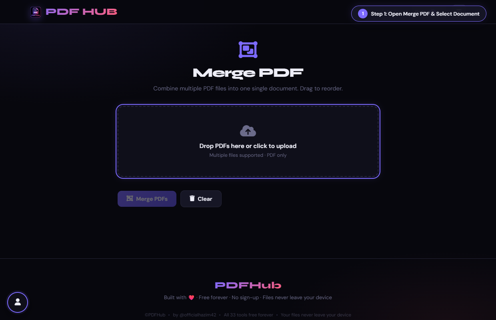

**Step 2: Select file and configure options**

Select two or more PDF documents. Verify the file order and remove any unwanted files using the remove icon.

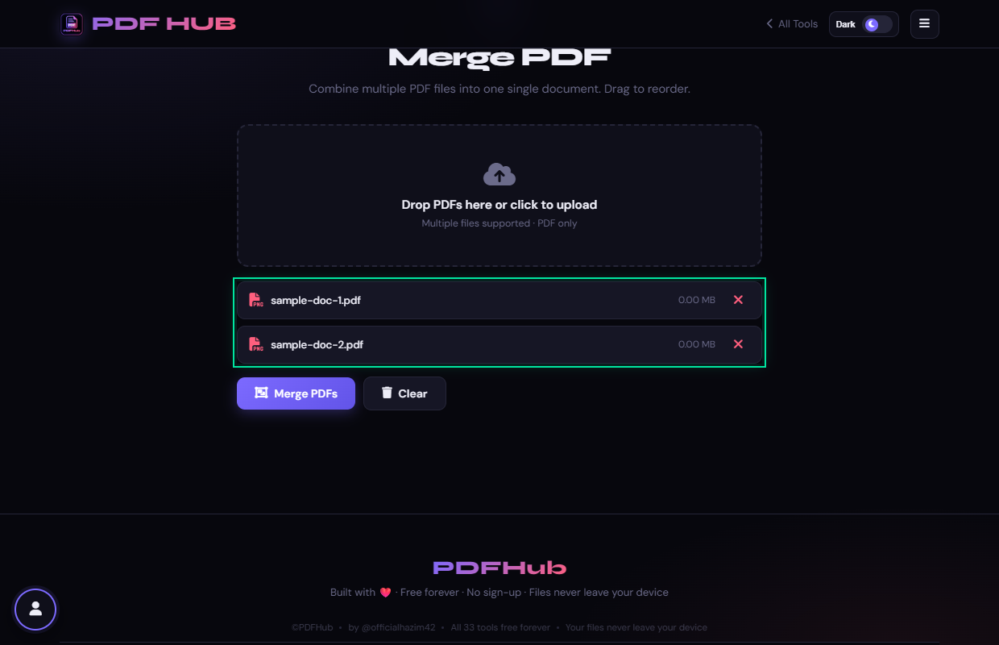

**Step 3: Process the document**

Click the **Merge PDFs** button to initiate instant in-memory concatenation with PDF-Lib.

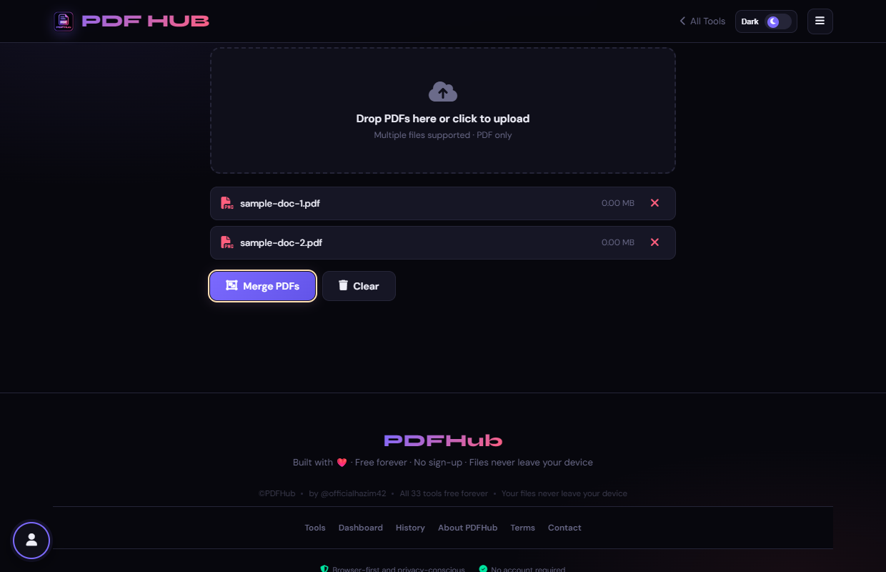

**Step 4: Verify preview and download result**

The output is verified and prepared. Click **Download** to save your combined PDF.

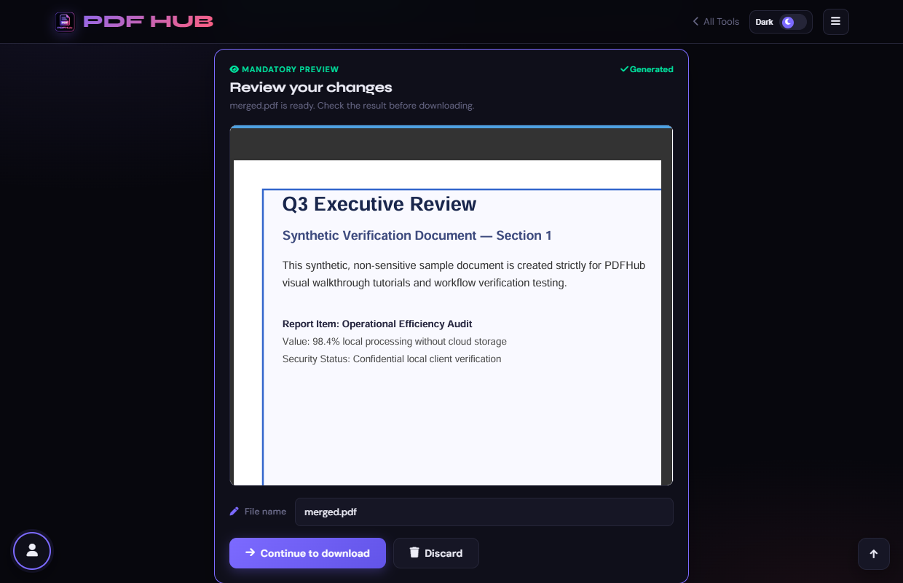

---

#### Organize PDF — Step-by-Step Guide

> **Purpose:** Reorder, rotate, and delete PDF pages using thumbnails.

**Step 1: Open tool and locate upload area**

Open Organize PDF and load any multi-page PDF document.


**Step 2: Select file and configure options**

Inspect the rendered visual thumbnail grid. Drag thumbnails to reorder, or use individual rotate and delete buttons.


**Step 3: Process the document**

Once your page layout is organized, click **Save Organized PDF**.


**Step 4: Verify preview and download result**

Review the generated page order and click **Download** to save your reordered PDF.


---

#### Remove Pages — Step-by-Step Guide

> **Purpose:** Delete selected page numbers or ranges from a PDF.

**Step 1: Open tool and locate upload area**

Access the Remove Pages tool and load the PDF document you need to modify.


**Step 2: Select file and configure options**

Enter the comma-separated page numbers or ranges to delete (e.g. `2` or `3-5`).


**Step 3: Process the document**

Click **Remove Pages** to build an updated PDF structure omitting the specified pages.


**Step 4: Verify preview and download result**

Confirm the updated page count and download your cleaned PDF file.


---

#### Scan to PDF — Step-by-Step Guide

> **Purpose:** Capture camera images or upload photos and assemble them into a PDF.

**Step 1: Open tool and locate upload area**

Open Scan to PDF. You can upload scanned photos (JPG, PNG, WebP) or activate your device camera.


**Step 2: Select file and configure options**

Select paper dimensions (A4, Letter, Fit) and optional image enhancements such as high contrast or grayscale.


**Step 3: Process the document**

Click **Create PDF** to assemble your captures into a cohesive multi-page PDF.


**Step 4: Verify preview and download result**

Inspect the generated scanned document and click **Download** to save the PDF.


---

#### Split PDF — Step-by-Step Guide

> **Purpose:** Create separate PDFs from ranges, every page, or groups of N pages.

**Step 1: Open tool and locate upload area**

Open Split PDF and drag your PDF file into the upload zone or click to select.


**Step 2: Select file and configure options**

Choose your preferred split mode: by page range (e.g. 1-2, 3), every page as separate PDF, or every N pages.


**Step 3: Process the document**

Click **Split PDF** to extract the selected ranges into standalone documents.


**Step 4: Verify preview and download result**

Review the generated file split and download your resulting document archives.


---


### 2. Optimize PDF

#### Compress PDF — Step-by-Step Guide

> **Purpose:** Reduce PDF structure and metadata overhead in the browser.

**Step 1: Open tool and locate upload area**

Open Compress PDF and drop your PDF into the upload area.

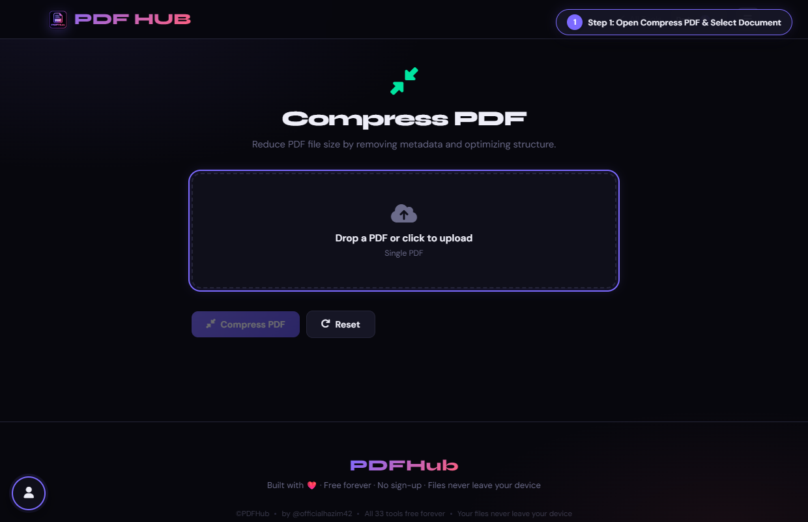

**Step 2: Select file and configure options**

Select your target compression preset: Low (maximum fidelity), Medium (balanced), or High (maximum structural compression).

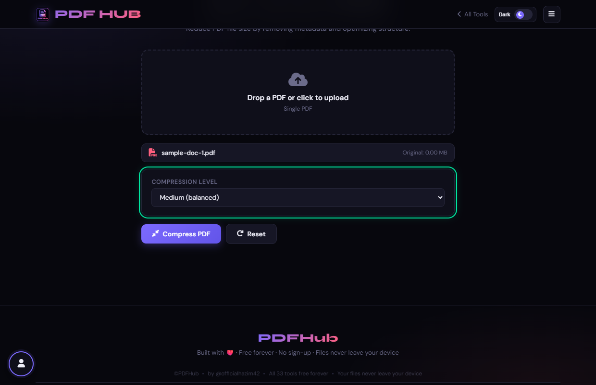

**Step 3: Process the document**

Click **Compress PDF** to optimize object streams, strip redundant metadata, and compact the PDF structure.

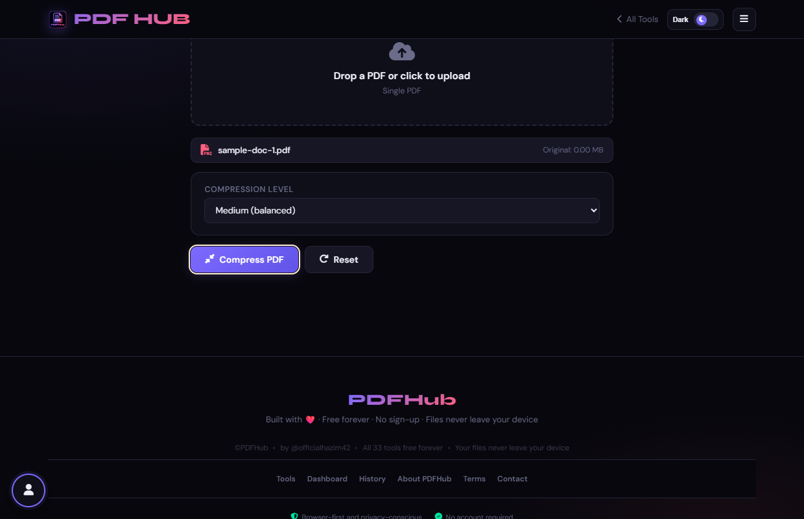

**Step 4: Verify preview and download result**

Review the compression ratio and saved file size in the result modal, then click **Download**.

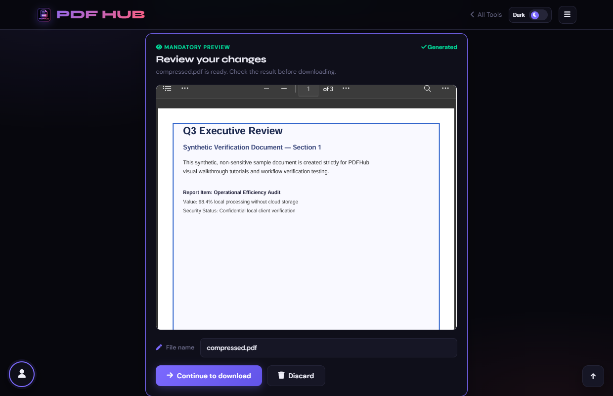

---

#### OCR PDF — Step-by-Step Guide

> **Purpose:** Recognize text in scanned PDF pages with browser-based Tesseract OCR.

**Step 1: Open tool and locate upload area**

Open OCR PDF and upload a scanned or image-based PDF document.

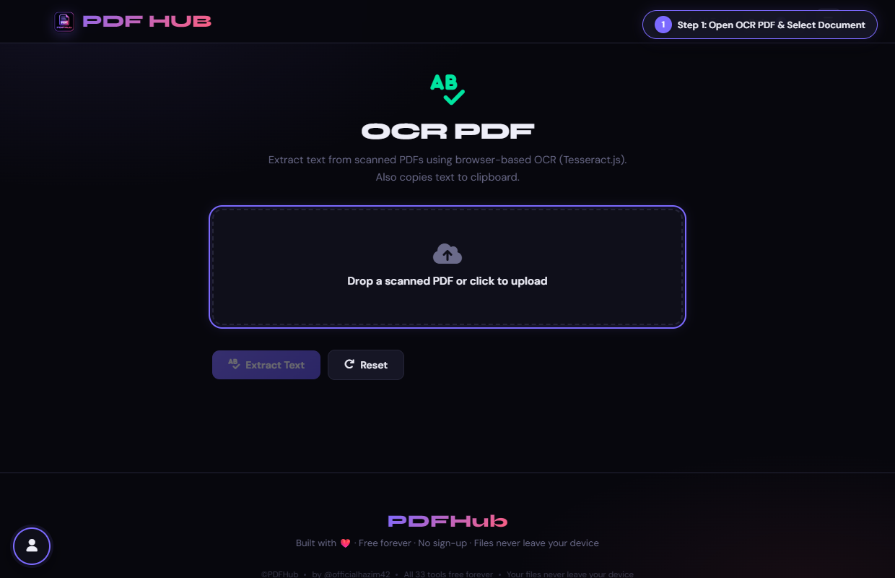

**Step 2: Select file and configure options**

Select the document language (English, Spanish, French, German, etc.) and page range for optical recognition.

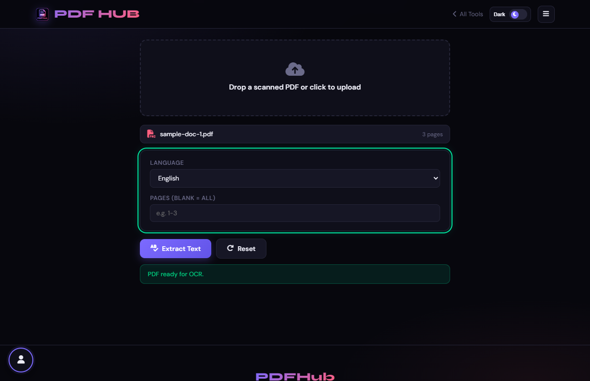

**Step 3: Process the document**

Click **Extract Text** to launch the browser Tesseract.js recognition worker.

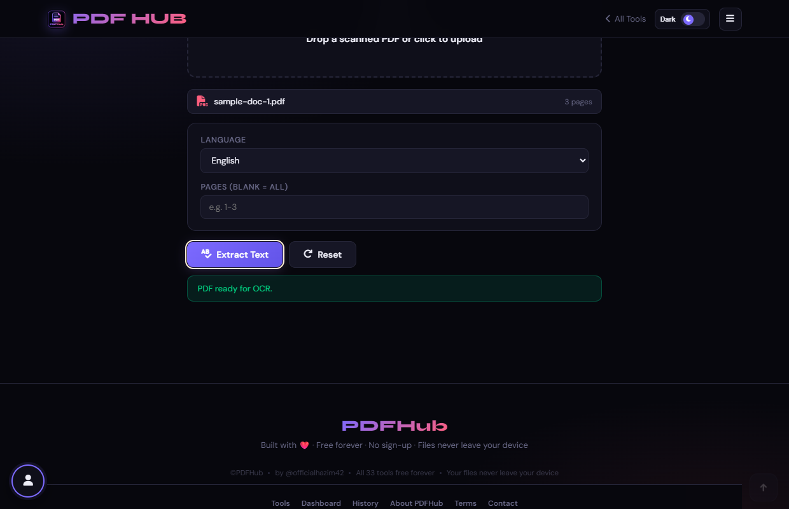

**Step 4: Verify preview and download result**

Inspect the extracted text directly in the output area. Use **Copy Text** or **Download .txt** to save the content.


---

#### Repair PDF — Step-by-Step Guide

> **Purpose:** Try to parse and reserialize a malformed PDF structure.

**Step 1: Open tool and locate upload area**

Navigate to Repair PDF and upload a broken, damaged, or unreadable PDF document.


**Step 2: Select file and configure options**

The engine parses the raw file buffer with lenient object loading to reconstruct missing xref tables.


**Step 3: Process the document**

Click **Repair PDF** to reserialize and rebuild the document stream.


**Step 4: Verify preview and download result**

Inspect the repaired file status and click **Download** to retrieve your recovered PDF.


---


### 3. Convert to PDF

#### Excel to PDF — Step-by-Step Guide

> **Purpose:** Turn a selected workbook sheet into a printable PDF using the browser print dialog.

**Step 1: Open tool and locate upload area**

Open Excel to PDF and select an `.xlsx`, `.xls`, or `.csv` spreadsheet.


**Step 2: Select file and configure options**

Select the workbook sheet to export, orientation (Portrait or Landscape for wide sheets), and review the live table preview.


**Step 3: Process the document**

Click **Convert to PDF** to prepare the formatted sheet layout.


**Step 4: Verify preview and download result**

Review the generated spreadsheet layout in the print preview and save as PDF.


---

#### HTML to PDF — Step-by-Step Guide

> **Purpose:** Print pasted HTML or an opened URL to a PDF from the browser.

**Step 1: Open tool and locate upload area**

Open HTML to PDF. Choose between pasting raw HTML markup or inputting a webpage URL.


**Step 2: Select file and configure options**

Paste your HTML code into the editor or specify the target website address, then select page dimensions.


**Step 3: Process the document**

Click **Convert to PDF** to render the markup via the browser rendering engine.


**Step 4: Verify preview and download result**

Select **Save as PDF** in the browser print dialog to generate your PDF file.


---

#### JPG to PDF — Step-by-Step Guide

> **Purpose:** Combine JPG, PNG, GIF, or WebP images into a single PDF.

**Step 1: Open tool and locate upload area**

Open JPG to PDF. Drag or select one or multiple images in JPG, PNG, GIF, or WebP format.


**Step 2: Select file and configure options**

Arrange image order and select your desired page format (Fit to Image, A4, or US Letter) with margin adjustments.


**Step 3: Process the document**

Click **Convert to PDF** to embed images as full-resolution PDF pages.


**Step 4: Verify preview and download result**

Verify the preview and click **Download** to save your consolidated PDF document.


---

#### PowerPoint to PDF — Step-by-Step Guide

> **Purpose:** Read PPTX slide text and create a browser print layout for PDF.

**Step 1: Open tool and locate upload area**

Open PowerPoint to PDF and upload your presentation (`.pptx`).


**Step 2: Select file and configure options**

Inspect slide previews and choose your preferred layout (1 slide per page or multi-slide handouts).


**Step 3: Process the document**

Click **Convert to PDF** to generate high-fidelity slide pages.


**Step 4: Verify preview and download result**

Use the browser print window to choose **Save as PDF** and store your presentation.


---

#### Word to PDF — Step-by-Step Guide

> **Purpose:** Convert DOCX text and basic formatting into a browser print layout.

**Step 1: Open tool and locate upload area**

Open Word to PDF and select a `.docx` document.

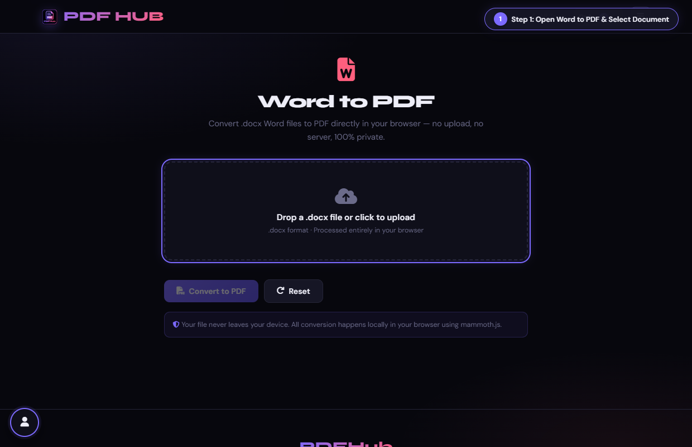

**Step 2: Select file and configure options**

The document structure is read locally with Mammoth.js. Configure paper size (A4, Letter) and typography styling.

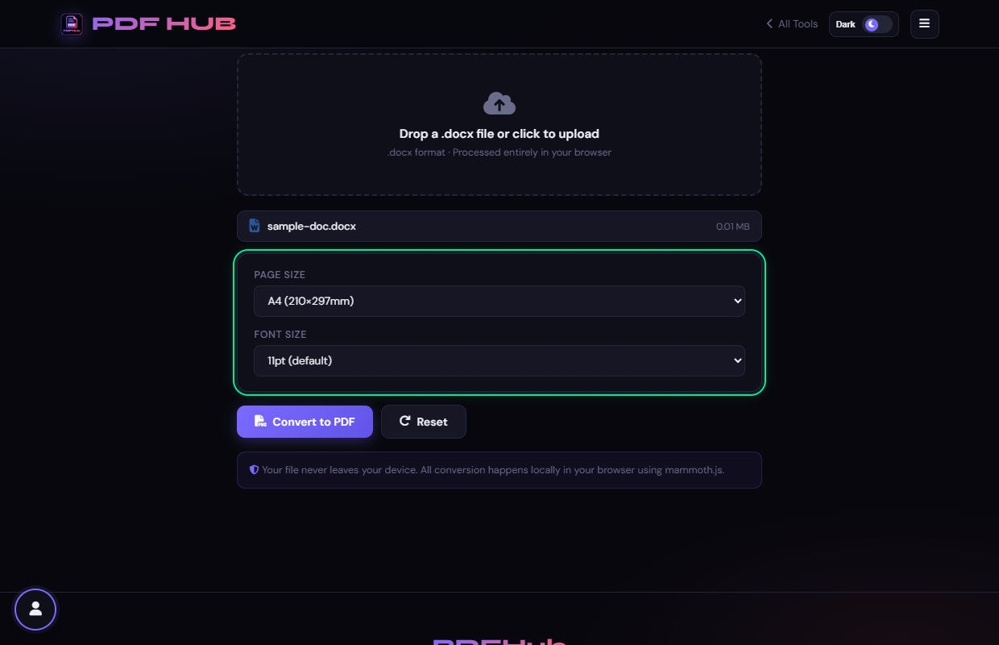

**Step 3: Process the document**

Click **Convert to PDF** to render a clean, print-ready document layout.

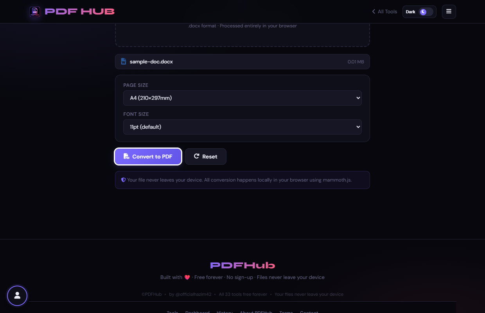

**Step 4: Verify preview and download result**

The browser print interface appears. Select **Save as PDF** as your destination printer.


---


### 4. Convert from PDF

#### PDF to Excel — Step-by-Step Guide

> **Purpose:** Extract aligned PDF text into XLSX or CSV rows and columns.

**Step 1: Open tool and locate upload area**

Open PDF to Excel and upload a PDF containing financial reports, schedules, or tabular data.

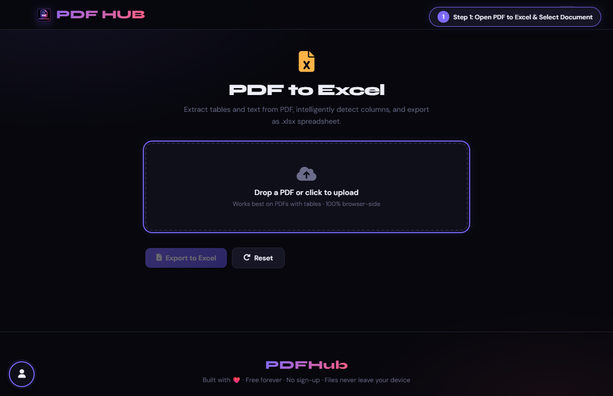

**Step 2: Select file and configure options**

Select the table detection mode (Auto, Whitespace/Tabs, or Line Delimited) and output format (XLSX or CSV).

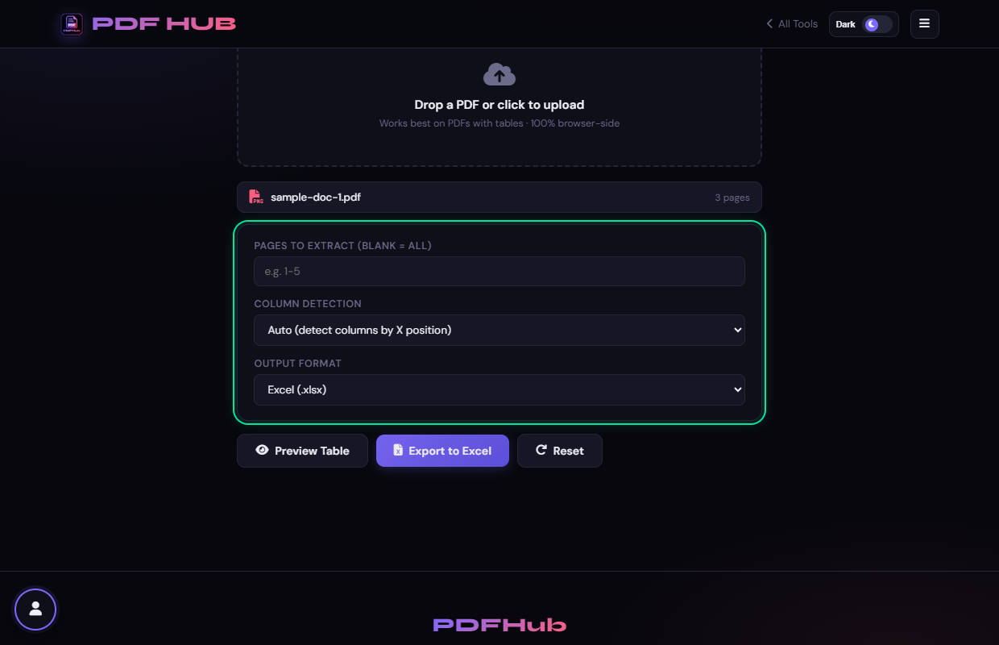

**Step 3: Process the document**

Click **Preview Table** to verify extracted rows and columns, then click **Export to Excel**.


**Step 4: Verify preview and download result**

Download your formatted Excel workbook or CSV data file.


---

#### PDF to JPG — Step-by-Step Guide

> **Purpose:** Render selected PDF pages into JPG or PNG images.

**Step 1: Open tool and locate upload area**

Open PDF to JPG and upload the PDF file you wish to convert into image assets.

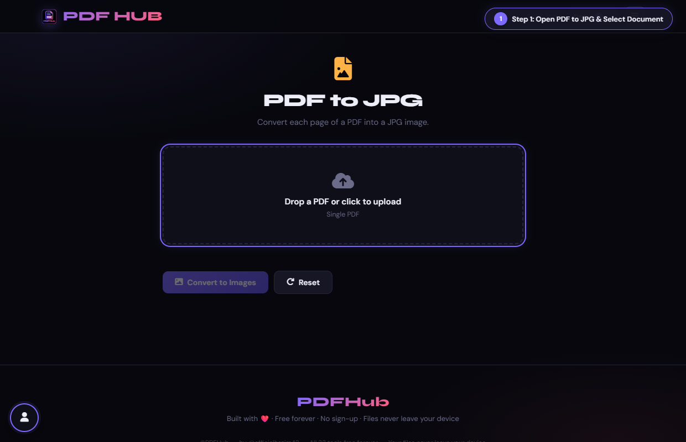

**Step 2: Select file and configure options**

Select image output format (JPG or PNG), render DPI quality (Standard or High), and specific page ranges.

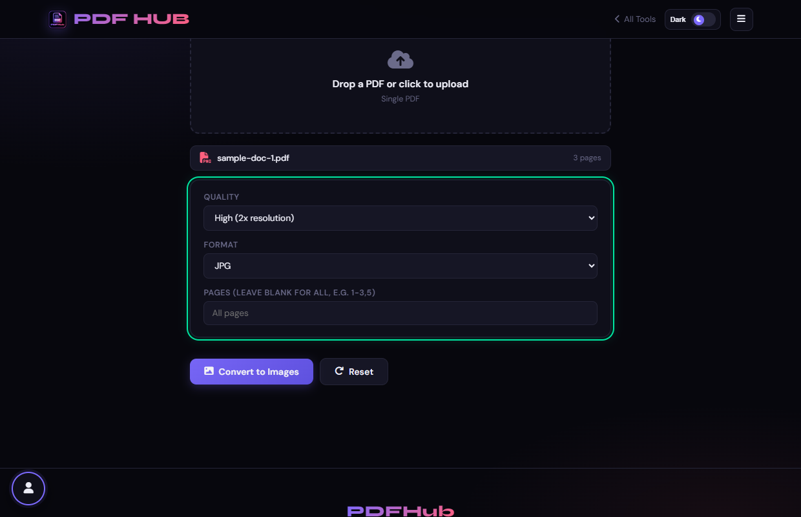

**Step 3: Process the document**

Click **Convert to Images** to render vector pages into crisp raster images with PDF.js.


**Step 4: Verify preview and download result**

Download individual page images or grab the complete document archive.

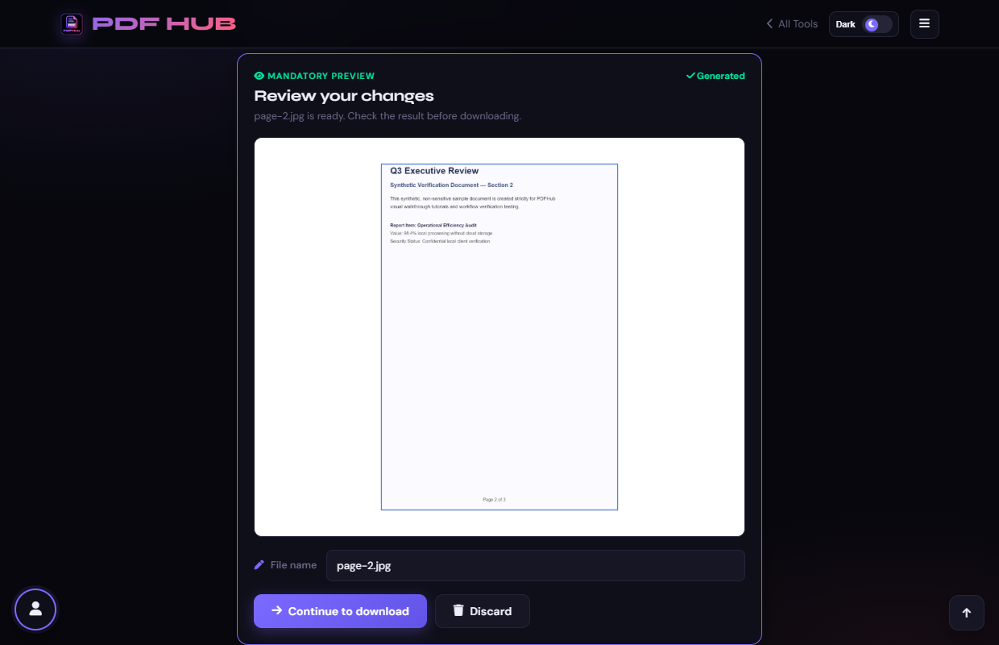

---

#### PDF to PDF/A — Step-by-Step Guide

> **Purpose:** Rewrite a PDF with selectable archival metadata and PDF/A options.

**Step 1: Open tool and locate upload area**

Open PDF to PDF/A and upload the PDF intended for long-term archival preservation.

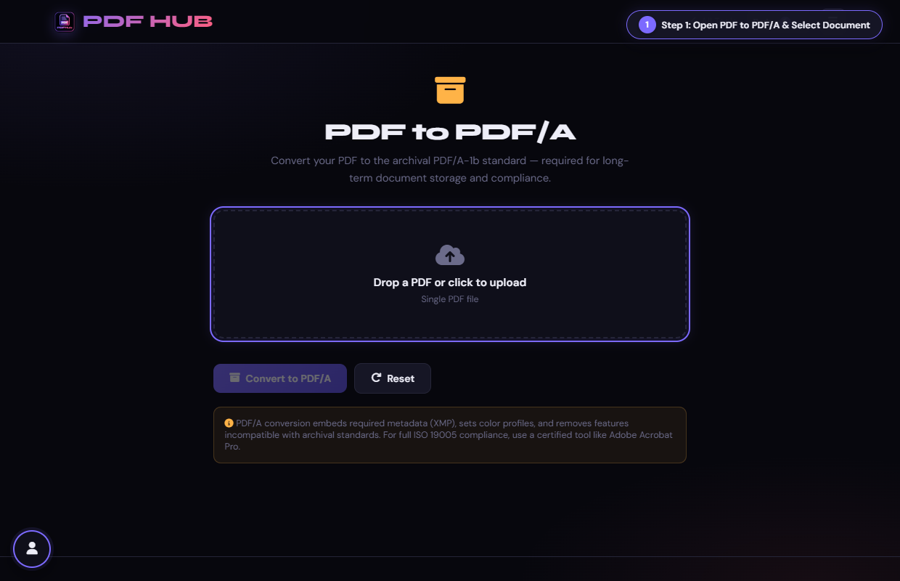

**Step 2: Select file and configure options**

Choose your compliance level (PDF/A-1b, PDF/A-2b, or PDF/A-3b) and enter document title and author metadata.

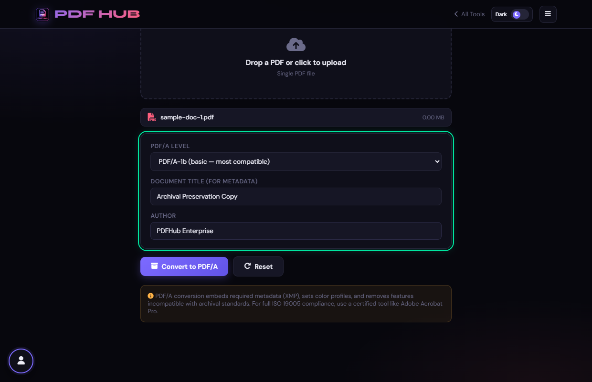

**Step 3: Process the document**

Click **Convert to PDF/A** to inject ISO-compliant color profiles, XMP metadata, and catalog entries.

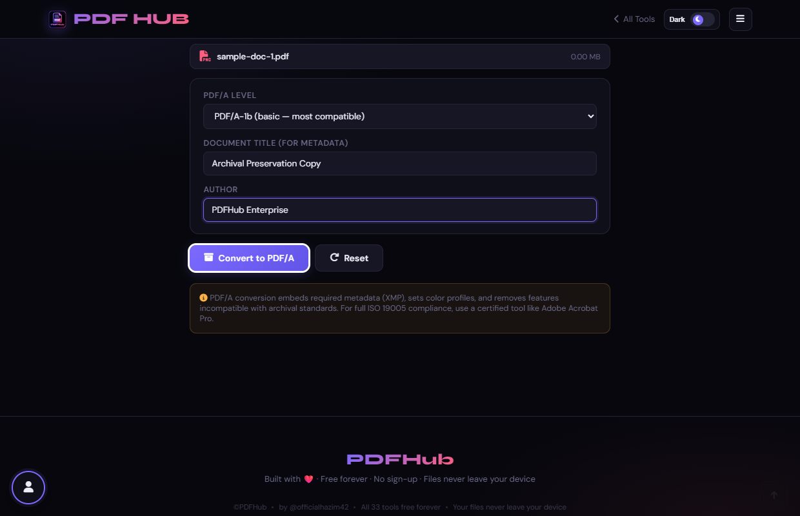

**Step 4: Verify preview and download result**

Inspect the generated archival document and click **Download** to save.


---

#### PDF to PowerPoint — Step-by-Step Guide

> **Purpose:** Render up to 20 PDF pages as slide images in a PPTX.

**Step 1: Open tool and locate upload area**

Open PDF to PowerPoint and upload your PDF document.


**Step 2: Select file and configure options**

Select slide quality and aspect ratio (Standard 4:3 or Widescreen 16:9), and review thumbnail ordering.


**Step 3: Process the document**

Click **Export as PPTX** to package each PDF page onto high-resolution presentation slides.


**Step 4: Verify preview and download result**

Click **Download** to retrieve your `.pptx` presentation deck.


---

#### PDF to Word — Step-by-Step Guide

> **Purpose:** Extract PDF text into DOCX, RTF, or plain text output.

**Step 1: Open tool and locate upload area**

Open PDF to Word and upload your text-based PDF document.


**Step 2: Select file and configure options**

Select your preferred output format: editable Word document (`.docx`), Rich Text (`.rtf`), or clean plain text (`.txt`).


**Step 3: Process the document**

Click **Convert to Word** to execute line-aware text extraction and formatting reconstruction.


**Step 4: Verify preview and download result**

Review the extraction report and click **Download** to save your editable Word document.


---


### 5. Edit PDF

#### Crop PDF — Step-by-Step Guide

> **Purpose:** Change the visible crop box using page margins.

**Step 1: Open tool and locate upload area**

Open Crop PDF and upload the document with unwanted white margins or header noise.


**Step 2: Select file and configure options**

Enter margin offsets in points for Top, Bottom, Left, and Right bounds, and select target pages (All, Odd, Even).


**Step 3: Process the document**

Click **Crop PDF** to recalculate the visible page CropBox and MediaBox.


**Step 4: Verify preview and download result**

Confirm the cropped dimensions in the preview modal and click **Download**.


---

#### Edit PDF — Step-by-Step Guide

> **Purpose:** Annotate PDF pages with pen, text, highlights, shapes, and lines.

**Step 1: Open tool and locate upload area**

Open Edit PDF and load the document page you wish to annotate.

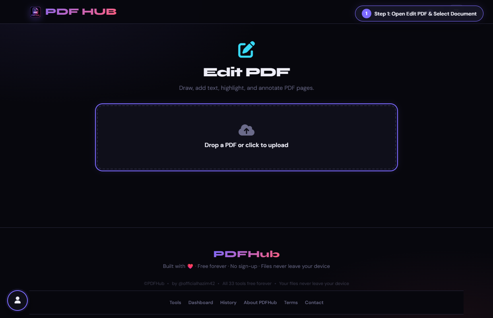

**Step 2: Select file and configure options**

Select your preferred annotation tool: Pen (freehand draw), Text (type text stamps), Highlight (semi-transparent marker), Rectangle, or Line.

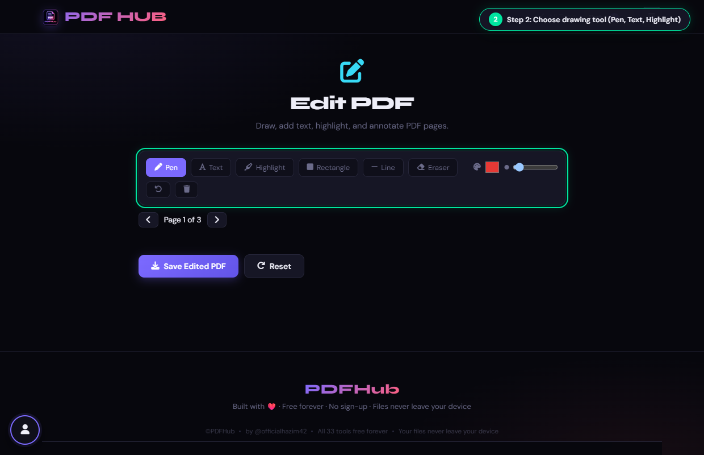

**Step 3: Process the document**

Apply your annotations onto the interactive page canvas and click **Save Edited PDF**.

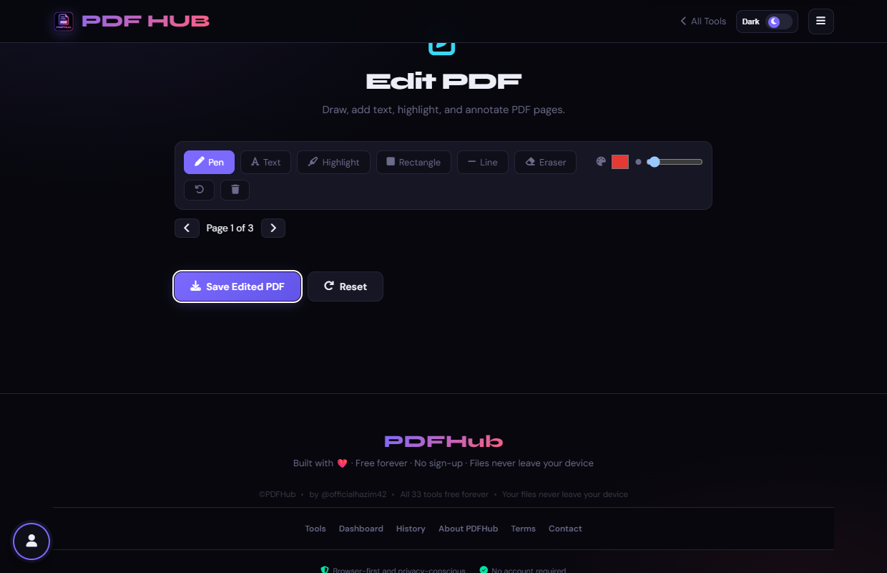

**Step 4: Verify preview and download result**

Review the flattened annotations in the result modal and click **Download**.

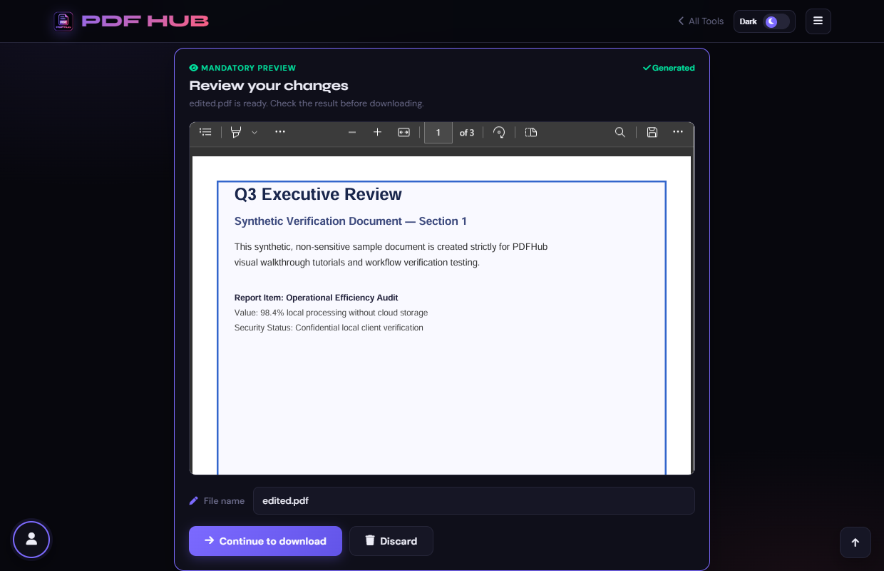

---

#### PDF Forms — Step-by-Step Guide

> **Purpose:** Fill supported interactive PDF form fields and flatten the result.

**Step 1: Open tool and locate upload area**

Open PDF Forms and upload any fillable interactive AcroForm PDF.

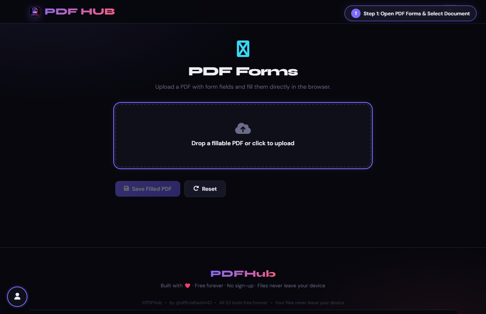

**Step 2: Select file and configure options**

The tool scans and presents all interactive form fields (text inputs, checkboxes, radio groups, and dropdown menus).

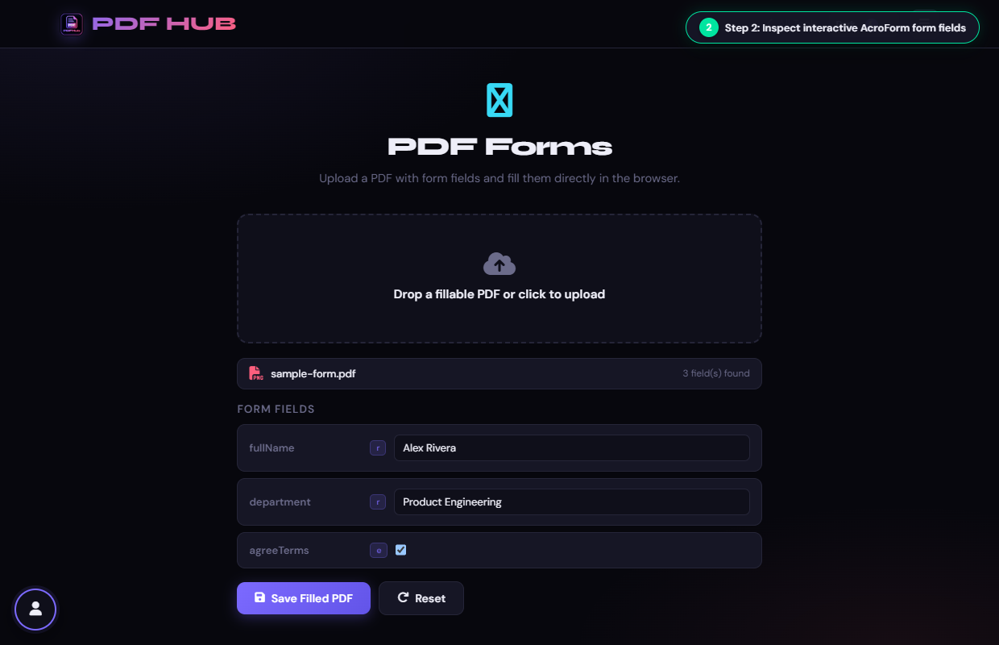

**Step 3: Process the document**

Fill in your required data directly into the fields list and click **Save Filled PDF**.

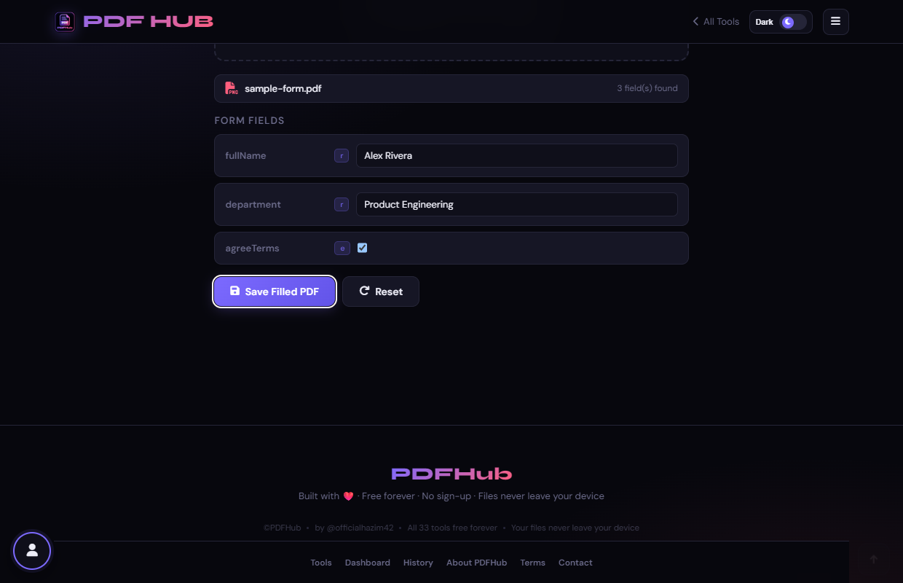

**Step 4: Verify preview and download result**

The completed values are flattened into the document stream. Click **Download** to save.

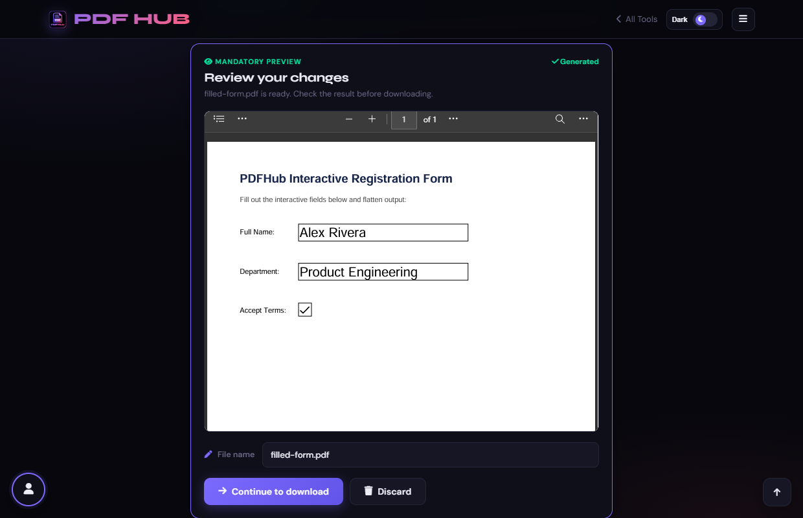

---

#### Add Page Numbers — Step-by-Step Guide

> **Purpose:** Stamp configurable page numbers onto every page of a PDF.

**Step 1: Open tool and locate upload area**

Open Add Page Numbers and select the PDF document to stamp.


**Step 2: Select file and configure options**

Configure stamp position (Bottom Center, Bottom Right, Header), numbering format (`Page {n} of {total}`), font size, and color.


**Step 3: Process the document**

Click **Add Numbers** to draw clean vector page numbering across all pages.


**Step 4: Verify preview and download result**

Inspect the stamped document preview and click **Download** to save.


---

#### Rotate PDF — Step-by-Step Guide

> **Purpose:** Rotate all, odd, even, or custom PDF pages by a selected angle.

**Step 1: Open tool and locate upload area**

Open Rotate PDF and upload the PDF with inverted or sideways pages.


**Step 2: Select file and configure options**

Select the rotation angle (90° clockwise, 180°, or 270°) and target pages (All pages, Odd only, Even only, or Custom).


**Step 3: Process the document**

Click **Rotate PDF** to modify the page rotation dictionary values without quality loss.


**Step 4: Verify preview and download result**

Review the correctly oriented document in the result modal and click **Download**.


---

#### Add Watermark — Step-by-Step Guide

> **Purpose:** Stamp custom text across every page with opacity, color, angle, and size controls.

**Step 1: Open tool and locate upload area**

Open Add Watermark and drop your document into the upload zone.

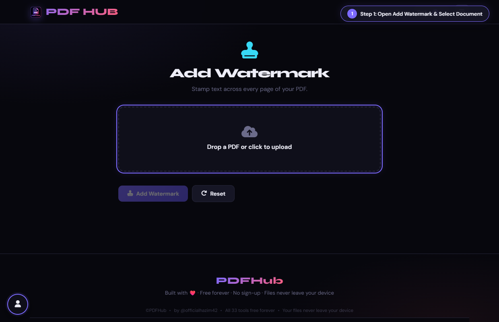

**Step 2: Select file and configure options**

Enter your custom watermark text, adjust transparency/opacity, font size, color, and diagonal rotation angle.

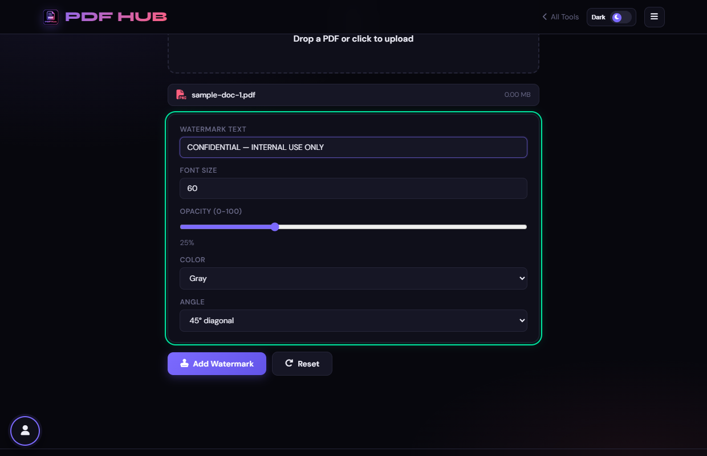

**Step 3: Process the document**

Click **Add Watermark** to embed semi-transparent watermark stamps across every page.


**Step 4: Verify preview and download result**

Verify the watermark placement and contrast in the preview, then click **Download**.

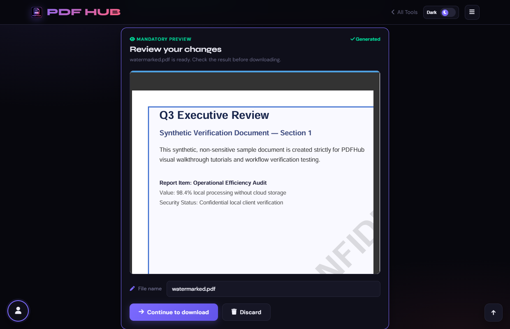

---


### 6. PDF Security

#### Compare PDF — Step-by-Step Guide

> **Purpose:** Review two PDF versions side by side and highlight visual differences.

**Step 1: Open tool and locate upload area**

Open Compare PDF and select both the Original PDF and Modified PDF documents.


**Step 2: Select file and configure options**

Verify dual-file loading and confirm matching page counts for comparison.


**Step 3: Process the document**

Click **Compare PDFs** to launch pixel-level visual difference scanning across rendered pages.


**Step 4: Verify preview and download result**

Inspect the side-by-side comparison interface where visual changes, shifts, and modifications are highlighted.


---

#### Protect PDF — Step-by-Step Guide

> **Purpose:** Add password encryption and permission settings to a PDF.

**Step 1: Open tool and locate upload area**

Open Protect PDF and drop your confidential PDF into the upload area.


**Step 2: Select file and configure options**

Enter your encryption password, confirm the password, and configure granular permissions (printing, copying, annotations).


**Step 3: Process the document**

Click **Protect PDF** to apply AES encryption with user and owner security credentials.


**Step 4: Verify preview and download result**

Your encrypted document is ready. Click **Download** and retain your password securely.


---

#### Redact PDF — Step-by-Step Guide

> **Purpose:** Draw black rectangles over sensitive areas and export a flattened PDF.

**Step 1: Open tool and locate upload area**

Open Redact PDF and upload the document containing private or confidential data.


**Step 2: Select file and configure options**

Navigate through pages and drag your cursor over sensitive text or figures to create blackout rectangles.


**Step 3: Process the document**

Verify all sensitive regions are covered, then click **Save Redacted PDF** to permanently rasterize the redactions.


**Step 4: Verify preview and download result**

Confirm that redacted content is permanently obscured, then click **Download**.


---

#### Sign PDF — Step-by-Step Guide

> **Purpose:** Draw or type a signature and place it on a rendered PDF page.

**Step 1: Open tool and locate upload area**

Open Sign PDF and upload the contract or agreement requiring signature.

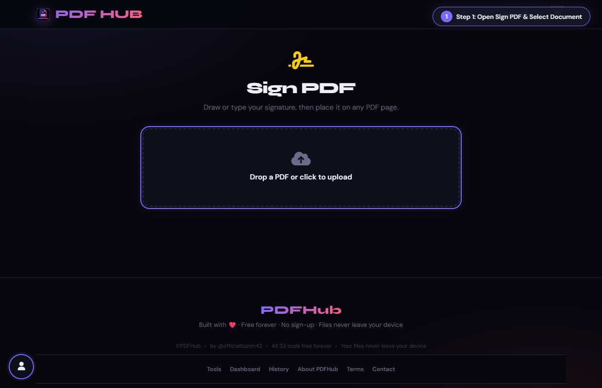

**Step 2: Select file and configure options**

Create your signature using either the interactive Draw canvas or the Type signature generator with cursive calligraphy fonts.

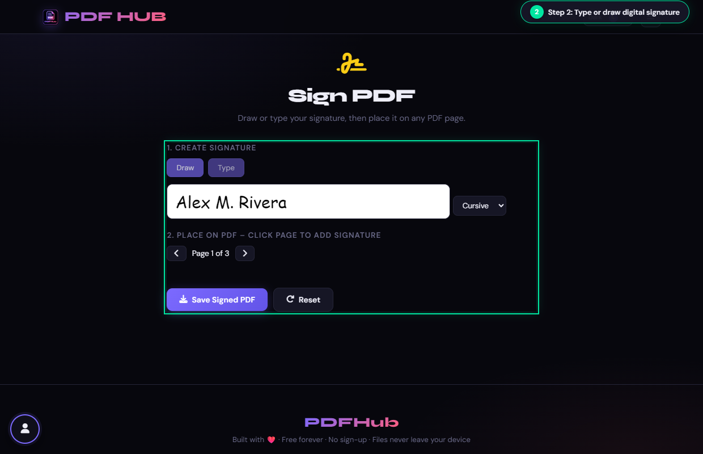

**Step 3: Process the document**

Click onto the rendered document page to place your signature stamp, position it, and click **Save Signed PDF**.


**Step 4: Verify preview and download result**

Inspect the signed document in the result modal and click **Download**.


---

#### Unlock PDF — Step-by-Step Guide

> **Purpose:** Remove supported PDF encryption when you provide the document password.

**Step 1: Open tool and locate upload area**

Open Unlock PDF and upload your password-protected PDF document.


**Step 2: Select file and configure options**

Enter the authorized document password into the password field.


**Step 3: Process the document**

Click **Unlock PDF** to decrypt the internal security handler and strip restrictive permissions.


**Step 4: Verify preview and download result**

Verify the unlocked document in the result modal and click **Download** to save the unencrypted file.


---


### 7. PDF Intelligence

#### PDF to Markdown — Step-by-Step Guide

> **Purpose:** Extract selectable PDF text into editable Markdown with optional headings.

**Step 1: Open tool and locate upload area**

Open PDF to Markdown and upload any structured text PDF.

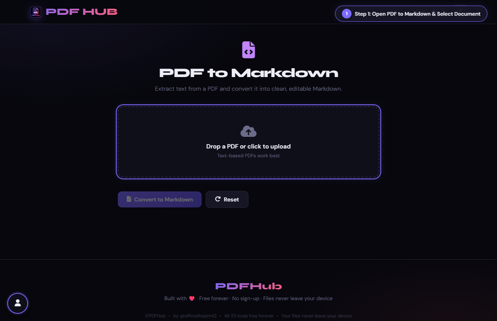

**Step 2: Select file and configure options**

Configure markdown parsing options: Detect Headings (#, ##), recognize bullet lists, and insert horizontal page breaks (`---`).

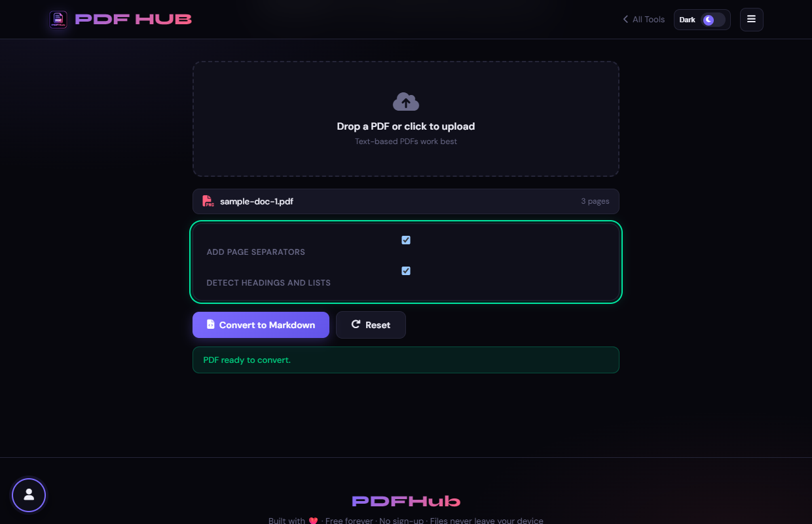

**Step 3: Process the document**

Click **Convert to Markdown** to extract text hierarchy into clean GitHub-flavored markdown.

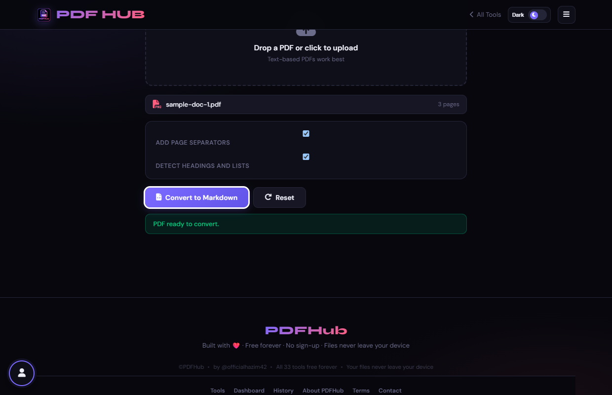

**Step 4: Verify preview and download result**

Inspect and edit the generated markdown in the live preview editor. Click **Copy Markdown** or **Download .md**.


---

#### AI Summarizer — Step-by-Step Guide

> **Purpose:** Extract PDF text and request a summary through the page’s configured AI service.

**Step 1: Open tool and locate upload area**

Open AI Summarizer and upload your text-based PDF document.


**Step 2: Select file and configure options**

Select your desired summary style (Concise overview, Bulleted takeaways, or Detailed breakdown) and maximum page count.


**Step 3: Process the document**

Click **Summarize PDF** to extract text content and trigger structured analysis.


**Step 4: Verify preview and download result**

Review the generated summary in the text console. Copy to clipboard or download the summary as a `.txt` file.


---

#### Translate PDF — Step-by-Step Guide

> **Purpose:** Extract selected PDF text and translate it through the configured free translation API.

**Step 1: Open tool and locate upload area**

Open Translate PDF and upload your foreign-language PDF document.

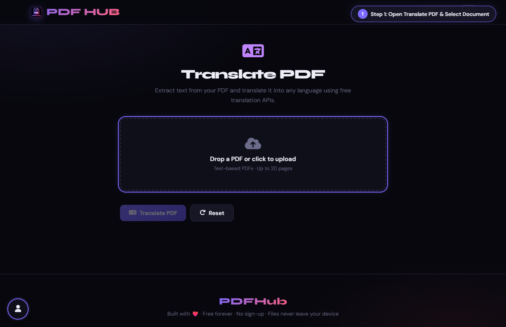

**Step 2: Select file and configure options**

Select the document source language and target language from over 16 supported languages.

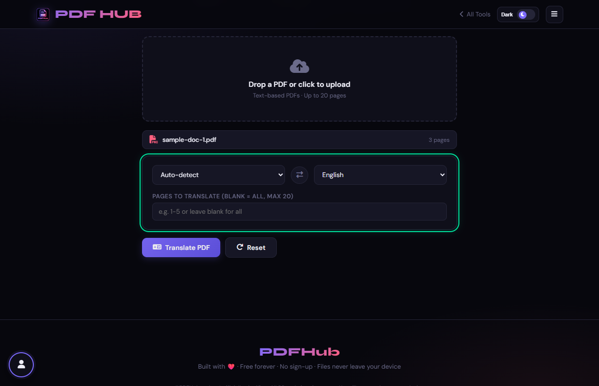

**Step 3: Process the document**

Click **Translate PDF** to extract text chunks and process translations.

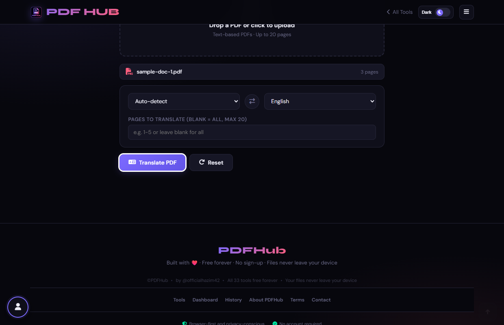

**Step 4: Verify preview and download result**

Review the translated document text in the side-by-side translation console, then copy or export.


---

## Technical Notes & Limitations

To ensure absolute transparency, PDFHub documents the following technical considerations:

1. **Browser Print Engine Workflows**: Tools converting from HTML, Word, and PowerPoint (`html-to-pdf`, `word-to-pdf`, `ppt-to-pdf`, `excel-to-pdf`) generate a styled print view and open your browser's native print interface. Select **Save as PDF** as the destination printer.
2. **Browser Memory Bounds**: Large documents (over 150 MB or 1,000+ pages) may be limited by individual browser tab memory limits. If processing very large files, split them into smaller sections first.
3. **OCR Engine Loading**: Optical Character Recognition (`ocr.html`) utilizes Tesseract.js. On first execution, the browser fetches the Tesseract language dictionary and WebAssembly worker (cached for future visits).
4. **Archival PDF/A Compliance**: The `pdf-to-pdfa` tool writes standard PDF/A catalog dictionaries and XMP archival metadata. For legal regulatory submissions, always verify with an external ISO validator.
5. **AI Summarizer & Translation**: Text extraction is executed 100% locally. The optional summarization and translation APIs require internet connectivity to communicate with external translation/AI endpoints.

---

## Run Locally

PDFHub requires no build pipeline or compilation. Start any static HTTP server from the project root:

```bash
# Using Python 3
python -m http.server 8000

# Or using Node.js
npx serve .
```

Open your browser to:
```
http://localhost:8000
```

---

## Deployment

- **Primary Canonical Production:** [https://pdfshub.netlify.app/](https://pdfshub.netlify.app/)
- **Alternative Deployment:** [https://pdfshub.smartstores.in/](https://pdfshub.smartstores.in/)

PDFHub can be deployed directly to any static hosting service (Netlify, Cloudflare Pages, GitHub Pages, or Apache/Nginx). Ensure HTTPS is enabled in production so browser Service Workers and PWA installation remain fully functional.

---

## License

MIT License. Free for personal, commercial, and educational use.
