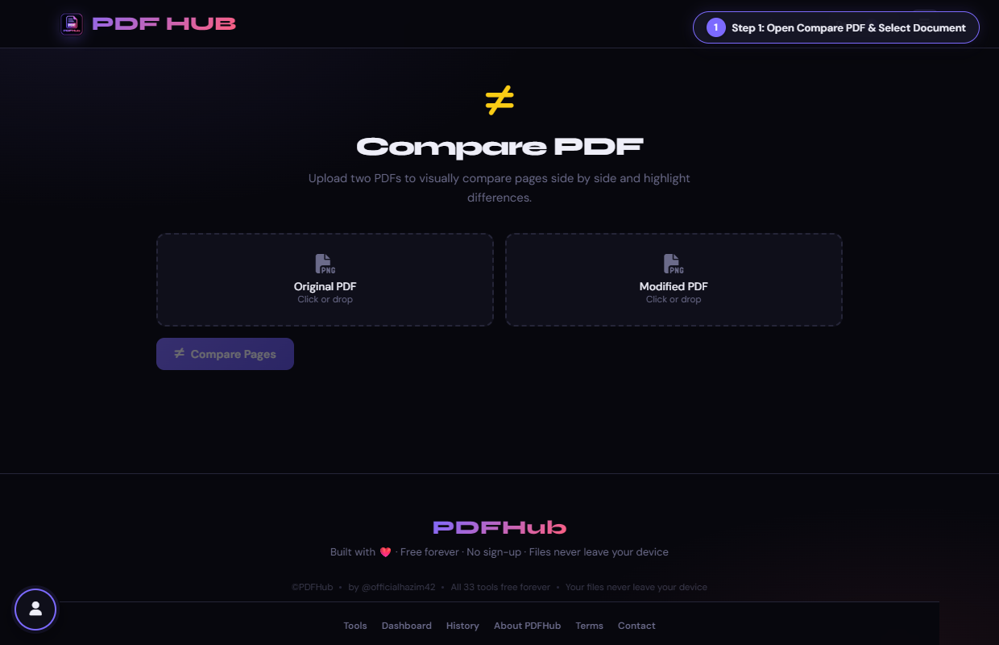
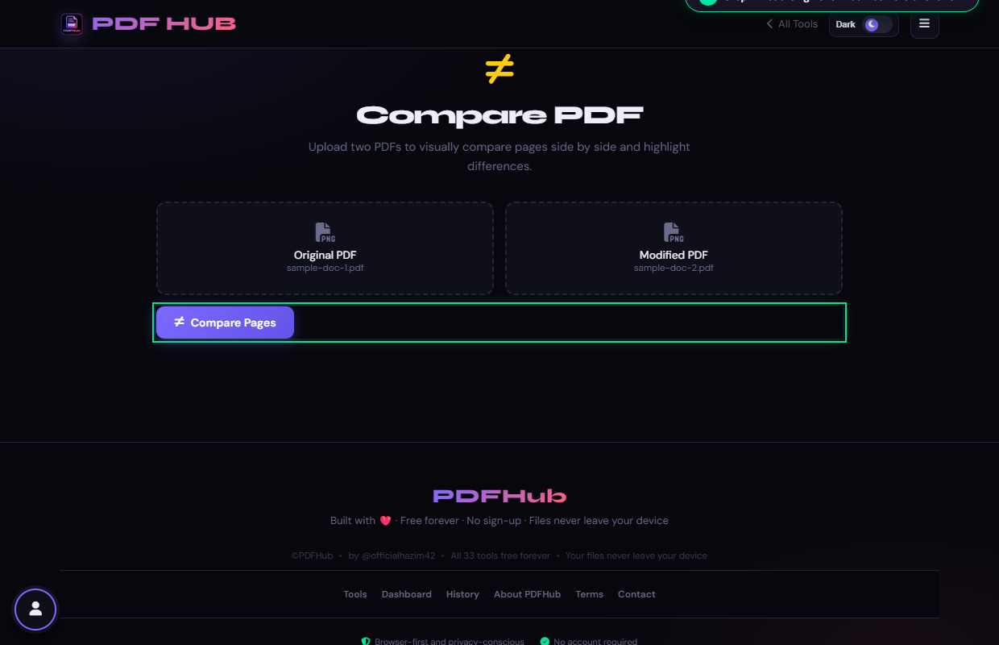
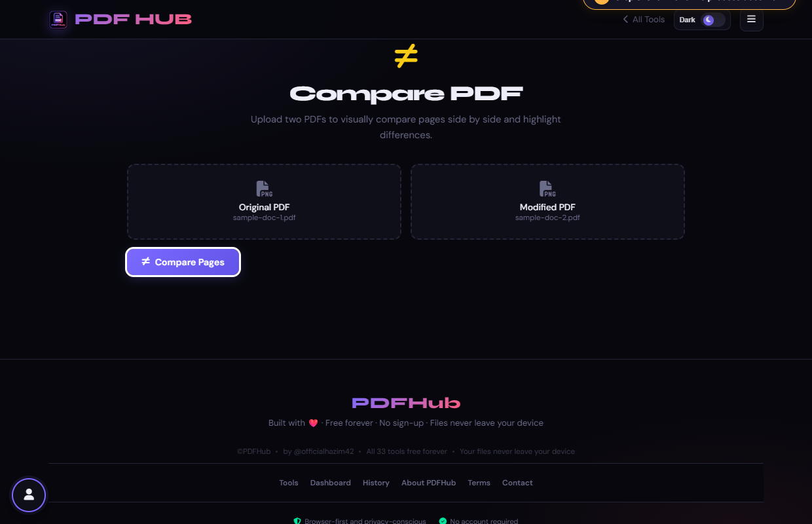

# Compare PDF — Technical Tool Documentation

> **Summary:** Review two PDF versions side by side and highlight visual differences.  
> **Tool Route:** `/tools/compare.html`  
> **Visual Guide Route:** `/guides/compare-pdf/`  
> **Category:** Organize PDF  
> **Processing Architecture:** 100% Client-Side. Both files remain in local browser memory.

---

## 1. What the Tool Does
Compare PDF renders matching pages from an original and modified document, then highlights differing pixels so you can review revisions without uploading either file.

**Requirements & Constraints:** Two readable PDF files are required. The comparison is visual and page-based; it does not create a new PDF.

---

## 2. When to Use It
Use **Compare PDF** whenever you need to perform client-side organize pdf operations without uploading confidential records to third-party cloud servers. 

**Ideal Scenarios:**
- Working on personal identity records, banking statements, medical filings, or NDAs requiring 100% local confidentiality.
- Fast offline or low-bandwidth processing directly in your web browser.
- Universal cross-platform document operations on Windows, macOS, Linux, Android, or iOS.

---

## 3. Key Implemented Features
- **Engine Architecture:** `pdf.js (dual rendering) + Canvas Pixel-by-Pixel Diff`
- **Zero Server Uploads:** Processing executes directly within client browser memory.
- **Instant Processing:** Fast execution powered by WebAssembly and native HTML5 APIs.
- **Review Previews:** Visual feedback and progress indicators confirm results prior to saving.
- **No Sign-up / No Watermarks:** Full functionality with zero paywalls or forced branding.

---

## 4. Supported Input Files
- **Primary Input:** Two PDF documents (Original PDF and Modified PDF)
- **Validation:** Files are validated in the browser prior to parsing.

---

## 5. Supported Output Files
- **Output Format:** Interactive side-by-side on-screen visual difference audit
- **MIME Types:** `application/pdf` (or appropriate image/text/zip formats).

---

## 6. File Size & Memory Limits
- **Recommended Bounds:** Client RAM bound
- **Technical Context:** Modern browser tabs enforce memory quotas (typically 1.5 GB to 2 GB per tab). PDFHub handles documents comfortably within standard browser memory limits. For files exceeding 150 MB or 1,000 pages, splitting into smaller sections is recommended.

---

## 7. Step-by-Step Instructions
1. **Open Compare PDF and choose the Original PDF file.**
2. **Choose the Modified PDF file and wait for both previews to load.**
3. **Select Compare Pages, then move through pages with the arrows.**
4. **Review the highlighted differences and page counts before acting on the result.**

---

## 8. Required User Inputs & Controls
- **File Upload Area (`#drop` / `#fin`):** Click to open native file browser or drag and drop supported files.
- **Tool Options (`#opts`):** Dynamic settings panel configuring parameters, page ranges, or compression levels.
- **Execution Button (`Compare Pages (#goBtn)`):** Triggers client-side processing pipeline.
- **Reset Button:** Clears loaded files and resets workspace to pristine state.

---

## 9. Processing Behavior & Execution Pipeline
Renders corresponding pages from Document 1 and Document 2 onto dual canvases, extracts pixel image data arrays, compares RGBA values per pixel, and highlights visual discrepancies on an overlay canvas.

---

## 10. Expected Output & Download Verification
- Upon successful execution, the interface triggers an automated browser download via `downloadBlob()` or opens a result review modal.
- Users can verify file size, page count, and visual rendering before finalizing the download.

---

## 11. Practical Example Use Case
Auditing contract revisions or engineering blueprints to spot subtle changes or unauthorized wording alterations.

---

## 12. Common Errors & Troubleshooting
- **Issue:** If a file will not load, confirm it is a readable PDF and try a fresh copy.
- **Issue:** If pages have different sizes, compare the content visually rather than relying on pixel counts.
- **Avoid:** Selecting the same version twice hides meaningful changes.
- **Avoid:** Expecting a downloadable redline file; this tool provides an on-screen comparison.
- **Tip:** Comparing documents with completely different page counts or resolutions. Solution: Use matching document versions.

---

## 13. Privacy & Data Handling Architecture
- **Local Processing:** 100% Client-Side. Both files remain in local browser memory.
- **Browser Memory:** Document bytes reside temporarily in `ArrayBuffer` memory and are garbage collected when the browser tab is refreshed or closed.
- **Cookies & Telemetry:** PDFHub sets zero tracking cookies, zero analytics beacons, and stores zero personal document data.

---

## 14. Frequently Asked Questions (FAQ)
#### Q: Does this edit either PDF?
**A:** No. It only renders and compares pages.

#### Q: Can I compare more than two files?
**A:** No. Use two files per comparison.

---

## 15. Related PDFHub Tools
- [Merge PDF Documentation](merge-pdf.md)
- [Split PDF Documentation](split-pdf.md)
- [PDF to JPG Documentation](pdf-to-jpg.md)

---

## 16. Links & Resources
- **Launch Live Tool:** [Open Compare PDF in PDFHub](../../tools/compare.html)
- **Visual Tutorial:** [View Compare PDF Visual Guide](../../guides/compare-pdf/)
- **All Tools Master Reference:** [All Tools Reference](../all-tools-reference.md)
- **Master Documentation Index:** [Documentation Index](../documentation-index.md)

---

## 17. Visual Walkthrough & Interface Screenshots

### Step 1: Open Compare PDF
- **Interface Control:** `Dual Drop Zones (#drop1, #drop2)`
- **What You See:** The workspace features dual upload zones: Original PDF on the left, Modified PDF on the right.
- **What to Do:** Open Compare PDF to highlight visual differences, edits, and pixel shifts between two documents.
- **Practical Pro-Tip:** Compare PDF is an on-screen visual auditor that runs 100% locally in your browser.

### Step 2: Upload Original Document
- **Interface Control:** `Original File Browser (#fin1)`
- **What You See:** The original document details and page count load into the left panel.
- **What to Do:** Select the earlier or baseline PDF version into the first upload box.
- **Practical Pro-Tip:** Comparing matching drafts with identical page sizes produces the clearest visual diff.

### Step 3: Upload Modified Document
- **Interface Control:** `Modified File Browser (#fin2)`
- **What You See:** The modified document loads into the right panel with its page count.
- **What to Do:** Select the updated or modified PDF version into the right upload box.
- **Practical Pro-Tip:** Both files must be readable PDFs.

### Step 4: Review Side-by-Side Previews
- **Interface Control:** `Preview Panes (.preview-wrap)`
- **What You See:** Side-by-side previews show page 1 of each document.
- **What to Do:** Confirm that both documents are aligned to corresponding sections.
- **Practical Pro-Tip:** Verify page counts to see if any pages were added or removed in the revision.

### Step 5: Click Compare Pages
- **Interface Control:** `Compare Action Button (#goBtn)`
- **What You See:** The visual diff engine rasterizes matching pages and runs pixel-by-pixel differential analysis.
- **What to Do:** Click the primary "Compare Pages" button.
- **Practical Pro-Tip:** All pixel analysis executes directly in WebAssembly inside your browser.

### Step 6: Audit Highlighted Differences
- **Interface Control:** `Diff Viewer (#diffViewer)`
- **What You See:** Modified text, changed numbers, and shifted images are highlighted with vibrant diff colors.
- **What to Do:** Inspect the highlighted color-coded difference overlays.
- **Practical Pro-Tip:** Unchanged content remains neutral, allowing edits to stand out instantly.

### Step 7: Navigate & Audit All Pages
- **Interface Control:** `Page Navigation Buttons (changePage)`
- **What You See:** The comparison viewer shifts page by page, highlighting edits on each sheet.
- **What to Do:** Use the left and right navigation arrows to audit differences across every page.
- **Practical Pro-Tip:** Compare PDF is an interactive inspection tool; your original files remain unmodified.

