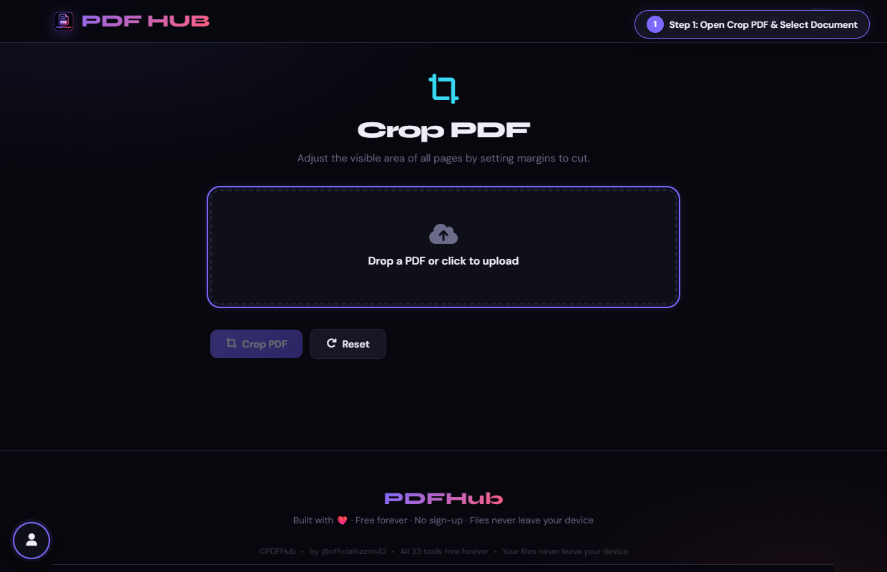
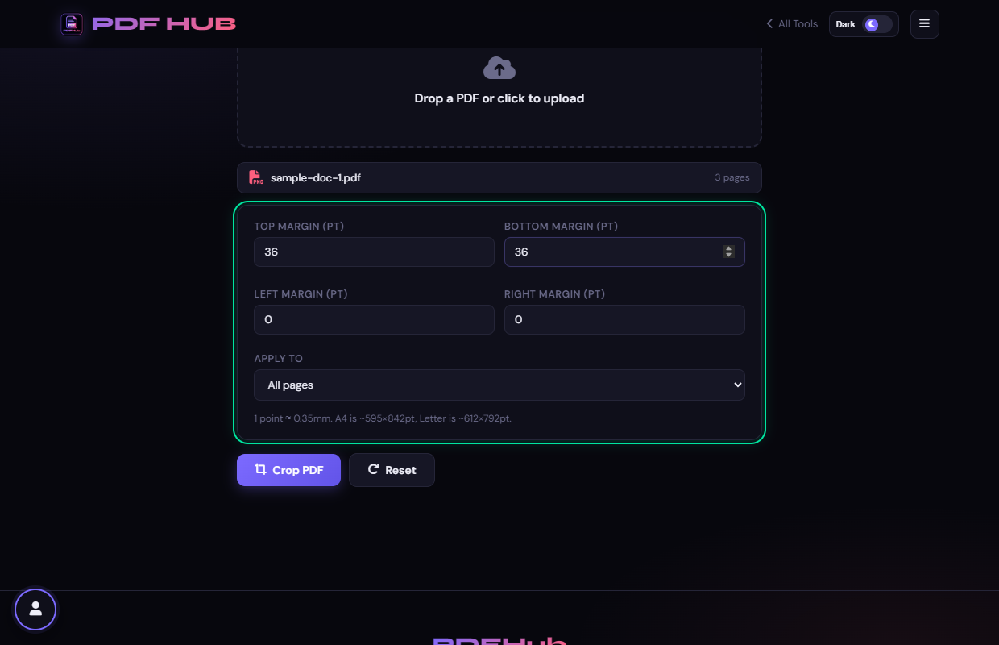
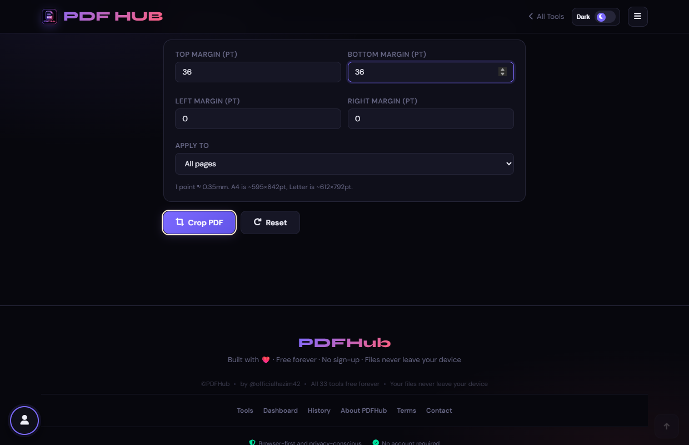
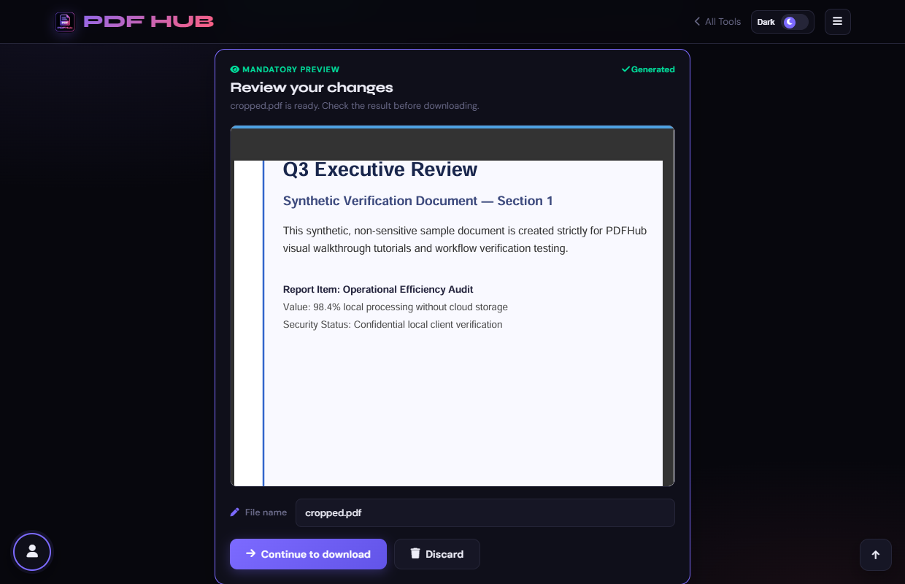

# Crop PDF — Technical Tool Documentation

> **Summary:** Change the visible crop box using page margins.  
> **Tool Route:** `/tools/crop.html`  
> **Visual Guide Route:** `/guides/crop-pdf/`  
> **Category:** Edit PDF  
> **Processing Architecture:** 100% Client-Side. Zero server uploads.

---

## 1. What the Tool Does
Crop PDF adjusts the visible page bounds with top, bottom, left, and right margins. It can apply the change to all, odd, or even pages.

**Requirements & Constraints:** One readable PDF is required. Margin values are points and should leave a positive page area.

---

## 2. When to Use It
Use **Crop PDF** whenever you need to perform client-side edit pdf operations without uploading confidential records to third-party cloud servers. 

**Ideal Scenarios:**
- Working on personal identity records, banking statements, medical filings, or NDAs requiring 100% local confidentiality.
- Fast offline or low-bandwidth processing directly in your web browser.
- Universal cross-platform document operations on Windows, macOS, Linux, Android, or iOS.

---

## 3. Key Implemented Features
- **Engine Architecture:** `pdf-lib (page.setCropBox, page.setMediaBox)`
- **Zero Server Uploads:** Processing executes directly within client browser memory.
- **Instant Processing:** Fast execution powered by WebAssembly and native HTML5 APIs.
- **Review Previews:** Visual feedback and progress indicators confirm results prior to saving.
- **No Sign-up / No Watermarks:** Full functionality with zero paywalls or forced branding.

---

## 4. Supported Input Files
- **Primary Input:** Single PDF document (.pdf)
- **Validation:** Files are validated in the browser prior to parsing.

---

## 5. Supported Output Files
- **Output Format:** Cropped PDF document (cropped.pdf)
- **MIME Types:** `application/pdf` (or appropriate image/text/zip formats).

---

## 6. File Size & Memory Limits
- **Recommended Bounds:** Client RAM bound
- **Technical Context:** Modern browser tabs enforce memory quotas (typically 1.5 GB to 2 GB per tab). PDFHub handles documents comfortably within standard browser memory limits. For files exceeding 150 MB or 1,000 pages, splitting into smaller sections is recommended.

---

## 7. Step-by-Step Instructions
1. **Upload a PDF to Crop PDF.**
2. **Enter top, bottom, left, and right margins in points.**
3. **Choose whether to apply the margins to all, odd, or even pages.**
4. **Select Crop PDF and inspect the resulting page edges.**

---

## 8. Required User Inputs & Controls
- **File Upload Area (`#drop` / `#fin`):** Click to open native file browser or drag and drop supported files.
- **Tool Options (`#opts`):** Dynamic settings panel configuring parameters, page ranges, or compression levels.
- **Execution Button (`Crop PDF (#goBtn)`):** Triggers client-side processing pipeline.
- **Reset Button:** Clears loaded files and resets workspace to pristine state.

---

## 9. Processing Behavior & Execution Pipeline
Reads MediaBox dimensions, subtracts user-specified margin offsets (top, bottom, left, right in points), sets new CropBox rectangle boundaries on selected pages, and outputs trimmed PDF.

---

## 10. Expected Output & Download Verification
- Upon successful execution, the interface triggers an automated browser download via `downloadBlob()` or opens a result review modal.
- Users can verify file size, page count, and visual rendering before finalizing the download.

---

## 11. Practical Example Use Case
Trimming printer bleed marks, header stamps, or excessive white margins from eBooks or academic articles.

---

## 12. Common Errors & Troubleshooting
- **Issue:** If the output is blank or clipped, retry with smaller margins.
- **Issue:** If the file cannot be read, use a valid, unencrypted PDF.
- **Avoid:** Entering margins larger than the page dimensions.
- **Avoid:** Confusing cropping with deleting content; the original content may still exist outside the crop box.
- **Tip:** Entering margin offsets larger than page dimensions causing inverted crop boxes. Solution: Use modest values (20–50 pt).

---

## 13. Privacy & Data Handling Architecture
- **Local Processing:** 100% Client-Side. Zero server uploads.
- **Browser Memory:** Document bytes reside temporarily in `ArrayBuffer` memory and are garbage collected when the browser tab is refreshed or closed.
- **Cookies & Telemetry:** PDFHub sets zero tracking cookies, zero analytics beacons, and stores zero personal document data.

---

## 14. Frequently Asked Questions (FAQ)
#### Q: Can I crop individual pages?
**A:** This page applies the setting by page parity, not individually.

#### Q: Does cropping remove content permanently?
**A:** It changes visible bounds rather than redrawing content.

---

## 15. Related PDFHub Tools
- [Rotate PDF Documentation](rotate-pdf.md)
- [Edit PDF Documentation](edit-pdf.md)
- [Organize PDF Documentation](organize-pdf.md)

---

## 16. Links & Resources
- **Launch Live Tool:** [Open Crop PDF in PDFHub](../../tools/crop.html)
- **Visual Tutorial:** [View Crop PDF Visual Guide](../../guides/crop-pdf/)
- **All Tools Master Reference:** [All Tools Reference](../all-tools-reference.md)
- **Master Documentation Index:** [Documentation Index](../documentation-index.md)

---

## 17. Visual Walkthrough & Interface Screenshots

### Step 1: Open Crop PDF
- **Interface Control:** `Upload Drop Zone (#drop)`
- **What You See:** The upload drop area accepts any PDF document.
- **What to Do:** Open Crop PDF to trim excess margins, printer marks, or unwanted borders.
- **Practical Pro-Tip:** Cropping adjusts the visible page boundary (CropBox) without deleting underlying content.

### Step 2: Upload PDF Document
- **Interface Control:** `File Browser (#fin)`
- **What You See:** The document loads and renders a visual preview canvas with boundary boxes.
- **What to Do:** Select your PDF document with margins you want to trim.
- **Practical Pro-Tip:** You can crop all pages uniformly or target individual sheets.

### Step 3: Choose Target Pages
- **Interface Control:** `Target Dropdown (#applyTo)`
- **What You See:** The selector ensures crop margins apply consistently across your target range.
- **What to Do:** Select whether to crop "All pages", "First page only", or "Current page".
- **Practical Pro-Tip:** Standard books and scan batches usually require uniform margin cropping.

### Step 4: Enter Margin Trim Values
- **Interface Control:** `Margin Inputs (#top, #bottom, #left, #right)`
- **What You See:** The input fields register trim depths for each border.
- **What to Do:** Enter the points to trim from the Top, Bottom, Left, and Right edges (e.g. 36pt = 0.5 inch).
- **Practical Pro-Tip:** 72 points equals 1 inch (25.4mm). A 36pt trim removes exactly half an inch.

### Step 5: Inspect Crop Box on Canvas
- **Interface Control:** `Canvas Bounding Box (#cropCanvas)`
- **What You See:** The overlay rectangle shows the exact area that will be retained.
- **What to Do:** Observe the highlighted crop boundary rectangle on the visual preview canvas.
- **Practical Pro-Tip:** Make sure headings, page numbers, and footnotes remain comfortably inside the box.

### Step 6: Click Crop PDF
- **Interface Control:** `Crop Action Button (#goBtn)`
- **What You See:** The client-side engine recalculates the page MediaBox and CropBox geometry.
- **What to Do:** Click the primary "Crop PDF" button.
- **Practical Pro-Tip:** The cropped file opens cleanly in all standard PDF viewers with trimmed margins.

### Step 7: Review Cropped Document & Download
- **Interface Control:** `Preview Section & Download (#generatedPreview, #dlModal)`
- **What You See:** The preview displays the clean, trimmed document without excess borders.
- **What to Do:** Inspect the trimmed pages in the preview viewer, then click "Download".
- **Practical Pro-Tip:** Your trimmed document is now ready for e-readers, tablets, or compact printing.

