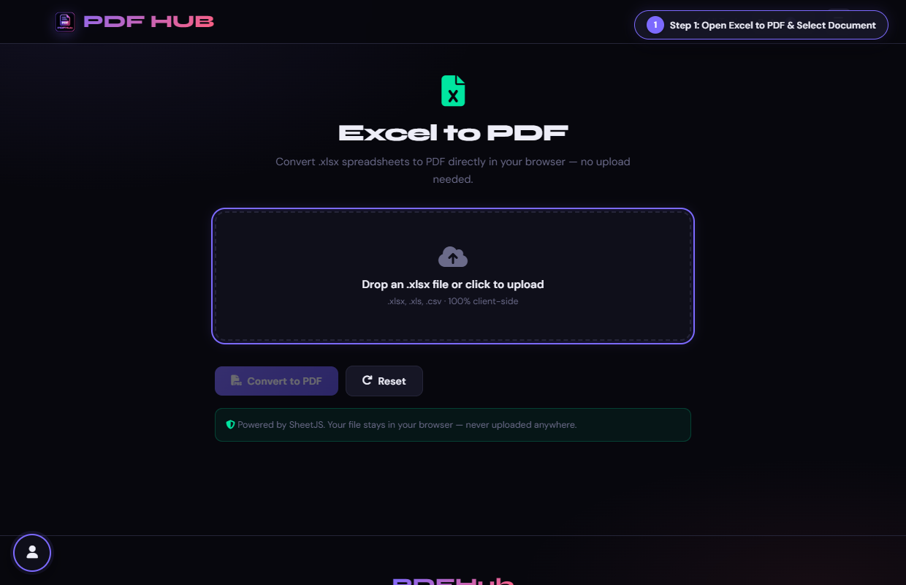
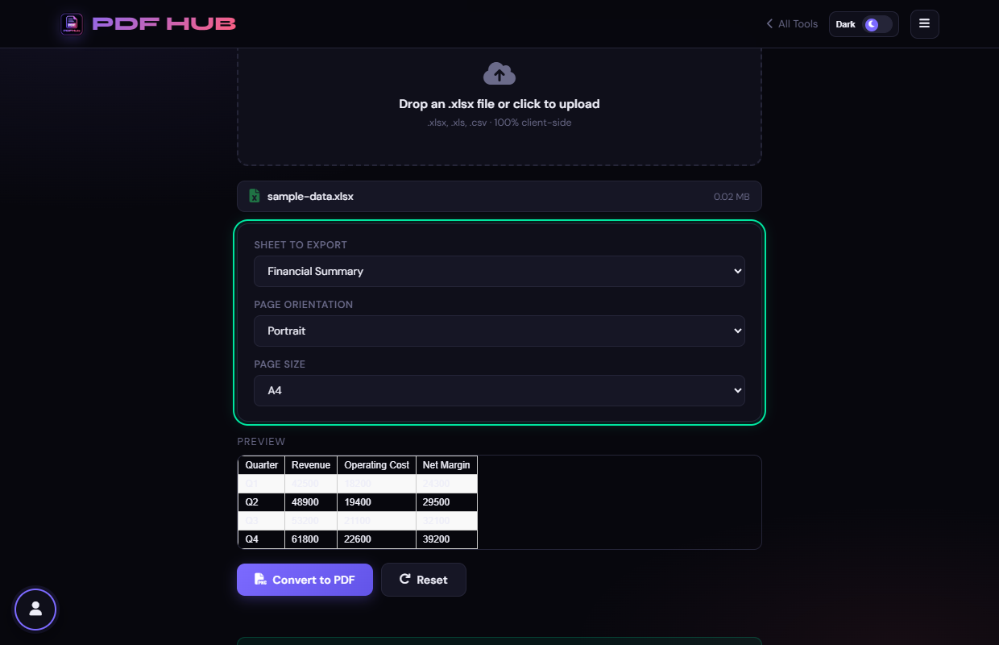
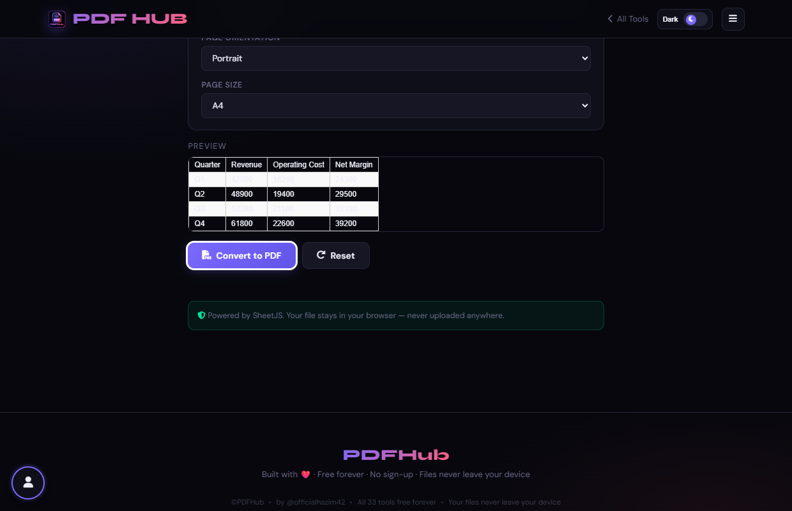

# Excel to PDF — Technical Tool Documentation

> **Summary:** Turn a selected workbook sheet into a printable PDF using the browser print dialog.  
> **Tool Route:** `/tools/excel-to-pdf.html`  
> **Visual Guide Route:** `/guides/excel-to-pdf/`  
> **Category:** Convert to PDF  
> **Processing Architecture:** 100% Client-Side. SheetJS runs entirely in browser memory.

---

## 1. What the Tool Does
Excel to PDF reads a workbook with SheetJS, lets you choose a sheet, orientation, and page size, then opens a styled print view.

**Requirements & Constraints:** The page accepts .xlsx, .xls, and .csv files. A browser print dialog is required to save the PDF.

---

## 2. When to Use It
Use **Excel to PDF** whenever you need to perform client-side convert to pdf operations without uploading confidential records to third-party cloud servers. 

**Ideal Scenarios:**
- Working on personal identity records, banking statements, medical filings, or NDAs requiring 100% local confidentiality.
- Fast offline or low-bandwidth processing directly in your web browser.
- Universal cross-platform document operations on Windows, macOS, Linux, Android, or iOS.

---

## 3. Key Implemented Features
- **Engine Architecture:** `SheetJS (xlsx.full.min.js) + Browser Print Engine`
- **Zero Server Uploads:** Processing executes directly within client browser memory.
- **Instant Processing:** Fast execution powered by WebAssembly and native HTML5 APIs.
- **Review Previews:** Visual feedback and progress indicators confirm results prior to saving.
- **No Sign-up / No Watermarks:** Full functionality with zero paywalls or forced branding.

---

## 4. Supported Input Files
- **Primary Input:** Microsoft Excel spreadsheet (.xlsx, .xls, .csv)
- **Validation:** Files are validated in the browser prior to parsing.

---

## 5. Supported Output Files
- **Output Format:** Formatted print view triggering browser "Save as PDF" destination
- **MIME Types:** `application/pdf` (or appropriate image/text/zip formats).

---

## 6. File Size & Memory Limits
- **Recommended Bounds:** Client RAM bound (~50 MB)
- **Technical Context:** Modern browser tabs enforce memory quotas (typically 1.5 GB to 2 GB per tab). PDFHub handles documents comfortably within standard browser memory limits. For files exceeding 150 MB or 1,000 pages, splitting into smaller sections is recommended.

---

## 7. Step-by-Step Instructions
1. **Choose an XLSX, XLS, or CSV file.**
2. **Select the sheet to export and review the table preview.**
3. **Choose portrait or landscape and A4 or Letter.**
4. **Select Convert to PDF, then choose Save as PDF in the print dialog.**

---

## 8. Required User Inputs & Controls
- **File Upload Area (`#drop` / `#fin`):** Click to open native file browser or drag and drop supported files.
- **Tool Options (`#opts`):** Dynamic settings panel configuring parameters, page ranges, or compression levels.
- **Execution Button (`Convert to PDF (#goBtn)`):** Triggers client-side processing pipeline.
- **Reset Button:** Clears loaded files and resets workspace to pristine state.

---

## 9. Processing Behavior & Execution Pipeline
Parses spreadsheet workbooks using SheetJS, renders chosen sheet as an HTML table with styled borders, applies orientation (Portrait/Landscape) and page size, and triggers native browser print to PDF.

---

## 10. Expected Output & Download Verification
- Upon successful execution, the interface triggers an automated browser download via `downloadBlob()` or opens a result review modal.
- Users can verify file size, page count, and visual rendering before finalizing the download.

---

## 11. Practical Example Use Case
Converting financial balance sheets, monthly budget spreadsheets, or employee rosters into clean PDF documents.

---

## 12. Common Errors & Troubleshooting
- **Issue:** If the workbook will not load, verify its extension and try opening it in a spreadsheet app first.
- **Issue:** If columns are clipped, choose landscape or adjust the source sheet.
- **Avoid:** Closing the print dialog without saving.
- **Avoid:** Expecting formulas or workbook formatting to behave exactly like desktop Excel.
- **Tip:** Very wide spreadsheets getting cut off horizontally. Solution: Choose Landscape orientation and select A4 or Letter.

---

## 13. Privacy & Data Handling Architecture
- **Local Processing:** 100% Client-Side. SheetJS runs entirely in browser memory.
- **Browser Memory:** Document bytes reside temporarily in `ArrayBuffer` memory and are garbage collected when the browser tab is refreshed or closed.
- **Cookies & Telemetry:** PDFHub sets zero tracking cookies, zero analytics beacons, and stores zero personal document data.

---

## 14. Frequently Asked Questions (FAQ)
#### Q: Does this export every sheet?
**A:** No. Select one sheet at a time.

#### Q: Where is the file saved?
**A:** Your browser print dialog controls the destination.

---

## 15. Related PDFHub Tools
- [Word to PDF Documentation](word-to-pdf.md)
- [JPG to PDF Documentation](jpg-to-pdf.md)
- [HTML to PDF Documentation](html-to-pdf.md)

---

## 16. Links & Resources
- **Launch Live Tool:** [Open Excel to PDF in PDFHub](../../tools/excel-to-pdf.html)
- **Visual Tutorial:** [View Excel to PDF Visual Guide](../../guides/excel-to-pdf/)
- **All Tools Master Reference:** [All Tools Reference](../all-tools-reference.md)
- **Master Documentation Index:** [Documentation Index](../documentation-index.md)

---

## 17. Visual Walkthrough & Interface Screenshots

### Step 1: Open Excel to PDF
- **Interface Control:** `Upload Drop Zone (#drop)`
- **What You See:** The upload drop zone accepts .xlsx, .xls, and .csv spreadsheet formats.
- **What to Do:** Open Excel to PDF to transform spreadsheets and workbooks into clean, printable reports.
- **Practical Pro-Tip:** Converting spreadsheets to PDF locks numbers and formatting so data cannot be accidentally edited.

### Step 2: Upload Workbook
- **Interface Control:** `File Browser (#fin)`
- **What You See:** The workbook loads and detected worksheet tabs appear in the sheet selector.
- **What to Do:** Select your spreadsheet file from your computer.
- **Practical Pro-Tip:** Multi-sheet workbooks can have individual worksheets selected for export.

### Step 3: Select Worksheet
- **Interface Control:** `Sheet Selector (#sheetSel)`
- **What You See:** The dropdown updates to focus the tabular renderer on your chosen worksheet.
- **What to Do:** Choose the target sheet tab from the dropdown list.
- **Practical Pro-Tip:** Make sure your chosen sheet contains the final data tables you wish to print.

### Step 4: Set Orientation to Landscape
- **Interface Control:** `Orientation Selector (#orient, #psize)`
- **What You See:** Page width expands to fit financial ledgers and multi-column tables cleanly.
- **What to Do:** Select "Landscape" orientation to accommodate wide table columns without truncation.
- **Practical Pro-Tip:** Landscape mode prevents wide tables from having columns cut off at the right edge.

### Step 5: Click Convert to PDF
- **Interface Control:** `Convert Action Button (#goBtn)`
- **What You See:** Spreadsheet rows and columns are formatted into paginated vector table cells.
- **What to Do:** Click the primary "Convert to PDF" button.
- **Practical Pro-Tip:** Calculated formula values are rendered exactly as evaluated in the workbook.

### Step 6: Inspect Tabular Layout
- **Interface Control:** `Preview Section (#generatedPreview)`
- **What You See:** The table renders with borders, headers, and clean numeric formatting.
- **What to Do:** Inspect the paginated table layout in the review preview viewer.
- **Practical Pro-Tip:** Verify that all columns fit comfortably within the page margins.

### Step 7: Download Spreadsheet PDF
- **Interface Control:** `Download Dialog (#dlModal .btn-success)`
- **What You See:** The download modal confirms your formatted document is ready.
- **What to Do:** Click "Download" to save your clean PDF spreadsheet report.
- **Practical Pro-Tip:** Your spreadsheet report is now ready for formal distribution and executive reviews.

