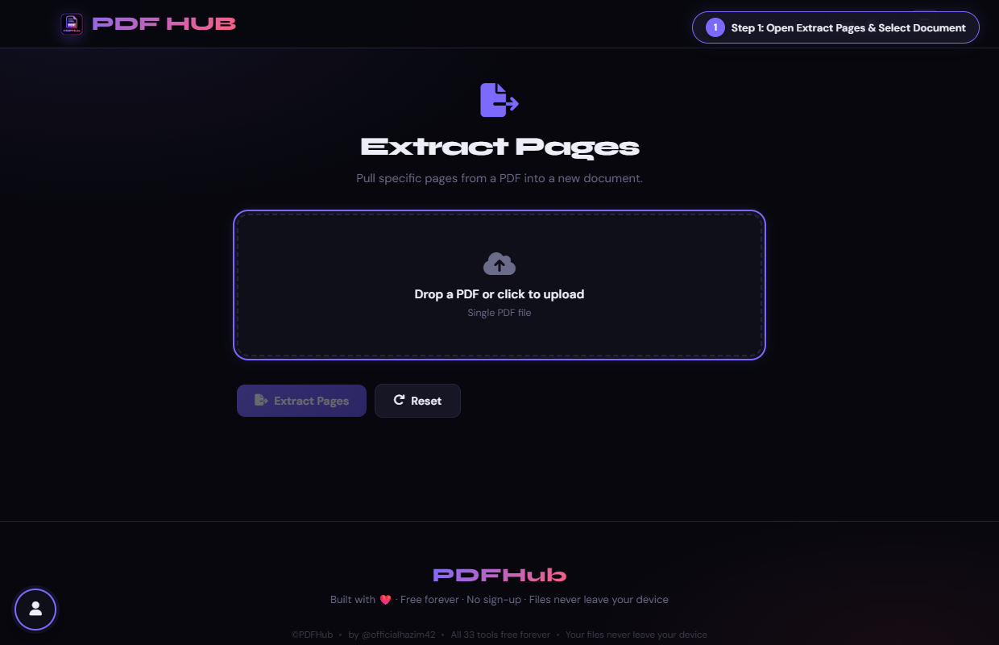
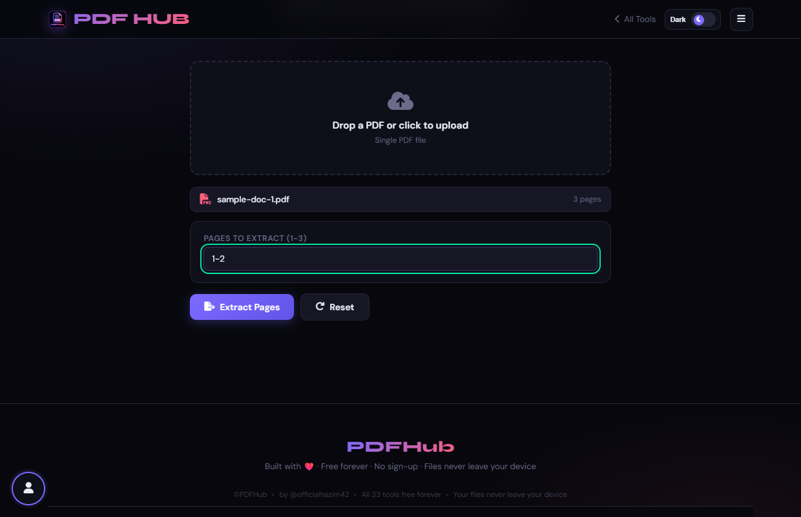
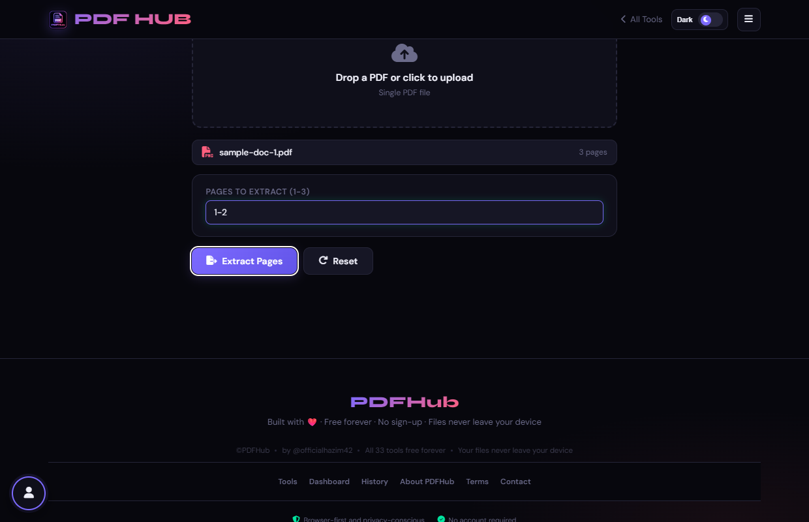
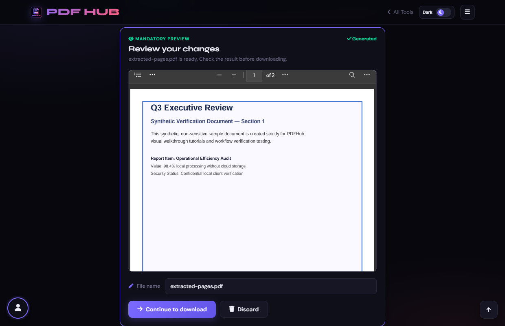

# Extract Pages — Technical Tool Documentation

> **Summary:** Copy selected page numbers or ranges into a new PDF.  
> **Tool Route:** `/tools/extract-pages.html`  
> **Visual Guide Route:** `/guides/extract-pages/`  
> **Category:** Organize PDF  
> **Processing Architecture:** 100% Client-Side. Zero server uploads.

---

## 1. What the Tool Does
Extract Pages copies the page numbers you specify into a new PDF while preserving their sorted order.

**Requirements & Constraints:** One readable PDF is required. Enter page numbers or ranges such as 1-3, 5, 8-10.

---

## 2. When to Use It
Use **Extract Pages** whenever you need to perform client-side organize pdf operations without uploading confidential records to third-party cloud servers. 

**Ideal Scenarios:**
- Working on personal identity records, banking statements, medical filings, or NDAs requiring 100% local confidentiality.
- Fast offline or low-bandwidth processing directly in your web browser.
- Universal cross-platform document operations on Windows, macOS, Linux, Android, or iOS.

---

## 3. Key Implemented Features
- **Engine Architecture:** `pdf-lib (PDFDocument.create, copyPages, addPage)`
- **Zero Server Uploads:** Processing executes directly within client browser memory.
- **Instant Processing:** Fast execution powered by WebAssembly and native HTML5 APIs.
- **Review Previews:** Visual feedback and progress indicators confirm results prior to saving.
- **No Sign-up / No Watermarks:** Full functionality with zero paywalls or forced branding.

---

## 4. Supported Input Files
- **Primary Input:** Single PDF document (.pdf)
- **Validation:** Files are validated in the browser prior to parsing.

---

## 5. Supported Output Files
- **Output Format:** Isolated PDF document (extracted-pages.pdf)
- **MIME Types:** `application/pdf` (or appropriate image/text/zip formats).

---

## 6. File Size & Memory Limits
- **Recommended Bounds:** Client RAM bound (~100 MB recommended)
- **Technical Context:** Modern browser tabs enforce memory quotas (typically 1.5 GB to 2 GB per tab). PDFHub handles documents comfortably within standard browser memory limits. For files exceeding 150 MB or 1,000 pages, splitting into smaller sections is recommended.

---

## 7. Step-by-Step Instructions
1. **Upload a PDF and note the page count shown.**
2. **Enter the pages or ranges you want to keep.**
3. **Select Extract Pages.**
4. **Open the generated PDF and confirm the selected pages.**

---

## 8. Required User Inputs & Controls
- **File Upload Area (`#drop` / `#fin`):** Click to open native file browser or drag and drop supported files.
- **Tool Options (`#opts`):** Dynamic settings panel configuring parameters, page ranges, or compression levels.
- **Execution Button (`Extract Pages (#goBtn)`):** Triggers client-side processing pipeline.
- **Reset Button:** Clears loaded files and resets workspace to pristine state.

---

## 9. Processing Behavior & Execution Pipeline
Reads source PDF, maps comma-separated target page numbers, initializes a target PDFDocument, copies only the requested page indices, and outputs a clean standalone PDF.

---

## 10. Expected Output & Download Verification
- Upon successful execution, the interface triggers an automated browser download via `downloadBlob()` or opens a result review modal.
- Users can verify file size, page count, and visual rendering before finalizing the download.

---

## 11. Practical Example Use Case
Extracting just the signature page and contract addendum from a long legal mortgage document.

---

## 12. Common Errors & Troubleshooting
- **Issue:** If no pages are extracted, use valid numbers within the displayed range.
- **Issue:** If parsing fails, try a fresh readable PDF.
- **Avoid:** Entering zero-based page numbers; the interface uses page 1 as the first page.
- **Avoid:** Assuming excluded pages remain in the output.
- **Tip:** Leaving the page input field empty. Solution: Provide page numbers or ranges (e.g. 1-3, 5).
- **Tip:** Targeting non-numeric characters. Solution: Use digits, hyphens, and commas only.

---

## 13. Privacy & Data Handling Architecture
- **Local Processing:** 100% Client-Side. Zero server uploads.
- **Browser Memory:** Document bytes reside temporarily in `ArrayBuffer` memory and are garbage collected when the browser tab is refreshed or closed.
- **Cookies & Telemetry:** PDFHub sets zero tracking cookies, zero analytics beacons, and stores zero personal document data.

---

## 14. Frequently Asked Questions (FAQ)
#### Q: Can I preserve page order?
**A:** Yes, selected pages are written in ascending order.

#### Q: Does extraction modify the original?
**A:** No.

---

## 15. Related PDFHub Tools
- [Split PDF Documentation](split-pdf.md)
- [Remove Pages Documentation](remove-pages.md)
- [Organize PDF Documentation](organize-pdf.md)

---

## 16. Links & Resources
- **Launch Live Tool:** [Open Extract Pages in PDFHub](../../tools/extract-pages.html)
- **Visual Tutorial:** [View Extract Pages Visual Guide](../../guides/extract-pages/)
- **All Tools Master Reference:** [All Tools Reference](../all-tools-reference.md)
- **Master Documentation Index:** [Documentation Index](../documentation-index.md)

---

## 17. Visual Walkthrough & Interface Screenshots

### Step 1: Open Extract Pages
- **Interface Control:** `Drop Area (#drop)`
- **What You See:** The upload drop area is ready to accept your multi-page PDF.
- **What to Do:** Open Extract Pages to pull out specific chapters, forms, or sections into a new PDF.
- **Practical Pro-Tip:** Extraction creates a new independent PDF without modifying the original file.

### Step 2: Upload Source Document
- **Interface Control:** `File Browser (#fin)`
- **What You See:** The document is loaded and its total page count is displayed.
- **What to Do:** Choose the PDF from which you want to extract specific sheets.
- **Practical Pro-Tip:** You can extract single individual pages or continuous multi-page ranges.

### Step 3: Inspect Source Details
- **Interface Control:** `Document Badge (#finfo)`
- **What You See:** The file badge shows document details, confirming readiness for extraction.
- **What to Do:** Verify the document name and available page count.
- **Practical Pro-Tip:** Ensure your target page numbers fall within the total count.

### Step 4: Specify Pages to Extract
- **Interface Control:** `Pages Input (#pages)`
- **What You See:** The input registers your target pages for isolation.
- **What to Do:** Type the exact page numbers or ranges to keep (e.g. "1-2" or "3, 5").
- **Practical Pro-Tip:** Use hyphens for continuous ranges like "1-3" and commas for separated pages like "1, 4".

### Step 5: Click Extract Pages
- **Interface Control:** `Action Button (#goBtn)`
- **What You See:** The client-side engine copies the selected pages into a fresh document container.
- **What to Do:** Click the "Extract Pages" action button.
- **Practical Pro-Tip:** Extraction preserves all vector text, fonts, images, and links on the chosen pages.

### Step 6: Review Extracted Pages
- **Interface Control:** `Review Preview (#generatedPreview)`
- **What You See:** The preview displays only the pages you specified, in exact sequence.
- **What to Do:** Verify the extracted pages inside the review preview frame.
- **Practical Pro-Tip:** Check that all required diagrams and text sections were captured.

### Step 7: Download Extracted PDF
- **Interface Control:** `Download Modal (#dlModal .btn-success)`
- **What You See:** The download modal provides the final file size and instant save button.
- **What to Do:** Click the green "Download" button to save the new PDF.
- **Practical Pro-Tip:** The newly created PDF is ready for sharing or filing.

