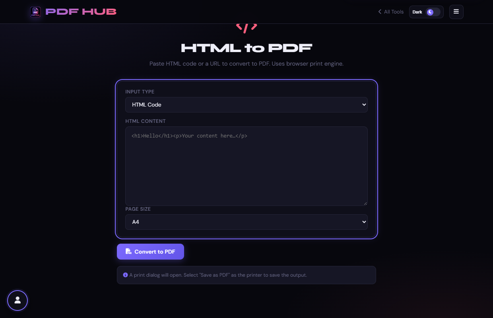
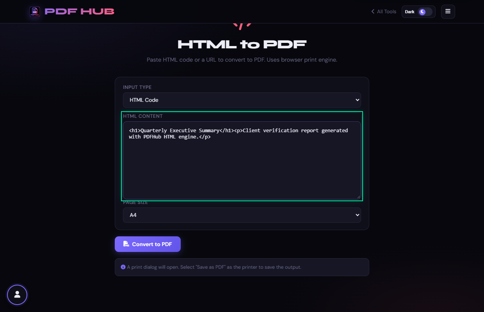
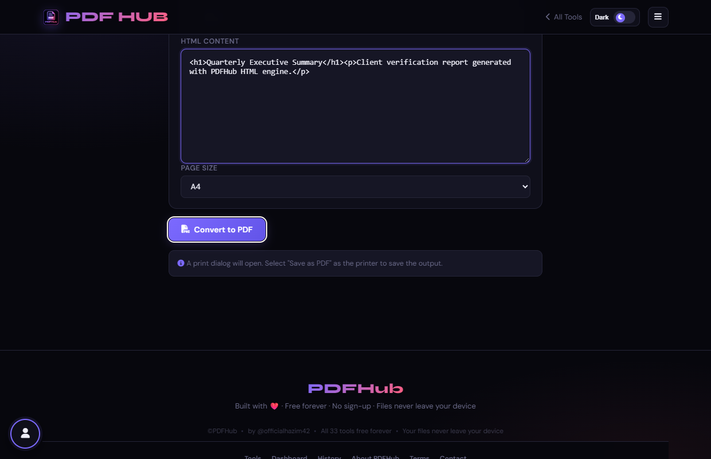

# HTML to PDF — Technical Tool Documentation

> **Summary:** Print pasted HTML or an opened URL to a PDF from the browser.  
> **Tool Route:** `/tools/html-to-pdf.html`  
> **Visual Guide Route:** `/guides/html-to-pdf/`  
> **Category:** Convert to PDF  
> **Processing Architecture:** 100% Client-Side for HTML markup. URL mode opens public target in new tab.

---

## 1. What the Tool Does
HTML to PDF supports pasted markup and URL mode. It opens a print-ready page or the requested URL and relies on the browser print engine.

**Requirements & Constraints:** URL mode requires network access to the website. Saving the result requires a browser print dialog.

---

## 2. When to Use It
Use **HTML to PDF** whenever you need to perform client-side convert to pdf operations without uploading confidential records to third-party cloud servers. 

**Ideal Scenarios:**
- Working on personal identity records, banking statements, medical filings, or NDAs requiring 100% local confidentiality.
- Fast offline or low-bandwidth processing directly in your web browser.
- Universal cross-platform document operations on Windows, macOS, Linux, Android, or iOS.

---

## 3. Key Implemented Features
- **Engine Architecture:** `Native Browser Print Engine (window.print)`
- **Zero Server Uploads:** Processing executes directly within client browser memory.
- **Instant Processing:** Fast execution powered by WebAssembly and native HTML5 APIs.
- **Review Previews:** Visual feedback and progress indicators confirm results prior to saving.
- **No Sign-up / No Watermarks:** Full functionality with zero paywalls or forced branding.

---

## 4. Supported Input Files
- **Primary Input:** HTML markup string or website URL
- **Validation:** Files are validated in the browser prior to parsing.

---

## 5. Supported Output Files
- **Output Format:** PDF document printed via native browser engine
- **MIME Types:** `application/pdf` (or appropriate image/text/zip formats).

---

## 6. File Size & Memory Limits
- **Recommended Bounds:** Client RAM bound
- **Technical Context:** Modern browser tabs enforce memory quotas (typically 1.5 GB to 2 GB per tab). PDFHub handles documents comfortably within standard browser memory limits. For files exceeding 150 MB or 1,000 pages, splitting into smaller sections is recommended.

---

## 7. Step-by-Step Instructions
1. **Choose HTML Code or URL.**
2. **Paste HTML or enter a complete website URL.**
3. **Choose A4 or Letter when using HTML code.**
4. **Select Convert to PDF and choose Save as PDF in the print dialog.**

---

## 8. Required User Inputs & Controls
- **File Upload Area (`#drop` / `#fin`):** Click to open native file browser or drag and drop supported files.
- **Tool Options (`#opts`):** Dynamic settings panel configuring parameters, page ranges, or compression levels.
- **Execution Button (`Convert to PDF (#goBtn)`):** Triggers client-side processing pipeline.
- **Reset Button:** Clears loaded files and resets workspace to pristine state.

---

## 9. Processing Behavior & Execution Pipeline
Creates an isolated print document containing user HTML markup and print stylesheets, sets page size (A4, Letter), and triggers window.print(). In URL mode, opens target URL in new tab.

---

## 10. Expected Output & Download Verification
- Upon successful execution, the interface triggers an automated browser download via `downloadBlob()` or opens a result review modal.
- Users can verify file size, page count, and visual rendering before finalizing the download.

---

## 11. Practical Example Use Case
Converting an HTML invoice template, receipt code, or article into a formatted PDF.

---

## 12. Common Errors & Troubleshooting
- **Issue:** If a URL does not open, verify the address and your network connection.
- **Issue:** If images are missing, ensure their URLs are reachable and allowed by the site.
- **Avoid:** Expecting URL mode to bypass a site login or cross-origin restrictions.
- **Avoid:** Closing the print tab before the browser finishes rendering.
- **Tip:** External stylesheets or images in raw HTML failing due to CORS when printed. Solution: Use inline CSS or base64 images.

---

## 13. Privacy & Data Handling Architecture
- **Local Processing:** 100% Client-Side for HTML markup. URL mode opens public target in new tab.
- **Browser Memory:** Document bytes reside temporarily in `ArrayBuffer` memory and are garbage collected when the browser tab is refreshed or closed.
- **Cookies & Telemetry:** PDFHub sets zero tracking cookies, zero analytics beacons, and stores zero personal document data.

---

## 14. Frequently Asked Questions (FAQ)
#### Q: Does this create a file automatically?
**A:** The browser print dialog handles saving.

#### Q: Can I paste arbitrary HTML?
**A:** Yes, but external resources may not load.

---

## 15. Related PDFHub Tools
- [Word to PDF Documentation](word-to-pdf.md)
- [Excel to PDF Documentation](excel-to-pdf.md)
- [JPG to PDF Documentation](jpg-to-pdf.md)

---

## 16. Links & Resources
- **Launch Live Tool:** [Open HTML to PDF in PDFHub](../../tools/html-to-pdf.html)
- **Visual Tutorial:** [View HTML to PDF Visual Guide](../../guides/html-to-pdf/)
- **All Tools Master Reference:** [All Tools Reference](../all-tools-reference.md)
- **Master Documentation Index:** [Documentation Index](../documentation-index.md)

---

## 17. Visual Walkthrough & Interface Screenshots

### Step 1: Open HTML to PDF
- **Interface Control:** `Tool Header & Options (#inputType)`
- **What You See:** The tool provides a mode toggle between "Raw HTML Code" and "Website URL".
- **What to Do:** Open HTML to PDF to render raw HTML code or public web URLs into documents.
- **Practical Pro-Tip:** Raw HTML mode is ideal for rendering invoices, receipts, and custom reports.

### Step 2: Select Input Mode
- **Interface Control:** `Source Toggle (#inputType)`
- **What You See:** The input area updates to show either a multiline code textarea or a URL text field.
- **What to Do:** Select "HTML Code" to type or paste markup, or "URL" to input a web address.
- **Practical Pro-Tip:** HTML Code mode supports standard CSS styles and embedded images.

### Step 3: Enter HTML Markup
- **Interface Control:** `Code Editor (#htmlInput, #htmlArea)`
- **What You See:** The editor registers your HTML code with line wrapping and syntax awareness.
- **What to Do:** Paste your HTML markup including tags, styling, and content into the text area.
- **Practical Pro-Tip:** You can use inline CSS like font-family and colors to style your output beautifully.

### Step 4: Configure Paper Dimensions
- **Interface Control:** `Page Size Selector (#psize)`
- **What You See:** The rendering engine configures page break targets and viewport width to match.
- **What to Do:** Select your target output paper format (A4 or US Letter).
- **Practical Pro-Tip:** Using standard A4 sizing ensures consistent layout across physical printers.

### Step 5: Click Convert to PDF
- **Interface Control:** `Convert Action Button (#goBtn)`
- **What You See:** The browser layout engine renders the HTML DOM and captures it into vector PDF pages.
- **What to Do:** Click the primary "Convert to PDF" button.
- **Practical Pro-Tip:** Client-side rendering accurately reflects modern CSS typography and flexbox layouts.

### Step 6: Review Rendered Layout
- **Interface Control:** `Preview Section (#generatedPreview)`
- **What You See:** Headings, tables, and styled text appear formatted exactly as defined in the HTML.
- **What to Do:** Inspect the rendered web document in the review preview viewer.
- **Practical Pro-Tip:** Ensure that no text overflowing occurs across page boundaries.

### Step 7: Download Generated PDF
- **Interface Control:** `Download Dialog (#dlModal .btn-success)`
- **What You See:** The download modal confirms that the web document has been compiled successfully.
- **What to Do:** Click the green "Download" button to save your PDF.
- **Practical Pro-Tip:** Your web-generated PDF is clean, searchable, and ready for publication.

