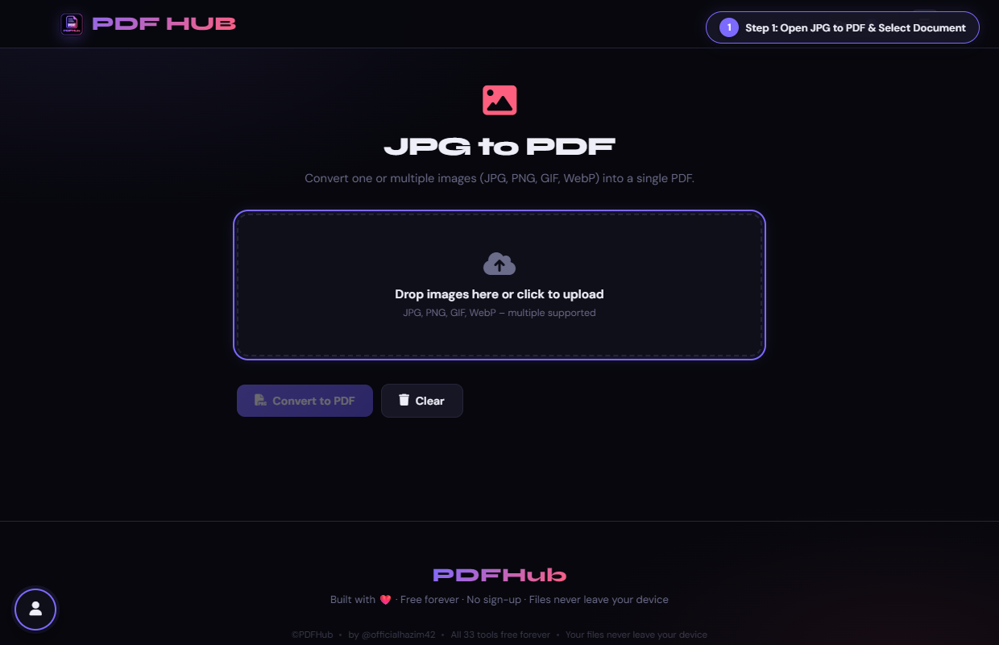
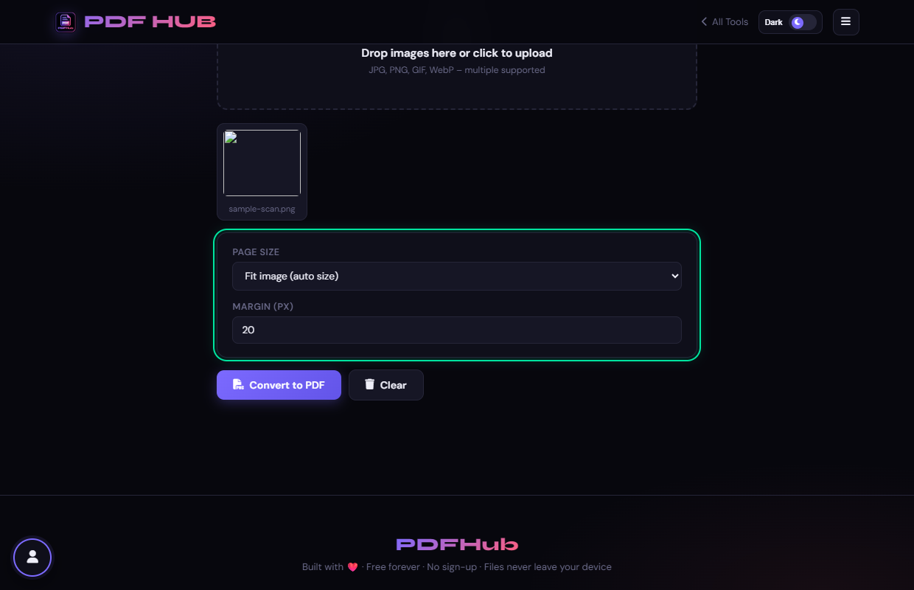
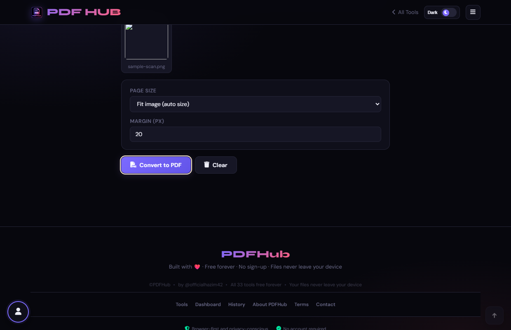

# JPG to PDF — Technical Tool Documentation

> **Summary:** Combine JPG, PNG, GIF, or WebP images into a single PDF.  
> **Tool Route:** `/tools/jpg-to-pdf.html`  
> **Visual Guide Route:** `/guides/jpg-to-pdf/`  
> **Category:** Convert to PDF  
> **Processing Architecture:** 100% Client-Side. Processed in local browser memory.

---

## 1. What the Tool Does
JPG to PDF embeds selected images as PDF pages, with fit, A4, or Letter sizing and a configurable margin.

**Requirements & Constraints:** The page accepts image files supported by the browser and allows multiple selection. Images are processed locally.

---

## 2. When to Use It
Use **JPG to PDF** whenever you need to perform client-side convert to pdf operations without uploading confidential records to third-party cloud servers. 

**Ideal Scenarios:**
- Working on personal identity records, banking statements, medical filings, or NDAs requiring 100% local confidentiality.
- Fast offline or low-bandwidth processing directly in your web browser.
- Universal cross-platform document operations on Windows, macOS, Linux, Android, or iOS.

---

## 3. Key Implemented Features
- **Engine Architecture:** `pdf-lib (embedJpg, embedPng)`
- **Zero Server Uploads:** Processing executes directly within client browser memory.
- **Instant Processing:** Fast execution powered by WebAssembly and native HTML5 APIs.
- **Review Previews:** Visual feedback and progress indicators confirm results prior to saving.
- **No Sign-up / No Watermarks:** Full functionality with zero paywalls or forced branding.

---

## 4. Supported Input Files
- **Primary Input:** One or more JPG, JPEG, PNG, or WebP images
- **Validation:** Files are validated in the browser prior to parsing.

---

## 5. Supported Output Files
- **Output Format:** Combined PDF document (images.pdf)
- **MIME Types:** `application/pdf` (or appropriate image/text/zip formats).

---

## 6. File Size & Memory Limits
- **Recommended Bounds:** Client RAM bound
- **Technical Context:** Modern browser tabs enforce memory quotas (typically 1.5 GB to 2 GB per tab). PDFHub handles documents comfortably within standard browser memory limits. For files exceeding 150 MB or 1,000 pages, splitting into smaller sections is recommended.

---

## 7. Step-by-Step Instructions
1. **Select or drop one or more images.**
2. **Review the image preview grid and remove unwanted images.**
3. **Choose Fit image, A4, or Letter and set the margin.**
4. **Select Convert to PDF and review the page order.**

---

## 8. Required User Inputs & Controls
- **File Upload Area (`#drop` / `#fin`):** Click to open native file browser or drag and drop supported files.
- **Tool Options (`#opts`):** Dynamic settings panel configuring parameters, page ranges, or compression levels.
- **Execution Button (`Convert to PDF (#goBtn)`):** Triggers client-side processing pipeline.
- **Reset Button:** Clears loaded files and resets workspace to pristine state.

---

## 9. Processing Behavior & Execution Pipeline
Reads image ArrayBuffers, determines dimensions, creates PDF pages according to chosen page size (Fit to image, A4, Letter), scales image to fit margins, embeds binary pixel streams, and saves PDF.

---

## 10. Expected Output & Download Verification
- Upon successful execution, the interface triggers an automated browser download via `downloadBlob()` or opens a result review modal.
- Users can verify file size, page count, and visual rendering before finalizing the download.

---

## 11. Practical Example Use Case
Bundling smartphone photos of IDs, driver licenses, or expense receipts into a single professional PDF document.

---

## 12. Common Errors & Troubleshooting
- **Issue:** If an image is not embedded, try PNG or JPG and confirm the browser can display it.
- **Issue:** If pages are clipped, choose Fit image or reduce the margin.
- **Avoid:** Uploading a non-image file.
- **Avoid:** Assuming the preview order will sort itself; check it before export.
- **Tip:** Attempting to upload unsupported formats like TIFF or BMP. Solution: Save or export images to JPG or PNG first.

---

## 13. Privacy & Data Handling Architecture
- **Local Processing:** 100% Client-Side. Processed in local browser memory.
- **Browser Memory:** Document bytes reside temporarily in `ArrayBuffer` memory and are garbage collected when the browser tab is refreshed or closed.
- **Cookies & Telemetry:** PDFHub sets zero tracking cookies, zero analytics beacons, and stores zero personal document data.

---

## 14. Frequently Asked Questions (FAQ)
#### Q: Can I create a multi-page PDF?
**A:** Yes, each selected image becomes a page.

#### Q: Does it accept WebP?
**A:** The interface advertises browser-supported image types including WebP.

---

## 15. Related PDFHub Tools
- [Scan to PDF Documentation](scan-to-pdf.md)
- [PDF to JPG Documentation](pdf-to-jpg.md)
- [Merge PDF Documentation](merge-pdf.md)

---

## 16. Links & Resources
- **Launch Live Tool:** [Open JPG to PDF in PDFHub](../../tools/jpg-to-pdf.html)
- **Visual Tutorial:** [View JPG to PDF Visual Guide](../../guides/jpg-to-pdf/)
- **All Tools Master Reference:** [All Tools Reference](../all-tools-reference.md)
- **Master Documentation Index:** [Documentation Index](../documentation-index.md)

---

## 17. Visual Walkthrough & Interface Screenshots

### Step 1: Open JPG to PDF
- **Interface Control:** `Upload Drop Zone (#drop)`
- **What You See:** The upload drop area accepts JPG, PNG, and WebP image formats.
- **What to Do:** Open JPG to PDF to compile photos, receipts, or diagrams into a clean PDF.
- **Practical Pro-Tip:** You can select multiple photos simultaneously to create a multi-page PDF.

### Step 2: Select Image Files
- **Interface Control:** `File Picker (#fin)`
- **What You See:** The images load into the workspace and render in a visual queue.
- **What to Do:** Select your photo files from your computer or phone.
- **Practical Pro-Tip:** Images are placed onto consecutive pages in the order they appear.

### Step 3: Review Image Queue
- **Interface Control:** `Image List (#flist)`
- **What You See:** Each image entry displays its name, dimensions, and file size.
- **What to Do:** Check that all intended image files are present and properly ordered.
- **Practical Pro-Tip:** If an extra image was selected, click its removal icon to take it out.

### Step 4: Configure Page Size & Margins
- **Interface Control:** `Layout Controls (#psize, #margin)`
- **What You See:** Page geometry options adjust how images are centered and framed on each page.
- **What to Do:** Select your desired paper standard (A4, US Letter, or Fit to Image) and margin spacing.
- **Practical Pro-Tip:** Adding a small margin (e.g. 20pt) provides a clean border suitable for printing.

### Step 5: Click Convert to PDF
- **Interface Control:** `Convert Action Button (#goBtn)`
- **What You See:** The browser embeds the image assets into vector PDF page streams.
- **What to Do:** Click the primary "Convert to PDF" button.
- **Practical Pro-Tip:** High-DPI resolution is preserved to keep photos sharp when printed.

### Step 6: Review Generated Document
- **Interface Control:** `Preview Section (#generatedPreview)`
- **What You See:** The preview displays each photo cleanly centered on its designated page.
- **What to Do:** Inspect the multi-page PDF layout inside the preview frame.
- **Practical Pro-Tip:** Check that orientation is correct on all pages before saving.

### Step 7: Download Compiled PDF
- **Interface Control:** `Download Dialog (#dlModal .btn-success)`
- **What You See:** The download modal confirms the final document is compiled and ready.
- **What to Do:** Click the green "Download" button to save your PDF album.
- **Practical Pro-Tip:** Your single PDF file now neatly bundles all your uploaded photos.

