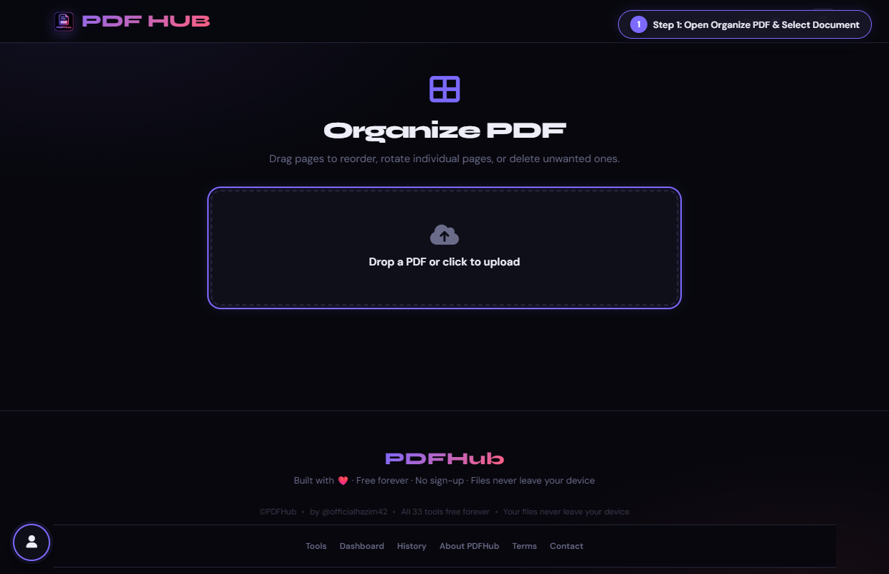
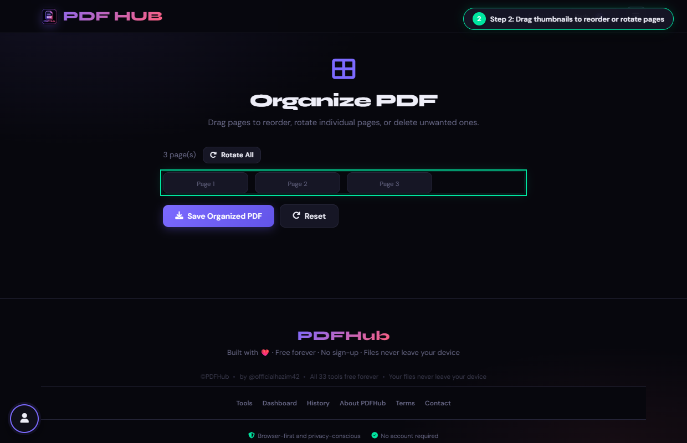
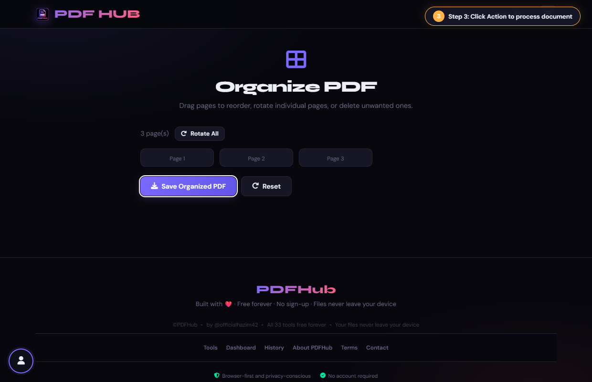
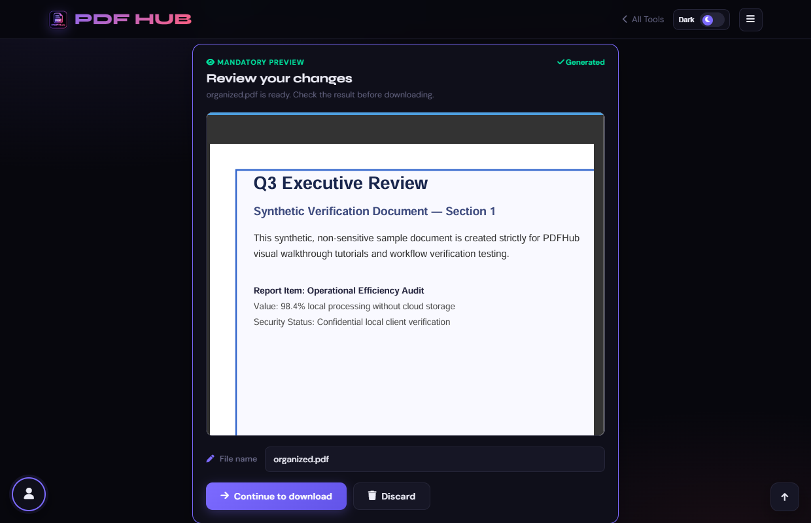

# Organize PDF — Technical Tool Documentation

> **Summary:** Reorder, rotate, and delete PDF pages using thumbnails.  
> **Tool Route:** `/tools/organize.html`  
> **Visual Guide Route:** `/guides/organize-pdf/`  
> **Category:** Organize PDF  
> **Processing Architecture:** 100% Client-Side. Zero server uploads.

---

## 1. What the Tool Does
Organize PDF renders page thumbnails so you can drag pages into a new order, rotate individual pages, delete pages, or rotate all pages.

**Requirements & Constraints:** One readable PDF is required. Page previews use browser memory and may be slower for large documents.

---

## 2. When to Use It
Use **Organize PDF** whenever you need to perform client-side organize pdf operations without uploading confidential records to third-party cloud servers. 

**Ideal Scenarios:**
- Working on personal identity records, banking statements, medical filings, or NDAs requiring 100% local confidentiality.
- Fast offline or low-bandwidth processing directly in your web browser.
- Universal cross-platform document operations on Windows, macOS, Linux, Android, or iOS.

---

## 3. Key Implemented Features
- **Engine Architecture:** `pdf.js (thumbnail rendering) + pdf-lib (page reordering)`
- **Zero Server Uploads:** Processing executes directly within client browser memory.
- **Instant Processing:** Fast execution powered by WebAssembly and native HTML5 APIs.
- **Review Previews:** Visual feedback and progress indicators confirm results prior to saving.
- **No Sign-up / No Watermarks:** Full functionality with zero paywalls or forced branding.

---

## 4. Supported Input Files
- **Primary Input:** Single PDF document (.pdf)
- **Validation:** Files are validated in the browser prior to parsing.

---

## 5. Supported Output Files
- **Output Format:** Reordered and rotated PDF document (organized.pdf)
- **MIME Types:** `application/pdf` (or appropriate image/text/zip formats).

---

## 6. File Size & Memory Limits
- **Recommended Bounds:** Client RAM bound (documents up to 80 pages recommended for smooth drag-and-drop)
- **Technical Context:** Modern browser tabs enforce memory quotas (typically 1.5 GB to 2 GB per tab). PDFHub handles documents comfortably within standard browser memory limits. For files exceeding 150 MB or 1,000 pages, splitting into smaller sections is recommended.

---

## 7. Step-by-Step Instructions
1. **Upload a PDF and wait for the thumbnail grid.**
2. **Drag thumbnails to change their order.**
3. **Use the rotate or delete controls on individual pages, or Rotate All.**
4. **Select Save Organized PDF and verify the page sequence.**

---

## 8. Required User Inputs & Controls
- **File Upload Area (`#drop` / `#fin`):** Click to open native file browser or drag and drop supported files.
- **Tool Options (`#opts`):** Dynamic settings panel configuring parameters, page ranges, or compression levels.
- **Execution Button (`Save PDF (#goBtn)`):** Triggers client-side processing pipeline.
- **Reset Button:** Clears loaded files and resets workspace to pristine state.

---

## 9. Processing Behavior & Execution Pipeline
Renders thumbnail canvases for every page using pdf.js, allows drag-and-drop visual reordering and per-page rotation (+90°), maps the final visual order to page indices, and compiles a reordered PDF using pdf-lib.

---

## 10. Expected Output & Download Verification
- Upon successful execution, the interface triggers an automated browser download via `downloadBlob()` or opens a result review modal.
- Users can verify file size, page count, and visual rendering before finalizing the download.

---

## 11. Practical Example Use Case
Fixing upside-down scanned invoices and rearranging mixed-up pages before archiving financial records.

---

## 12. Common Errors & Troubleshooting
- **Issue:** If thumbnails are slow, close other heavy tabs and work in smaller documents.
- **Issue:** If a page appears rotated incorrectly, use the individual rotate control again.
- **Avoid:** Dragging from the wrong thumbnail after pages have shifted.
- **Avoid:** Deleting a page without checking the resulting count.
- **Tip:** Reordering very large documents (100+ pages) causing browser canvas memory pressure. Solution: Split into smaller batches first.

---

## 13. Privacy & Data Handling Architecture
- **Local Processing:** 100% Client-Side. Zero server uploads.
- **Browser Memory:** Document bytes reside temporarily in `ArrayBuffer` memory and are garbage collected when the browser tab is refreshed or closed.
- **Cookies & Telemetry:** PDFHub sets zero tracking cookies, zero analytics beacons, and stores zero personal document data.

---

## 14. Frequently Asked Questions (FAQ)
#### Q: Can I undo a deletion?
**A:** Not within the current page; reload the original to start over.

#### Q: Does it change the original?
**A:** No, it creates a new PDF.

---

## 15. Related PDFHub Tools
- [Merge PDF Documentation](merge-pdf.md)
- [Rotate PDF Documentation](rotate-pdf.md)
- [Remove Pages Documentation](remove-pages.md)

---

## 16. Links & Resources
- **Launch Live Tool:** [Open Organize PDF in PDFHub](../../tools/organize.html)
- **Visual Tutorial:** [View Organize PDF Visual Guide](../../guides/organize-pdf/)
- **All Tools Master Reference:** [All Tools Reference](../all-tools-reference.md)
- **Master Documentation Index:** [Documentation Index](../documentation-index.md)

---

## 17. Visual Walkthrough & Interface Screenshots

### Step 1: Open Organize PDF
- **Interface Control:** `Upload Drop Zone (#drop)`
- **What You See:** The upload zone is ready to receive your multi-page PDF.
- **What to Do:** Open Organize PDF to visually rearrange, rotate, and sort document pages.
- **Practical Pro-Tip:** Organize PDF gives you a visual grid of every page in your document.

### Step 2: Upload PDF Document
- **Interface Control:** `File Selector (#fin)`
- **What You See:** The browser renders high-resolution thumbnail cards for every page.
- **What to Do:** Select your PDF file from your device.
- **Practical Pro-Tip:** Thumbnails are generated directly in browser canvas for maximum privacy.

### Step 3: Inspect Page Thumbnails
- **Interface Control:** `Organizer Grid (#pagesGrid)`
- **What You See:** Each page thumbnail displays its page number, visual preview, and action icons.
- **What to Do:** Scroll through the grid to inspect the current order of pages.
- **Practical Pro-Tip:** Hover over any thumbnail to reveal rotation and delete buttons.

### Step 4: Drag to Reorder Pages
- **Interface Control:** `Drag Handles (.page-card)`
- **What You See:** The grid shifts dynamically to accommodate the dragged page in real time.
- **What to Do:** Click and drag any page thumbnail to move it to a new position.
- **Practical Pro-Tip:** Page numbers update automatically to reflect the new document order.

### Step 5: Rotate Individual Pages
- **Interface Control:** `Thumbnail Rotate Button (.rotate-btn)`
- **What You See:** The thumbnail turns 90 degrees clockwise with each click.
- **What to Do:** Click the rotate icon on any individual thumbnail that is oriented incorrectly.
- **Practical Pro-Tip:** You can rotate specific pages without affecting the rest of the document.

### Step 6: Save New Page Organization
- **Interface Control:** `Save Button (button.btn-primary)`
- **What You See:** The client-side engine compiles the document with your custom order and rotations.
- **What to Do:** Click the primary "Save PDF" button at the bottom of the workspace.
- **Practical Pro-Tip:** All bookmark and orientation metadata is updated cleanly.

### Step 7: Download Organized PDF
- **Interface Control:** `Download Dialog (#dlModal .btn-success)`
- **What You See:** The download modal confirms that the newly organized PDF is ready.
- **What to Do:** Click "Download" to save your re-sequenced PDF.
- **Practical Pro-Tip:** Open the downloaded file in any PDF viewer to confirm the new page sequence.

