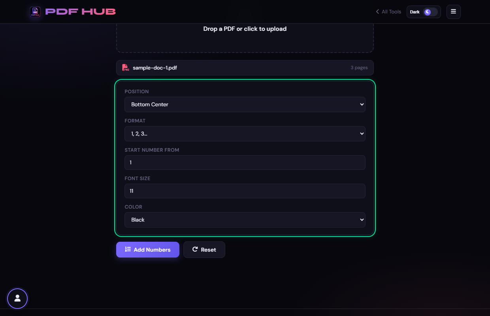
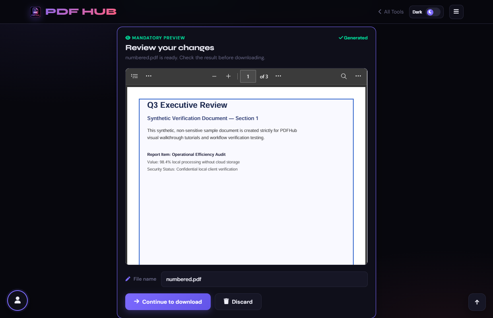

# Add Page Numbers — Technical Tool Documentation

> **Summary:** Stamp configurable page numbers onto every page of a PDF.  
> **Tool Route:** `/tools/page-numbers.html`  
> **Visual Guide Route:** `/guides/page-numbers/`  
> **Category:** Edit PDF  
> **Processing Architecture:** 100% Client-Side. Zero server uploads.

---

## 1. What the Tool Does
Add Page Numbers embeds a number label on each page with position, format, starting number, font size, and color controls.

**Requirements & Constraints:** One readable PDF is required. The number is drawn onto every page, so leave sufficient margin.

---

## 2. When to Use It
Use **Add Page Numbers** whenever you need to perform client-side edit pdf operations without uploading confidential records to third-party cloud servers. 

**Ideal Scenarios:**
- Working on personal identity records, banking statements, medical filings, or NDAs requiring 100% local confidentiality.
- Fast offline or low-bandwidth processing directly in your web browser.
- Universal cross-platform document operations on Windows, macOS, Linux, Android, or iOS.

---

## 3. Key Implemented Features
- **Engine Architecture:** `pdf-lib (page.drawText, StandardFonts.Helvetica)`
- **Zero Server Uploads:** Processing executes directly within client browser memory.
- **Instant Processing:** Fast execution powered by WebAssembly and native HTML5 APIs.
- **Review Previews:** Visual feedback and progress indicators confirm results prior to saving.
- **No Sign-up / No Watermarks:** Full functionality with zero paywalls or forced branding.

---

## 4. Supported Input Files
- **Primary Input:** Single PDF document (.pdf)
- **Validation:** Files are validated in the browser prior to parsing.

---

## 5. Supported Output Files
- **Output Format:** Numbered PDF document (numbered.pdf)
- **MIME Types:** `application/pdf` (or appropriate image/text/zip formats).

---

## 6. File Size & Memory Limits
- **Recommended Bounds:** Client RAM bound
- **Technical Context:** Modern browser tabs enforce memory quotas (typically 1.5 GB to 2 GB per tab). PDFHub handles documents comfortably within standard browser memory limits. For files exceeding 150 MB or 1,000 pages, splitting into smaller sections is recommended.

---

## 7. Step-by-Step Instructions
1. **Upload a PDF and wait for its page count.**
2. **Choose a position, format, starting number, font size, and color.**
3. **Select Add Numbers.**
4. **Review the first and last pages of the generated PDF.**

---

## 8. Required User Inputs & Controls
- **File Upload Area (`#drop` / `#fin`):** Click to open native file browser or drag and drop supported files.
- **Tool Options (`#opts`):** Dynamic settings panel configuring parameters, page ranges, or compression levels.
- **Execution Button (`Add Page Numbers (#goBtn)`):** Triggers client-side processing pipeline.
- **Reset Button:** Clears loaded files and resets workspace to pristine state.

---

## 9. Processing Behavior & Execution Pipeline
Iterates through pages, calculates coordinates based on position (Bottom/Top, Center/Left/Right), formats numbering string ("Page X of Y", "X", etc.), embeds font, draws text at exact offsets, and saves PDF.

---

## 10. Expected Output & Download Verification
- Upon successful execution, the interface triggers an automated browser download via `downloadBlob()` or opens a result review modal.
- Users can verify file size, page count, and visual rendering before finalizing the download.

---

## 11. Practical Example Use Case
Adding formal pagination to bound manuscripts, legal briefs, reports, or printed thesis documents.

---

## 12. Common Errors & Troubleshooting
- **Issue:** If a number overlaps content, choose another position or smaller size.
- **Issue:** If the PDF cannot load, repair or export a readable copy first.
- **Avoid:** Choosing white text on a light page.
- **Avoid:** Forgetting that the start number affects every subsequent page.
- **Tip:** Page numbers overlapping existing footer text. Solution: Adjust position to Top Right or adjust margin.

---

## 13. Privacy & Data Handling Architecture
- **Local Processing:** 100% Client-Side. Zero server uploads.
- **Browser Memory:** Document bytes reside temporarily in `ArrayBuffer` memory and are garbage collected when the browser tab is refreshed or closed.
- **Cookies & Telemetry:** PDFHub sets zero tracking cookies, zero analytics beacons, and stores zero personal document data.

---

## 14. Frequently Asked Questions (FAQ)
#### Q: Can I number selected pages only?
**A:** This page applies numbering to every page.

#### Q: Does it modify existing text?
**A:** It adds a new text stamp.

---

## 15. Related PDFHub Tools
- [Edit PDF Documentation](edit-pdf.md)
- [Rotate PDF Documentation](rotate-pdf.md)
- [Organize PDF Documentation](organize-pdf.md)

---

## 16. Links & Resources
- **Launch Live Tool:** [Open Add Page Numbers in PDFHub](../../tools/page-numbers.html)
- **Visual Tutorial:** [View Add Page Numbers Visual Guide](../../guides/page-numbers/)
- **All Tools Master Reference:** [All Tools Reference](../all-tools-reference.md)
- **Master Documentation Index:** [Documentation Index](../documentation-index.md)

---

## 17. Visual Walkthrough & Interface Screenshots

### Step 1: Open Add Page Numbers
- **Interface Control:** `Upload Drop Zone (#drop)`
- **What You See:** The upload area accepts any multi-page PDF document.
- **What to Do:** Open Add Page Numbers to stamp consecutive page numbers onto document pages.
- **Practical Pro-Tip:** Adding page numbers is essential for legal filings, thesis papers, and formal reports.

### Step 2: Upload PDF Document
- **Interface Control:** `File Browser (#fin)`
- **What You See:** The document loads and total page count is detected.
- **What to Do:** Select your PDF document from your storage.
- **Practical Pro-Tip:** The tool accurately detects total pages to support "Page X of Y" formats.

### Step 3: Choose Number Position
- **Interface Control:** `Position Dropdown (#pos)`
- **What You See:** Position options align coordinates relative to page margins.
- **What to Do:** Select where numbers should appear (e.g. Bottom Center, Bottom Right, or Top Right).
- **Practical Pro-Tip:** Bottom Right is the standard placement for corporate and academic documents.

### Step 4: Select Numbering Format
- **Interface Control:** `Format Selector (#fmt)`
- **What You See:** The format template updates the text string stamped on each page.
- **What to Do:** Choose the stamp text format: "Page {n} of {total}", "{n} / {total}", or simple "{n}".
- **Practical Pro-Tip:** "Page X of Y" guarantees readers know immediately if any page is missing.

### Step 5: Configure Font & Start Number
- **Interface Control:** `Styling Controls (#start, #fsize, #color)`
- **What You See:** Controls allow precise customization to match your document aesthetics.
- **What to Do:** Set the starting number (e.g. 1), typography font size (e.g. 10pt), and color.
- **Practical Pro-Tip:** A neutral gray (#666666) or dark slate color blends elegantly with existing page headers.

### Step 6: Click Add Page Numbers
- **Interface Control:** `Action Button (#goBtn)`
- **What You See:** Vector page number text is stamped directly into each page stream in memory.
- **What to Do:** Click the primary "Add Page Numbers" button.
- **Practical Pro-Tip:** Stamped numbers are sharp vector glyphs that stay crisp at any zoom level.

### Step 7: Review Stamped Pages & Download
- **Interface Control:** `Review Section & Download (#generatedPreview, #dlModal)`
- **What You See:** The preview displays numbers cleanly positioned on each page.
- **What to Do:** Inspect the stamped numbers in the preview viewer, then click "Download".
- **Practical Pro-Tip:** Check the first and last pages in the preview to confirm placement.

