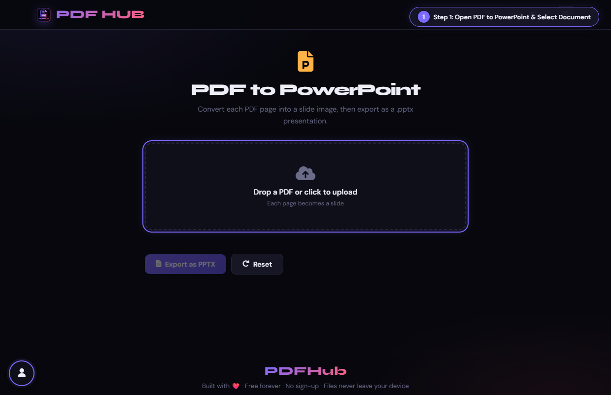
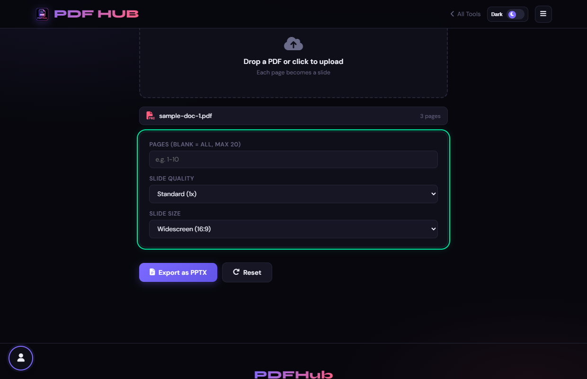
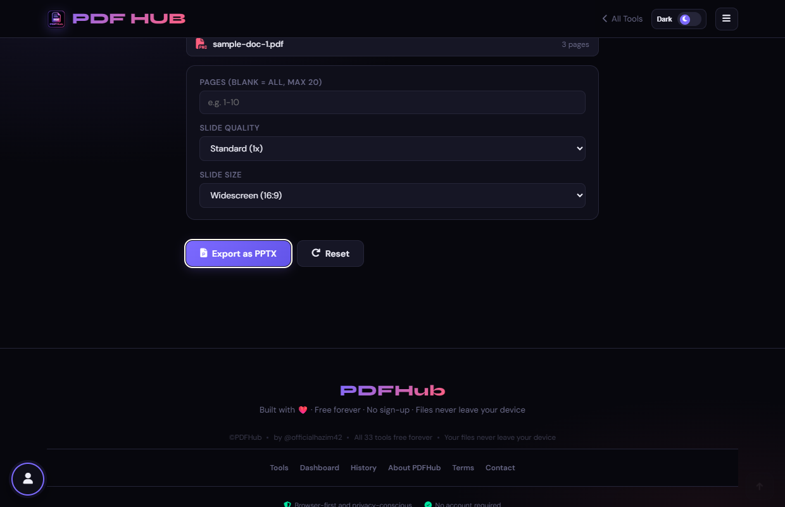

# PDF to PowerPoint — Technical Tool Documentation

> **Summary:** Render up to 20 PDF pages as slide images in a PPTX.  
> **Tool Route:** `/tools/pdf-to-ppt.html`  
> **Visual Guide Route:** `/guides/pdf-to-ppt/`  
> **Category:** Convert from PDF  
> **Processing Architecture:** 100% Client-Side. Zero server uploads.

---

## 1. What the Tool Does
PDF to PowerPoint renders selected PDF pages to images and places each page on a presentation slide. The result is image-based rather than editable text.

**Requirements & Constraints:** One readable PDF is required. The page limits the selected range to 20 pages and loads a PPTX generation library.

---

## 2. When to Use It
Use **PDF to PowerPoint** whenever you need to perform client-side convert from pdf operations without uploading confidential records to third-party cloud servers. 

**Ideal Scenarios:**
- Working on personal identity records, banking statements, medical filings, or NDAs requiring 100% local confidentiality.
- Fast offline or low-bandwidth processing directly in your web browser.
- Universal cross-platform document operations on Windows, macOS, Linux, Android, or iOS.

---

## 3. Key Implemented Features
- **Engine Architecture:** `pdf.js (canvas rendering) + PptxGenJS (pptxgen.bundle.js)`
- **Zero Server Uploads:** Processing executes directly within client browser memory.
- **Instant Processing:** Fast execution powered by WebAssembly and native HTML5 APIs.
- **Review Previews:** Visual feedback and progress indicators confirm results prior to saving.
- **No Sign-up / No Watermarks:** Full functionality with zero paywalls or forced branding.

---

## 4. Supported Input Files
- **Primary Input:** Single PDF document (.pdf)
- **Validation:** Files are validated in the browser prior to parsing.

---

## 5. Supported Output Files
- **Output Format:** Microsoft PowerPoint presentation (.pptx)
- **MIME Types:** `application/pdf` (or appropriate image/text/zip formats).

---

## 6. File Size & Memory Limits
- **Recommended Bounds:** Client RAM bound (~50 MB)
- **Technical Context:** Modern browser tabs enforce memory quotas (typically 1.5 GB to 2 GB per tab). PDFHub handles documents comfortably within standard browser memory limits. For files exceeding 150 MB or 1,000 pages, splitting into smaller sections is recommended.

---

## 7. Step-by-Step Instructions
1. **Upload a PDF and choose pages, slide quality, and slide size.**
2. **Review the generated page thumbnails.**
3. **Select Export as PPTX.**
4. **Open the presentation and check image scale and slide order.**

---

## 8. Required User Inputs & Controls
- **File Upload Area (`#drop` / `#fin`):** Click to open native file browser or drag and drop supported files.
- **Tool Options (`#opts`):** Dynamic settings panel configuring parameters, page ranges, or compression levels.
- **Execution Button (`Convert to PowerPoint (#goBtn)`):** Triggers client-side processing pipeline.
- **Reset Button:** Clears loaded files and resets workspace to pristine state.

---

## 9. Processing Behavior & Execution Pipeline
Renders each PDF page into a high-resolution image blob via pdf.js, initializes a PptxGenJS presentation instance with selected aspect ratio (16:9 or 4:3), adds a slide for each page, and writes the .pptx binary.

---

## 10. Expected Output & Download Verification
- Upon successful execution, the interface triggers an automated browser download via `downloadBlob()` or opens a result review modal.
- Users can verify file size, page count, and visual rendering before finalizing the download.

---

## 11. Practical Example Use Case
Converting exported PDF presentations back into a slide deck to present in PowerPoint or Google Slides.

---

## 12. Common Errors & Troubleshooting
- **Issue:** If export fails, lower the quality or reduce the page selection.
- **Issue:** If slides appear soft, rerun with High quality.
- **Avoid:** Expecting the PDF text to become editable slide text.
- **Avoid:** Selecting more than the supported 20-page range.
- **Tip:** Text on slides is rendered as raster images rather than vector editable text. Slides serve as backdrop slides.

---

## 13. Privacy & Data Handling Architecture
- **Local Processing:** 100% Client-Side. Zero server uploads.
- **Browser Memory:** Document bytes reside temporarily in `ArrayBuffer` memory and are garbage collected when the browser tab is refreshed or closed.
- **Cookies & Telemetry:** PDFHub sets zero tracking cookies, zero analytics beacons, and stores zero personal document data.

---

## 14. Frequently Asked Questions (FAQ)
#### Q: Are slides editable?
**A:** Each PDF page is placed as an image.

#### Q: Can I export all pages?
**A:** Only up to the page limit exposed by the tool.

---

## 15. Related PDFHub Tools
- [PDF to JPG Documentation](pdf-to-jpg.md)
- [PDF to Word Documentation](pdf-to-word.md)
- [PDF to Excel Documentation](pdf-to-excel.md)

---

## 16. Links & Resources
- **Launch Live Tool:** [Open PDF to PowerPoint in PDFHub](../../tools/pdf-to-ppt.html)
- **Visual Tutorial:** [View PDF to PowerPoint Visual Guide](../../guides/pdf-to-ppt/)
- **All Tools Master Reference:** [All Tools Reference](../all-tools-reference.md)
- **Master Documentation Index:** [Documentation Index](../documentation-index.md)

---

## 17. Visual Walkthrough & Interface Screenshots

### Step 1: Open PDF to PowerPoint
- **Interface Control:** `Upload Drop Zone (#drop)`
- **What You See:** The drop area accepts PDF slide decks and multi-page documents.
- **What to Do:** Open PDF to PowerPoint to convert presentation slides into editable PPTX decks.
- **Practical Pro-Tip:** Each PDF page is converted into an individual slide in the resulting PowerPoint deck.

### Step 2: Upload Slide PDF
- **Interface Control:** `File Browser (#fin)`
- **What You See:** The presentation file loads and total slide count is confirmed.
- **What to Do:** Select your PDF slide deck from your computer.
- **Practical Pro-Tip:** Presentations exported to PDF from Keynote or Google Slides are fully compatible.

### Step 3: Configure Slide Dimensions
- **Interface Control:** `Slide Settings (#scale, #slidesize)`
- **What You See:** Slide geometry options configure slide bounds to match modern presentation screens.
- **What to Do:** Choose your desired slide aspect ratio (16:9 Widescreen or 4:3 Standard) and quality scale.
- **Practical Pro-Tip:** High quality scale ensures that embedded diagrams and charts stay sharp.

### Step 4: Click Convert to Presentation
- **Interface Control:** `Convert Action Button (#goBtn)`
- **What You See:** The slide generator compiles pages into structured PowerPoint (.pptx) slides.
- **What to Do:** Click the primary "Convert to Presentation" button.
- **Practical Pro-Tip:** Client-side processing guarantees your confidential slides are never uploaded to the cloud.

### Step 5: Review Slide Status
- **Interface Control:** `Preview Section (#generatedPreview)`
- **What You See:** The review panel confirms slide count and default PPTX file name.
- **What to Do:** Check the review confirmation showing the completed presentation file.
- **Practical Pro-Tip:** Verify slide count matches your source document before saving.

### Step 6: Download PowerPoint Deck
- **Interface Control:** `Download Dialog (#dlModal .btn-success)`
- **What You See:** The download modal confirms your presentation file is ready.
- **What to Do:** Click "Download" to save your new PowerPoint (.pptx) file.
- **Practical Pro-Tip:** You can now present, reorder, or add speaker notes directly in PowerPoint.

