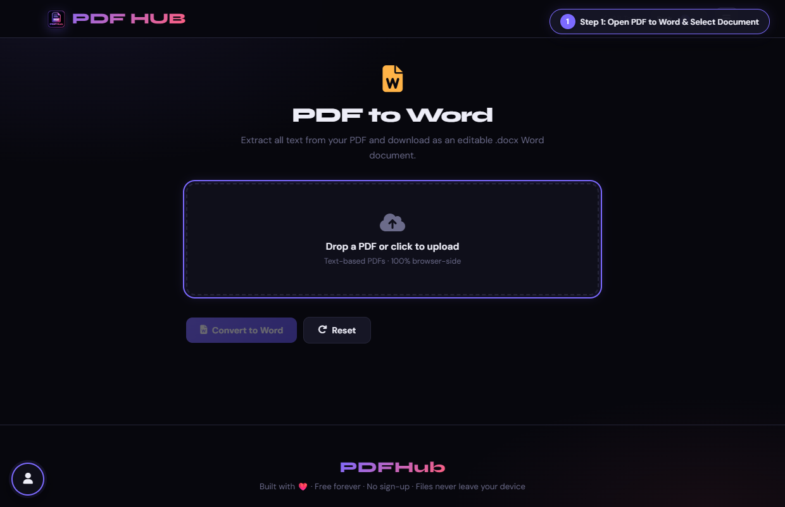
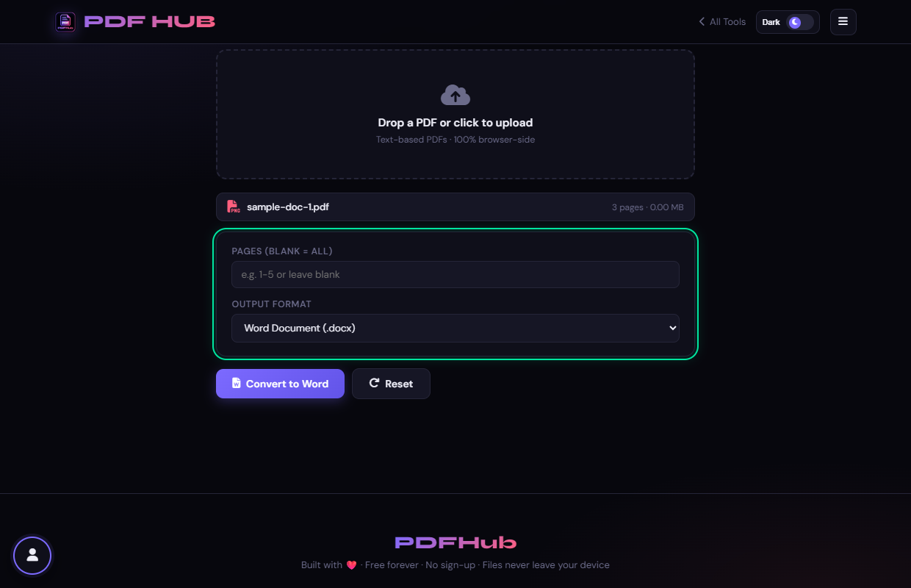
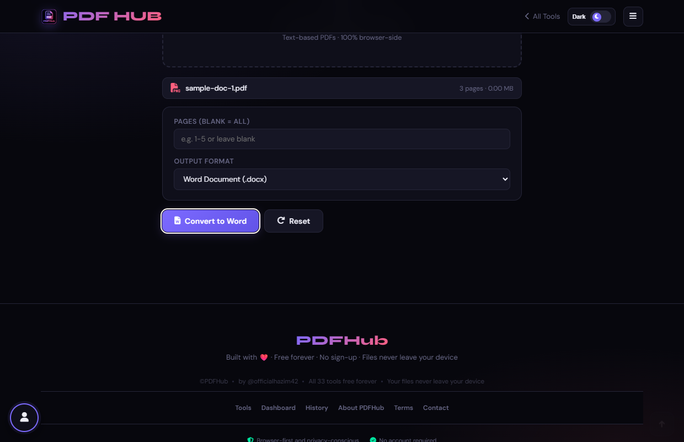
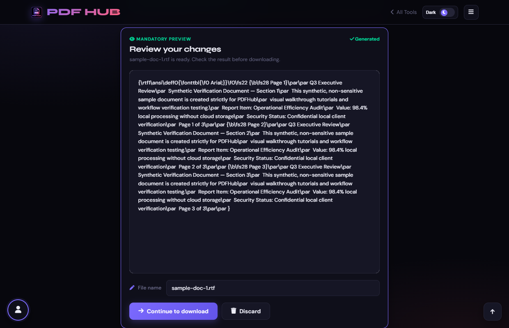

# PDF to Word — Technical Tool Documentation

> **Summary:** Extract PDF text into DOCX, RTF, or plain text output.  
> **Tool Route:** `/tools/pdf-to-word.html`  
> **Visual Guide Route:** `/guides/pdf-to-word/`  
> **Category:** Convert from PDF  
> **Processing Architecture:** 100% Client-Side. Zero server uploads.

---

## 1. What the Tool Does
PDF to Word groups extracted PDF text into lines and produces an editable document or text file. Complex layouts and scans may need cleanup or OCR.

**Requirements & Constraints:** Text-based PDFs work best. Select pages or leave blank for all, then choose an output format.

---

## 2. When to Use It
Use **PDF to Word** whenever you need to perform client-side convert from pdf operations without uploading confidential records to third-party cloud servers. 

**Ideal Scenarios:**
- Working on personal identity records, banking statements, medical filings, or NDAs requiring 100% local confidentiality.
- Fast offline or low-bandwidth processing directly in your web browser.
- Universal cross-platform document operations on Windows, macOS, Linux, Android, or iOS.

---

## 3. Key Implemented Features
- **Engine Architecture:** `pdf.js (text line extraction) + docx.js (index.umd.js) + fallback RTF/TXT`
- **Zero Server Uploads:** Processing executes directly within client browser memory.
- **Instant Processing:** Fast execution powered by WebAssembly and native HTML5 APIs.
- **Review Previews:** Visual feedback and progress indicators confirm results prior to saving.
- **No Sign-up / No Watermarks:** Full functionality with zero paywalls or forced branding.

---

## 4. Supported Input Files
- **Primary Input:** Text-based PDF document (.pdf)
- **Validation:** Files are validated in the browser prior to parsing.

---

## 5. Supported Output Files
- **Output Format:** Editable Microsoft Word document (.docx), Rich Text (.rtf), or Plain Text (.txt)
- **MIME Types:** `application/pdf` (or appropriate image/text/zip formats).

---

## 6. File Size & Memory Limits
- **Recommended Bounds:** Client RAM bound (~50 MB)
- **Technical Context:** Modern browser tabs enforce memory quotas (typically 1.5 GB to 2 GB per tab). PDFHub handles documents comfortably within standard browser memory limits. For files exceeding 150 MB or 1,000 pages, splitting into smaller sections is recommended.

---

## 7. Step-by-Step Instructions
1. **Upload a PDF and select the pages to convert.**
2. **Choose DOCX, RTF, or plain text.**
3. **Select Convert to Word and wait for text extraction.**
4. **Open the output and compare important formatting with the PDF.**

---

## 8. Required User Inputs & Controls
- **File Upload Area (`#drop` / `#fin`):** Click to open native file browser or drag and drop supported files.
- **Tool Options (`#opts`):** Dynamic settings panel configuring parameters, page ranges, or compression levels.
- **Execution Button (`Convert to Word (#goBtn)`):** Triggers client-side processing pipeline.
- **Reset Button:** Clears loaded files and resets workspace to pristine state.

---

## 9. Processing Behavior & Execution Pipeline
Extracts text content fragments and bounding coordinates with pdf.js, groups text items into vertical line structures, constructs a Document AST with Paragraph and Heading objects in docx.js, and packs into a .docx blob.

---

## 10. Expected Output & Download Verification
- Upon successful execution, the interface triggers an automated browser download via `downloadBlob()` or opens a result review modal.
- Users can verify file size, page count, and visual rendering before finalizing the download.

---

## 11. Practical Example Use Case
Converting agreements or reports back into editable Microsoft Word documents to revise clauses or wording.

---

## 12. Common Errors & Troubleshooting
- **Issue:** If no text is extracted, use OCR PDF.
- **Issue:** If DOCX generation fails, the page may fall back to RTF; review the status message.
- **Avoid:** Expecting exact columns, images, or typography from text extraction.
- **Avoid:** Skipping the output review.
- **Tip:** Scanned PDFs containing images of text produce empty output. Solution: Run OCR PDF first to generate a text layer.

---

## 13. Privacy & Data Handling Architecture
- **Local Processing:** 100% Client-Side. Zero server uploads.
- **Browser Memory:** Document bytes reside temporarily in `ArrayBuffer` memory and are garbage collected when the browser tab is refreshed or closed.
- **Cookies & Telemetry:** PDFHub sets zero tracking cookies, zero analytics beacons, and stores zero personal document data.

---

## 14. Frequently Asked Questions (FAQ)
#### Q: Can it convert scanned PDFs?
**A:** OCR is recommended first.

#### Q: Does it preserve the original layout?
**A:** It preserves text order approximately, not full visual layout.

---

## 15. Related PDFHub Tools
- [OCR PDF Documentation](ocr-pdf.md)
- [PDF to Markdown Documentation](pdf-to-markdown.md)
- [PDF to Excel Documentation](pdf-to-excel.md)

---

## 16. Links & Resources
- **Launch Live Tool:** [Open PDF to Word in PDFHub](../../tools/pdf-to-word.html)
- **Visual Tutorial:** [View PDF to Word Visual Guide](../../guides/pdf-to-word/)
- **All Tools Master Reference:** [All Tools Reference](../all-tools-reference.md)
- **Master Documentation Index:** [Documentation Index](../documentation-index.md)

---

## 17. Visual Walkthrough & Interface Screenshots

### Step 1: Open PDF to Word
- **Interface Control:** `Upload Drop Zone (#drop)`
- **What You See:** The drop area accepts any text-based PDF document.
- **What to Do:** Open PDF to Word to extract paragraphs and headings into an editable Microsoft Word document.
- **Practical Pro-Tip:** Conversion extracts live text, formatting, and layout into standardized .docx format.

### Step 2: Upload PDF Document
- **Interface Control:** `File Browser (#fin)`
- **What You See:** The file details, name, and total page count appear in the workspace.
- **What to Do:** Select your PDF document from your storage.
- **Practical Pro-Tip:** Documents containing digital text (rather than flat scanned photos) produce the best results.

### Step 3: Select Export Format
- **Interface Control:** `Format Selector (#outfmt, #pgrange)`
- **What You See:** The selector configures document packaging for Microsoft Word or text editors.
- **What to Do:** Choose your preferred export format (.docx, RTF, or Plain Text) and page range.
- **Practical Pro-Tip:** RTF is universally compatible across older word processors and legacy systems.

### Step 4: Click Convert to Word
- **Interface Control:** `Convert Action Button (#goBtn)`
- **What You See:** The extraction engine parses text blocks, font styles, and paragraphs into Word structures.
- **What to Do:** Click the primary "Convert to Word" button.
- **Practical Pro-Tip:** All extraction takes place locally on your computer with complete privacy.

### Step 5: Review Generated Document
- **Interface Control:** `Preview Section (#generatedPreview)`
- **What You See:** The review panel confirms that the .docx file is compiled and ready.
- **What to Do:** Verify the document status and output filename in the review section.
- **Practical Pro-Tip:** You can edit the filename before downloading if desired.

### Step 6: Download Editable Word File
- **Interface Control:** `Download Dialog (#dlModal .btn-success)`
- **What You See:** The download modal provides the final .docx file for immediate saving.
- **What to Do:** Click "Download" to save your editable Word (.docx) file.
- **Practical Pro-Tip:** You can now freely edit, modify, and re-format the text as needed.

