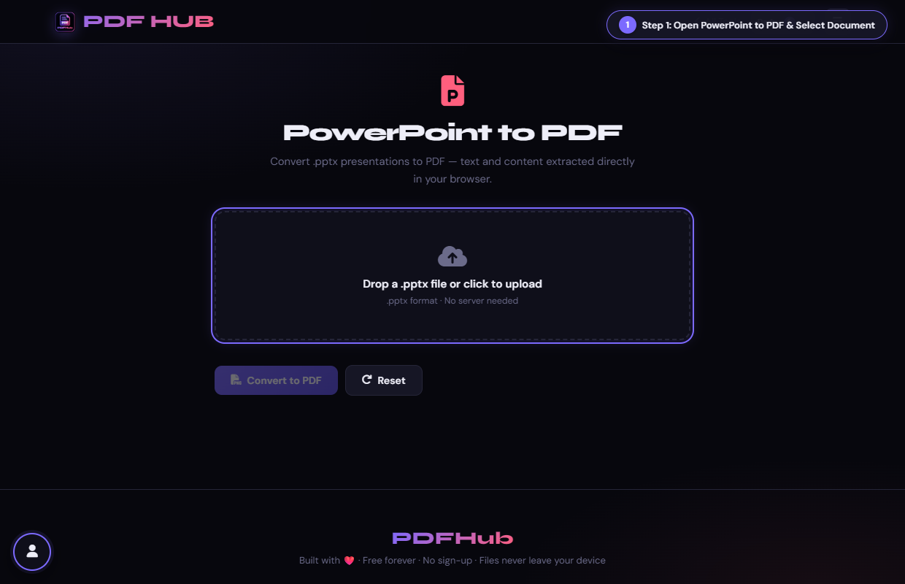
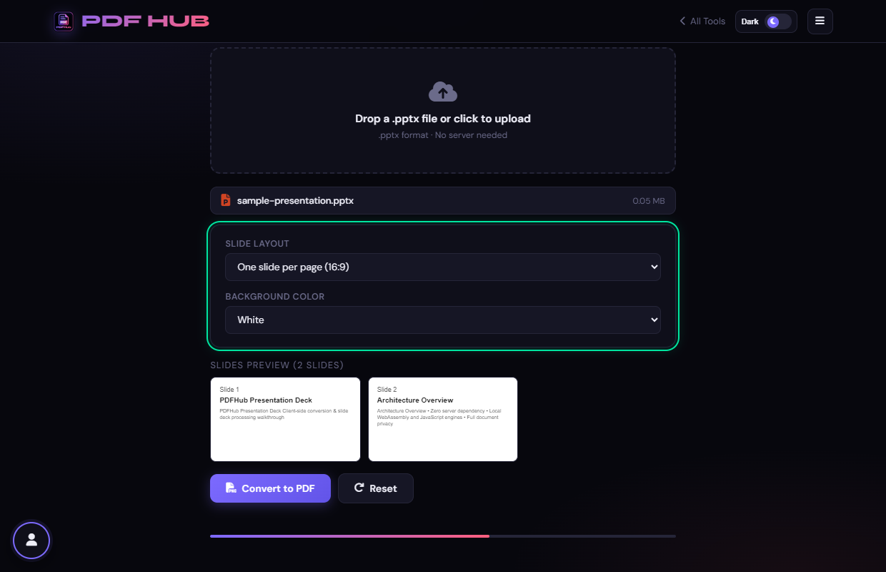
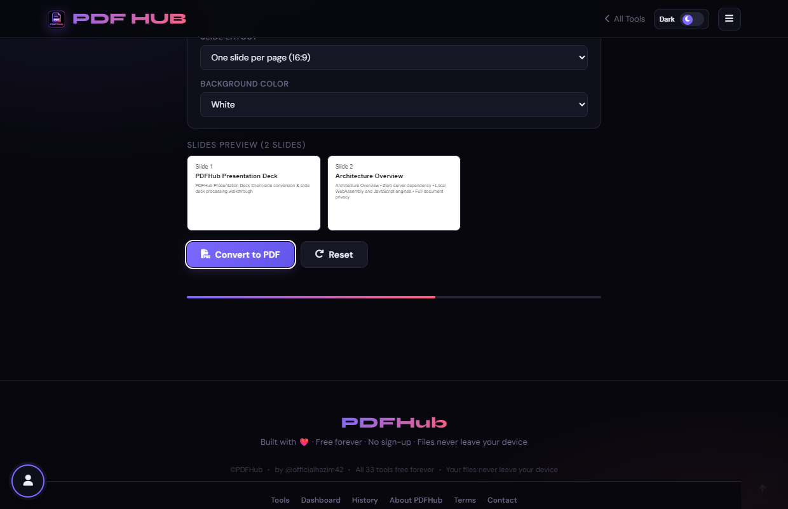

# PowerPoint to PDF — Technical Tool Documentation

> **Summary:** Read PPTX slide text and create a browser print layout for PDF.  
> **Tool Route:** `/tools/ppt-to-pdf.html`  
> **Visual Guide Route:** `/guides/ppt-to-pdf/`  
> **Category:** Convert to PDF  
> **Processing Architecture:** 100% Client-Side. Zip extraction occurs in local memory.

---

## 1. What the Tool Does
PowerPoint to PDF reads slide XML from a PPTX archive, previews extracted slide text, and opens a printable layout with slide and handout options.

**Requirements & Constraints:** A .pptx file and a browser print dialog are required. Images and complex PowerPoint features may not be represented fully.

---

## 2. When to Use It
Use **PowerPoint to PDF** whenever you need to perform client-side convert to pdf operations without uploading confidential records to third-party cloud servers. 

**Ideal Scenarios:**
- Working on personal identity records, banking statements, medical filings, or NDAs requiring 100% local confidentiality.
- Fast offline or low-bandwidth processing directly in your web browser.
- Universal cross-platform document operations on Windows, macOS, Linux, Android, or iOS.

---

## 3. Key Implemented Features
- **Engine Architecture:** `JSZip (PPTX XML & media extraction) + Browser Print Engine`
- **Zero Server Uploads:** Processing executes directly within client browser memory.
- **Instant Processing:** Fast execution powered by WebAssembly and native HTML5 APIs.
- **Review Previews:** Visual feedback and progress indicators confirm results prior to saving.
- **No Sign-up / No Watermarks:** Full functionality with zero paywalls or forced branding.

---

## 4. Supported Input Files
- **Primary Input:** Microsoft PowerPoint presentation (.pptx)
- **Validation:** Files are validated in the browser prior to parsing.

---

## 5. Supported Output Files
- **Output Format:** Formatted print view triggering browser "Save as PDF" destination
- **MIME Types:** `application/pdf` (or appropriate image/text/zip formats).

---

## 6. File Size & Memory Limits
- **Recommended Bounds:** Client RAM bound (~50 MB PPTX)
- **Technical Context:** Modern browser tabs enforce memory quotas (typically 1.5 GB to 2 GB per tab). PDFHub handles documents comfortably within standard browser memory limits. For files exceeding 150 MB or 1,000 pages, splitting into smaller sections is recommended.

---

## 7. Step-by-Step Instructions
1. **Select a PPTX presentation.**
2. **Wait for slide text previews, then choose a slide layout and background.**
3. **Select Convert to PDF.**
4. **Choose Save as PDF in the print dialog and inspect the result.**

---

## 8. Required User Inputs & Controls
- **File Upload Area (`#drop` / `#fin`):** Click to open native file browser or drag and drop supported files.
- **Tool Options (`#opts`):** Dynamic settings panel configuring parameters, page ranges, or compression levels.
- **Execution Button (`Convert to PDF (#goBtn)`):** Triggers client-side processing pipeline.
- **Reset Button:** Clears loaded files and resets workspace to pristine state.

---

## 9. Processing Behavior & Execution Pipeline
Unzips PPTX package in memory, extracts slide XML, geometries, text runs, and embedded media, formats slides into print CSS pages (1 slide/page or 2 slides/page handouts), and opens browser print dialog.

---

## 10. Expected Output & Download Verification
- Upon successful execution, the interface triggers an automated browser download via `downloadBlob()` or opens a result review modal.
- Users can verify file size, page count, and visual rendering before finalizing the download.

---

## 11. Practical Example Use Case
Preparing lecture slide decks or business presentations for distribution and printing as PDF handouts.

---

## 12. Common Errors & Troubleshooting
- **Issue:** If the PPTX will not open, confirm it is a valid Office Open XML presentation.
- **Issue:** If slide images or formatting are missing, export from PowerPoint for a faithful result.
- **Avoid:** Expecting animations and all slide artwork to be preserved.
- **Avoid:** Closing the print dialog without choosing Save as PDF.
- **Tip:** Uploading legacy binary .ppt files. Solution: Save as .pptx first.
- **Tip:** Complex PowerPoint animation effects are omitted in static PDF export.

---

## 13. Privacy & Data Handling Architecture
- **Local Processing:** 100% Client-Side. Zip extraction occurs in local memory.
- **Browser Memory:** Document bytes reside temporarily in `ArrayBuffer` memory and are garbage collected when the browser tab is refreshed or closed.
- **Cookies & Telemetry:** PDFHub sets zero tracking cookies, zero analytics beacons, and stores zero personal document data.

---

## 14. Frequently Asked Questions (FAQ)
#### Q: Does it preserve animations?
**A:** No, PDF is static.

#### Q: Can I create handouts?
**A:** The page offers two- and four-per-page layouts.

---

## 15. Related PDFHub Tools
- [Excel to PDF Documentation](excel-to-pdf.md)
- [Word to PDF Documentation](word-to-pdf.md)
- [PDF to PowerPoint Documentation](pdf-to-ppt.md)

---

## 16. Links & Resources
- **Launch Live Tool:** [Open PowerPoint to PDF in PDFHub](../../tools/ppt-to-pdf.html)
- **Visual Tutorial:** [View PowerPoint to PDF Visual Guide](../../guides/ppt-to-pdf/)
- **All Tools Master Reference:** [All Tools Reference](../all-tools-reference.md)
- **Master Documentation Index:** [Documentation Index](../documentation-index.md)

---

## 17. Visual Walkthrough & Interface Screenshots

### Step 1: Open PowerPoint to PDF
- **Interface Control:** `Upload Drop Zone (#drop)`
- **What You See:** The workspace accepts Microsoft PowerPoint (.pptx) presentation decks.
- **What to Do:** Open PowerPoint to PDF to convert presentation slides into universally portable documents.
- **Practical Pro-Tip:** Converting slides to PDF prevents unwanted font changes when sharing across different devices.

### Step 2: Upload Presentation Deck
- **Interface Control:** `File Browser (#fin)`
- **What You See:** The presentation is parsed locally and slide details are displayed.
- **What to Do:** Select your .pptx presentation file from your device.
- **Practical Pro-Tip:** Slide decks with custom aspect ratios are automatically handled.

### Step 3: Set Slide Aspect Ratio
- **Interface Control:** `Layout Dropdown (#layout, #bg)`
- **What You See:** The page bounding boxes adjust to match standard projector and monitor dimensions.
- **What to Do:** Choose your presentation aspect ratio (16:9 Widescreen or 4:3 Standard) and background color.
- **Practical Pro-Tip:** Setting a clean white background guarantees clear printing on physical printers.

### Step 4: Click Convert to PDF
- **Interface Control:** `Convert Action Button (#goBtn)`
- **What You See:** The presentation engine compiles slide contents into individual PDF pages.
- **What to Do:** Click the primary "Convert to PDF" button.
- **Practical Pro-Tip:** Each slide becomes a crisp, full-bleed page in the final document.

### Step 5: Inspect Converted Slides
- **Interface Control:** `Preview Section (#generatedPreview)`
- **What You See:** The preview displays slide titles, body copy, and layout boundaries clearly.
- **What to Do:** Scroll through the converted slide deck in the preview viewer.
- **Practical Pro-Tip:** Check that text boxes do not overlap slide boundaries.

### Step 6: Download PDF Presentation
- **Interface Control:** `Download Dialog (#dlModal .btn-success)`
- **What You See:** The download modal confirms your PDF presentation is ready.
- **What to Do:** Click "Download" to save the converted slide deck.
- **Practical Pro-Tip:** Your slides can now be presented in full-screen mode on any PDF reader without PowerPoint installed.

