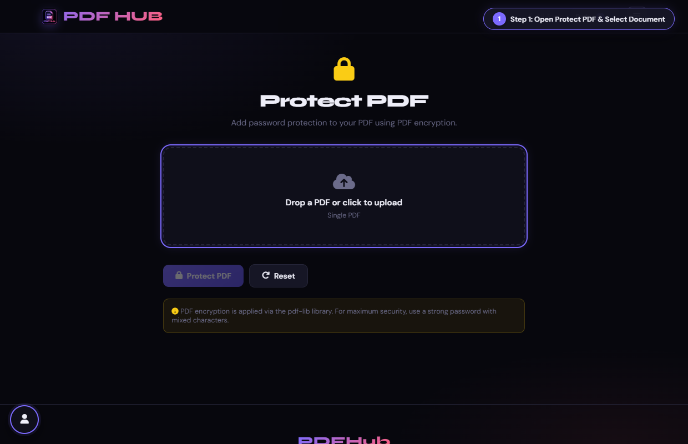
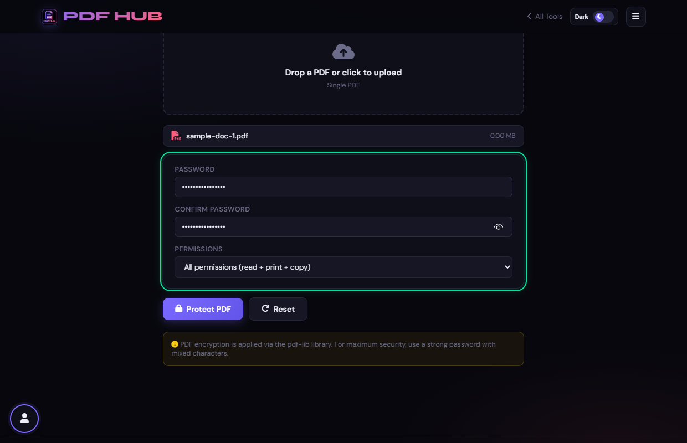
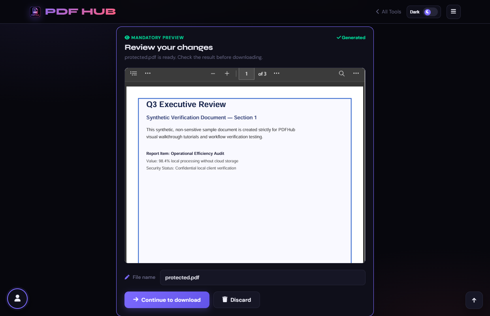

# Protect PDF — Technical Tool Documentation

> **Summary:** Add password encryption and permission settings to a PDF.  
> **Tool Route:** `/tools/protect.html`  
> **Visual Guide Route:** `/guides/protect-pdf/`  
> **Category:** Secure PDF  
> **Processing Architecture:** 100% Client-Side. Password and file never leave browser memory.

---

## 1. What the Tool Does
Protect PDF uses pdf-lib password options to create an encrypted copy with a chosen password and permissions.

**Requirements & Constraints:** One readable PDF is required. The password is entered locally and is not recoverable by PDFHub.

---

## 2. When to Use It
Use **Protect PDF** whenever you need to perform client-side secure pdf operations without uploading confidential records to third-party cloud servers. 

**Ideal Scenarios:**
- Working on personal identity records, banking statements, medical filings, or NDAs requiring 100% local confidentiality.
- Fast offline or low-bandwidth processing directly in your web browser.
- Universal cross-platform document operations on Windows, macOS, Linux, Android, or iOS.

---

## 3. Key Implemented Features
- **Engine Architecture:** `pdf-lib (userPassword, ownerPassword, permissions)`
- **Zero Server Uploads:** Processing executes directly within client browser memory.
- **Instant Processing:** Fast execution powered by WebAssembly and native HTML5 APIs.
- **Review Previews:** Visual feedback and progress indicators confirm results prior to saving.
- **No Sign-up / No Watermarks:** Full functionality with zero paywalls or forced branding.

---

## 4. Supported Input Files
- **Primary Input:** Single PDF document (.pdf)
- **Validation:** Files are validated in the browser prior to parsing.

---

## 5. Supported Output Files
- **Output Format:** Password-encrypted PDF document (protected.pdf)
- **MIME Types:** `application/pdf` (or appropriate image/text/zip formats).

---

## 6. File Size & Memory Limits
- **Recommended Bounds:** Client RAM bound
- **Technical Context:** Modern browser tabs enforce memory quotas (typically 1.5 GB to 2 GB per tab). PDFHub handles documents comfortably within standard browser memory limits. For files exceeding 150 MB or 1,000 pages, splitting into smaller sections is recommended.

---

## 7. Step-by-Step Instructions
1. **Upload a PDF.**
2. **Enter a password twice and choose the available permission preset.**
3. **Select Protect PDF.**
4. **Open the downloaded file and test the password before deleting the source.**

---

## 8. Required User Inputs & Controls
- **File Upload Area (`#drop` / `#fin`):** Click to open native file browser or drag and drop supported files.
- **Tool Options (`#opts`):** Dynamic settings panel configuring parameters, page ranges, or compression levels.
- **Execution Button (`Protect PDF (#goBtn)`):** Triggers client-side processing pipeline.
- **Reset Button:** Clears loaded files and resets workspace to pristine state.

---

## 9. Processing Behavior & Execution Pipeline
Loads PDF with ignoreEncryption flag, invokes doc.save({ userPassword, ownerPassword, permissions }), generates standard AES encryption dictionaries, and outputs a protected document.

---

## 10. Expected Output & Download Verification
- Upon successful execution, the interface triggers an automated browser download via `downloadBlob()` or opens a result review modal.
- Users can verify file size, page count, and visual rendering before finalizing the download.

---

## 11. Practical Example Use Case
Securing confidential payroll sheets, medical records, or tax returns before emailing them.

---

## 12. Common Errors & Troubleshooting
- **Issue:** If passwords do not match, re-enter both fields.
- **Issue:** If encryption fails, retry with a readable PDF and a strong browser session.
- **Avoid:** Forgetting the password.
- **Avoid:** Assuming viewer permissions are enforced equally by every PDF reader.
- **Tip:** Forgetting the password. Solution: PDFHub cannot recover lost passwords; retain a secure record.

---

## 13. Privacy & Data Handling Architecture
- **Local Processing:** 100% Client-Side. Password and file never leave browser memory.
- **Browser Memory:** Document bytes reside temporarily in `ArrayBuffer` memory and are garbage collected when the browser tab is refreshed or closed.
- **Cookies & Telemetry:** PDFHub sets zero tracking cookies, zero analytics beacons, and stores zero personal document data.

---

## 14. Frequently Asked Questions (FAQ)
#### Q: Can PDFHub recover a forgotten password?
**A:** No.

#### Q: Does this upload the password?
**A:** The operation is performed in the browser.

---

## 15. Related PDFHub Tools
- [Unlock PDF Documentation](unlock-pdf.md)
- [Redact PDF Documentation](redact-pdf.md)
- [Sign PDF Documentation](sign-pdf.md)

---

## 16. Links & Resources
- **Launch Live Tool:** [Open Protect PDF in PDFHub](../../tools/protect.html)
- **Visual Tutorial:** [View Protect PDF Visual Guide](../../guides/protect-pdf/)
- **All Tools Master Reference:** [All Tools Reference](../all-tools-reference.md)
- **Master Documentation Index:** [Documentation Index](../documentation-index.md)

---

## 17. Visual Walkthrough & Interface Screenshots

### Step 1: Open Protect PDF
- **Interface Control:** `Upload Drop Zone (#drop)`
- **What You See:** The upload drop area accepts any PDF document requiring confidentiality protection.
- **What to Do:** Open Protect PDF to encrypt your documents with AES encryption and strong passwords.
- **Practical Pro-Tip:** Protecting documents prevents unauthorized viewing, printing, and copying.

### Step 2: Upload Document to Protect
- **Interface Control:** `File Browser (#fin)`
- **What You See:** The document loads and the password configuration controls appear.
- **What to Do:** Select your confidential PDF file from your device.
- **Practical Pro-Tip:** Ensure you store the password securely, as encrypted files cannot be opened without it.

### Step 3: Enter Strong Password
- **Interface Control:** `Password Field (#pw)`
- **What You See:** The field masks characters for privacy and security.
- **What to Do:** Type a strong, secret password into the first password input.
- **Practical Pro-Tip:** A passphrase with 10 or more characters provides high security against brute-force attacks.

### Step 4: Confirm Password Verification
- **Interface Control:** `Confirm Password Field (#pw2)`
- **What You See:** The verification field confirms that both password inputs match.
- **What to Do:** Re-type the exact same password into the confirmation field.
- **Practical Pro-Tip:** If inputs do not match, the tool will alert you before encrypting.

### Step 5: Configure Permissions
- **Interface Control:** `Permissions Selector (#perms)`
- **What You See:** Permission flags restrict what unauthorized viewers can do even after viewing.
- **What to Do:** Choose permissions restrictions (e.g. Allow printing, Allow copying text, or Full lockdown).
- **Practical Pro-Tip:** Disabling printing prevents unauthorized physical paper distribution.

### Step 6: Click Protect PDF
- **Interface Control:** `Protect Action Button (#goBtn)`
- **What You See:** The client-side crypto engine encrypts the entire document stream using AES-256 cipher.
- **What to Do:** Click the primary "Protect PDF" button.
- **Practical Pro-Tip:** Encryption happens 100% locally; neither your file nor your password ever leaves your machine.

### Step 7: Download Password-Protected PDF
- **Interface Control:** `Download Dialog (#dlModal .btn-success)`
- **What You See:** The download modal confirms your file is encrypted with AES-256.
- **What to Do:** Click "Download" to save your encrypted PDF document.
- **Practical Pro-Tip:** Anyone opening this document will now be prompted for the password before pages can render.

