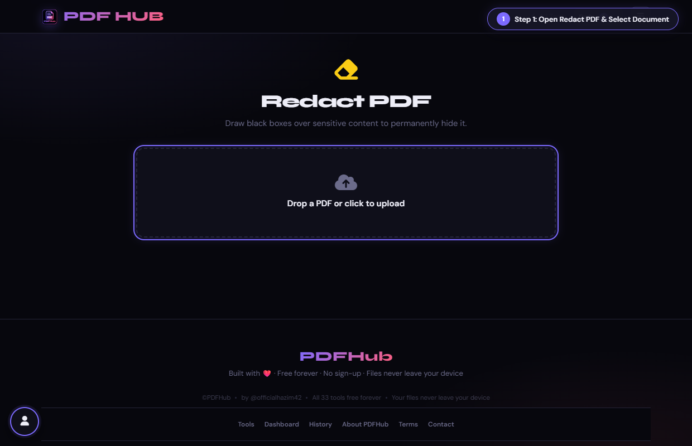
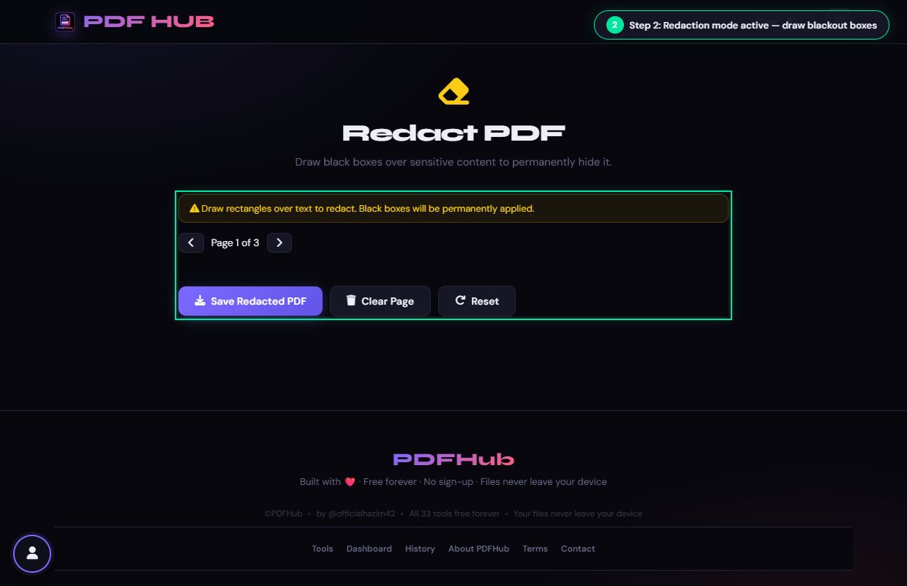
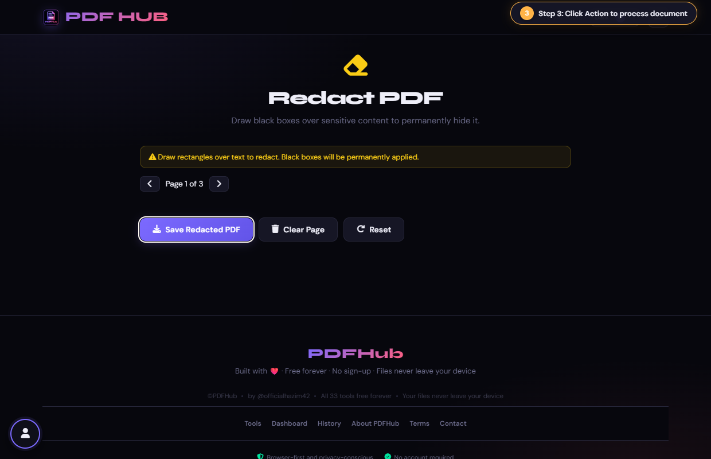
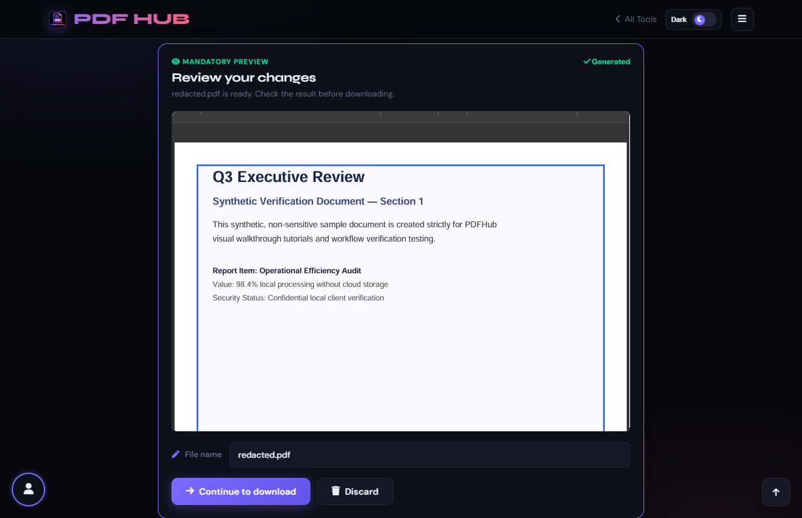

# Redact PDF — Technical Tool Documentation

> **Summary:** Draw black rectangles over sensitive areas and export a flattened PDF.  
> **Tool Route:** `/tools/redact.html`  
> **Visual Guide Route:** `/guides/redact-pdf/`  
> **Category:** Secure PDF  
> **Processing Architecture:** 100% Client-Side. Zero server uploads.

---

## 1. What the Tool Does
Redact PDF renders pages for marking, then draws black rectangles into the output PDF. Inspect the exported copy carefully before sharing.

**Requirements & Constraints:** One readable PDF is required. Redaction coordinates are based on the rendered page and must cover the complete sensitive area.

---

## 2. When to Use It
Use **Redact PDF** whenever you need to perform client-side secure pdf operations without uploading confidential records to third-party cloud servers. 

**Ideal Scenarios:**
- Working on personal identity records, banking statements, medical filings, or NDAs requiring 100% local confidentiality.
- Fast offline or low-bandwidth processing directly in your web browser.
- Universal cross-platform document operations on Windows, macOS, Linux, Android, or iOS.

---

## 3. Key Implemented Features
- **Engine Architecture:** `pdf.js (preview) + pdf-lib (page.drawRectangle with black fill)`
- **Zero Server Uploads:** Processing executes directly within client browser memory.
- **Instant Processing:** Fast execution powered by WebAssembly and native HTML5 APIs.
- **Review Previews:** Visual feedback and progress indicators confirm results prior to saving.
- **No Sign-up / No Watermarks:** Full functionality with zero paywalls or forced branding.

---

## 4. Supported Input Files
- **Primary Input:** Single PDF document (.pdf)
- **Validation:** Files are validated in the browser prior to parsing.

---

## 5. Supported Output Files
- **Output Format:** Permanently redacted PDF document (redacted.pdf)
- **MIME Types:** `application/pdf` (or appropriate image/text/zip formats).

---

## 6. File Size & Memory Limits
- **Recommended Bounds:** Client RAM bound
- **Technical Context:** Modern browser tabs enforce memory quotas (typically 1.5 GB to 2 GB per tab). PDFHub handles documents comfortably within standard browser memory limits. For files exceeding 150 MB or 1,000 pages, splitting into smaller sections is recommended.

---

## 7. Step-by-Step Instructions
1. **Upload a PDF and choose a page.**
2. **Drag over every sensitive region to create a black box.**
3. **Move through pages and repeat as needed; use Clear Page to start a page again.**
4. **Select Save Redacted PDF and verify the result in a separate viewer.**

---

## 8. Required User Inputs & Controls
- **File Upload Area (`#drop` / `#fin`):** Click to open native file browser or drag and drop supported files.
- **Tool Options (`#opts`):** Dynamic settings panel configuring parameters, page ranges, or compression levels.
- **Execution Button (`Save Redacted PDF (#goBtn)`):** Triggers client-side processing pipeline.
- **Reset Button:** Clears loaded files and resets workspace to pristine state.

---

## 9. Processing Behavior & Execution Pipeline
Renders page previews, captures user-drawn bounding boxes over sensitive regions, translates coordinates to PDF coordinate space, draws opaque black rectangles permanently onto the page content stream, and saves.

---

## 10. Expected Output & Download Verification
- Upon successful execution, the interface triggers an automated browser download via `downloadBlob()` or opens a result review modal.
- Users can verify file size, page count, and visual rendering before finalizing the download.

---

## 11. Practical Example Use Case
Blacking out Social Security Numbers, credit card details, or confidential client names before public disclosure.

---

## 12. Common Errors & Troubleshooting
- **Issue:** If a box is misplaced, clear that page and redraw.
- **Issue:** If text can still be selected outside a box, expand the redaction area and export again.
- **Avoid:** Redacting only a screenshot layer or forgetting another page.
- **Avoid:** Sharing the source PDF instead of the redacted output.
- **Tip:** Assuming transparent highlights redact text. Redact tool draws solid 100% opaque black rectangles.

---

## 13. Privacy & Data Handling Architecture
- **Local Processing:** 100% Client-Side. Zero server uploads.
- **Browser Memory:** Document bytes reside temporarily in `ArrayBuffer` memory and are garbage collected when the browser tab is refreshed or closed.
- **Cookies & Telemetry:** PDFHub sets zero tracking cookies, zero analytics beacons, and stores zero personal document data.

---

## 14. Frequently Asked Questions (FAQ)
#### Q: Is redaction reversible?
**A:** Treat the exported result as permanent, but retain the source privately.

#### Q: Does it detect sensitive text automatically?
**A:** No, marking is manual.

---

## 15. Related PDFHub Tools
- [Protect PDF Documentation](protect-pdf.md)
- [Edit PDF Documentation](edit-pdf.md)
- [PDF Forms Documentation](forms-pdf.md)

---

## 16. Links & Resources
- **Launch Live Tool:** [Open Redact PDF in PDFHub](../../tools/redact.html)
- **Visual Tutorial:** [View Redact PDF Visual Guide](../../guides/redact-pdf/)
- **All Tools Master Reference:** [All Tools Reference](../all-tools-reference.md)
- **Master Documentation Index:** [Documentation Index](../documentation-index.md)

---

## 17. Visual Walkthrough & Interface Screenshots

### Step 1: Open Redact PDF
- **Interface Control:** `Upload Drop Zone (#drop)`
- **What You See:** The drop area accepts any PDF document containing confidential information.
- **What to Do:** Open Redact PDF to permanently black out and sanitize private, personal, or financial data.
- **Practical Pro-Tip:** Redaction permanently deletes the underlying text and vectors, preventing data recovery.

### Step 2: Upload Sensitive PDF
- **Interface Control:** `File Browser (#fin)`
- **What You See:** The document renders in the interactive redaction canvas viewer.
- **What to Do:** Select your confidential PDF file from your storage.
- **Practical Pro-Tip:** Redaction is irreversible; keep an unmodified backup of your original file.

### Step 3: Select Target Page
- **Interface Control:** `Page Switcher (changePage)`
- **What You See:** The canvas viewer displays the active page with full document legibility.
- **What to Do:** Navigate to the exact page where confidential text or numbers appear.
- **Practical Pro-Tip:** You can redact multiple pages across the document in one session.

### Step 4: Draw Blackout Redaction Box
- **Interface Control:** `Redaction Canvas (#editor, canvas)`
- **What You See:** An opaque solid black box covers the confidential content entirely.
- **What to Do:** Click and drag a blackout rectangle directly over the private text.
- **Practical Pro-Tip:** Drag slightly past the edges of sensitive text to ensure full coverage.

### Step 5: Inspect Redaction Coverage
- **Interface Control:** `Blackout Overlay Preview`
- **What You See:** Solid blackout blocks conceal all private numbers and names completely.
- **What to Do:** Review the drawn blackout boxes to confirm nothing sensitive is exposed.
- **Practical Pro-Tip:** Check headers and footnotes for repeated account numbers or IDs.

### Step 6: Click Save Redacted PDF
- **Interface Control:** `Save Action Button (button.btn-primary)`
- **What You See:** The redaction engine removes the underlying text stream and bakes solid black vectors.
- **What to Do:** Click the primary "Save Redacted PDF" button.
- **Practical Pro-Tip:** Text beneath redaction boxes cannot be highlighted, searched, or extracted by any tool.

### Step 7: Download Sanitized PDF
- **Interface Control:** `Download Dialog (#dlModal .btn-success)`
- **What You See:** The download modal confirms your redacted document is safe for public release.
- **What to Do:** Click "Download" to save your permanently sanitized PDF.
- **Practical Pro-Tip:** Your sanitized document is now legally safe for public filings or third-party audits.

