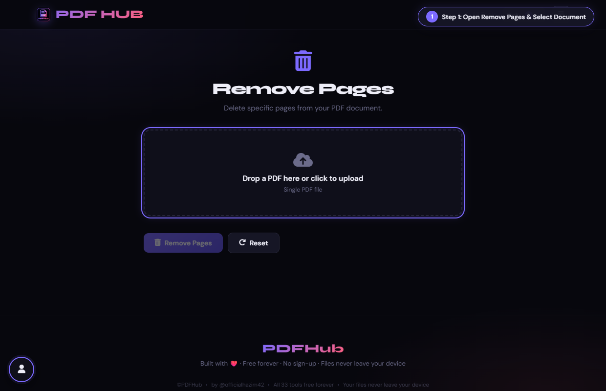
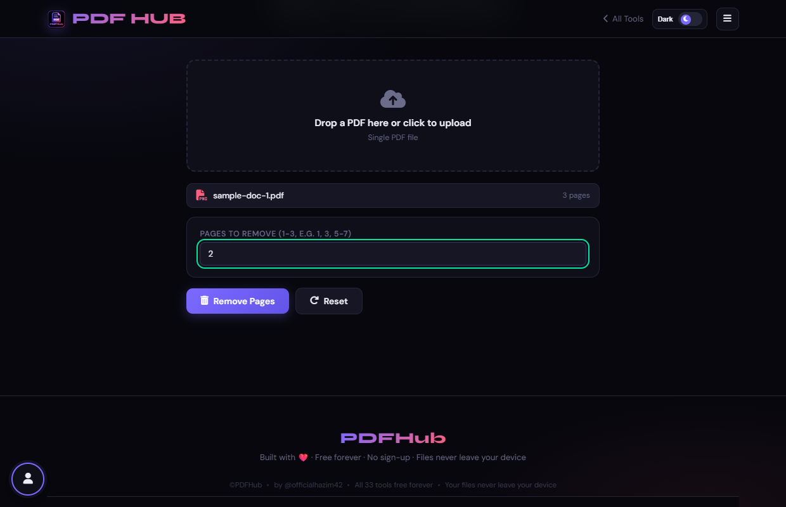
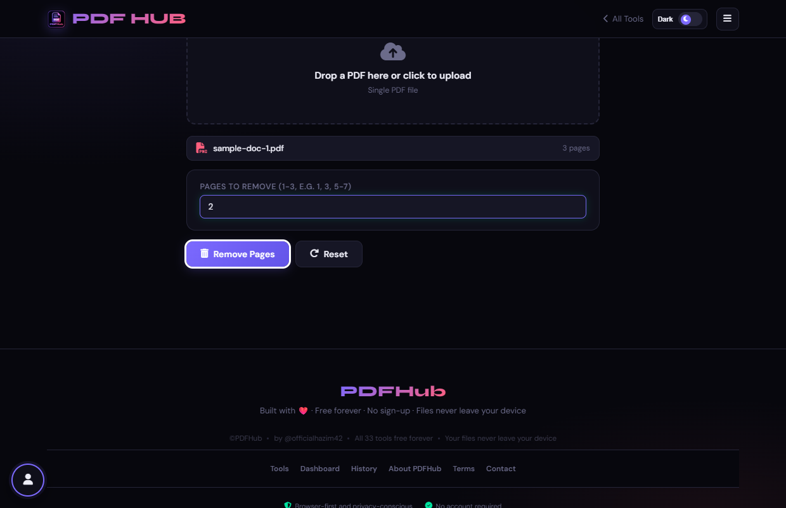
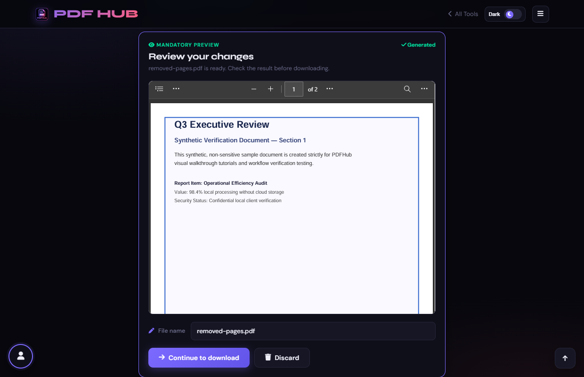

# Remove Pages — Technical Tool Documentation

> **Summary:** Delete selected page numbers or ranges from a PDF.  
> **Tool Route:** `/tools/remove-pages.html`  
> **Visual Guide Route:** `/guides/remove-pages/`  
> **Category:** Organize PDF  
> **Processing Architecture:** 100% Client-Side. Zero server uploads.

---

## 1. What the Tool Does
Remove Pages copies every page except the page numbers or ranges you enter. It prevents exporting an empty document.

**Requirements & Constraints:** One readable PDF is required. Page numbers use one-based values such as 1, 3, or 5-7.

---

## 2. When to Use It
Use **Remove Pages** whenever you need to perform client-side organize pdf operations without uploading confidential records to third-party cloud servers. 

**Ideal Scenarios:**
- Working on personal identity records, banking statements, medical filings, or NDAs requiring 100% local confidentiality.
- Fast offline or low-bandwidth processing directly in your web browser.
- Universal cross-platform document operations on Windows, macOS, Linux, Android, or iOS.

---

## 3. Key Implemented Features
- **Engine Architecture:** `pdf-lib (PDFDocument.load, removePage)`
- **Zero Server Uploads:** Processing executes directly within client browser memory.
- **Instant Processing:** Fast execution powered by WebAssembly and native HTML5 APIs.
- **Review Previews:** Visual feedback and progress indicators confirm results prior to saving.
- **No Sign-up / No Watermarks:** Full functionality with zero paywalls or forced branding.

---

## 4. Supported Input Files
- **Primary Input:** Single PDF document (.pdf)
- **Validation:** Files are validated in the browser prior to parsing.

---

## 5. Supported Output Files
- **Output Format:** Cleaned PDF document (removed-pages.pdf)
- **MIME Types:** `application/pdf` (or appropriate image/text/zip formats).

---

## 6. File Size & Memory Limits
- **Recommended Bounds:** Client RAM bound (~100 MB recommended)
- **Technical Context:** Modern browser tabs enforce memory quotas (typically 1.5 GB to 2 GB per tab). PDFHub handles documents comfortably within standard browser memory limits. For files exceeding 150 MB or 1,000 pages, splitting into smaller sections is recommended.

---

## 7. Step-by-Step Instructions
1. **Upload a PDF and note the page count.**
2. **Enter the page numbers or ranges to remove.**
3. **Select Remove Pages and confirm the result count in the status message.**
4. **Open the output and check the first, last, and adjacent pages.**

---

## 8. Required User Inputs & Controls
- **File Upload Area (`#drop` / `#fin`):** Click to open native file browser or drag and drop supported files.
- **Tool Options (`#opts`):** Dynamic settings panel configuring parameters, page ranges, or compression levels.
- **Execution Button (`Remove Pages (#goBtn)`):** Triggers client-side processing pipeline.
- **Reset Button:** Clears loaded files and resets workspace to pristine state.

---

## 9. Processing Behavior & Execution Pipeline
Parses the PDF structure, converts comma-separated page input into a 0-indexed set, sorts page indices in descending order, invokes doc.removePage(idx) sequentially to avoid index shift, and re-serializes the pruned PDF.

---

## 10. Expected Output & Download Verification
- Upon successful execution, the interface triggers an automated browser download via `downloadBlob()` or opens a result review modal.
- Users can verify file size, page count, and visual rendering before finalizing the download.

---

## 11. Practical Example Use Case
Deleting blank scanner separation sheets and confidential pricing tables before sharing a proposal with a client.

---

## 12. Common Errors & Troubleshooting
- **Issue:** If no pages are removed, enter at least one valid page number.
- **Issue:** If all pages are selected, the tool stops instead of creating an empty PDF.
- **Avoid:** Entering an invalid range or accidentally targeting every page.
- **Avoid:** Forgetting that later page numbers shift after removal.
- **Tip:** Removing all pages in the document. Solution: Ensure at least one page remains in the target document.
- **Tip:** Typing out-of-bounds page numbers. Solution: Check total pages displayed in the file information badge.

---

## 13. Privacy & Data Handling Architecture
- **Local Processing:** 100% Client-Side. Zero server uploads.
- **Browser Memory:** Document bytes reside temporarily in `ArrayBuffer` memory and are garbage collected when the browser tab is refreshed or closed.
- **Cookies & Telemetry:** PDFHub sets zero tracking cookies, zero analytics beacons, and stores zero personal document data.

---

## 14. Frequently Asked Questions (FAQ)
#### Q: Can I remove all pages?
**A:** No, the tool prevents an empty result.

#### Q: Can I undo removal?
**A:** Re-upload the original and select a different range.

---

## 15. Related PDFHub Tools
- [Extract Pages Documentation](extract-pages.md)
- [Split PDF Documentation](split-pdf.md)
- [Organize PDF Documentation](organize-pdf.md)

---

## 16. Links & Resources
- **Launch Live Tool:** [Open Remove Pages in PDFHub](../../tools/remove-pages.html)
- **Visual Tutorial:** [View Remove Pages Visual Guide](../../guides/remove-pages/)
- **All Tools Master Reference:** [All Tools Reference](../all-tools-reference.md)
- **Master Documentation Index:** [Documentation Index](../documentation-index.md)

---

## 17. Visual Walkthrough & Interface Screenshots

### Step 1: Open Remove Pages
- **Interface Control:** `Upload Drop Zone (#drop)`
- **What You See:** The clean workspace displays a file upload box.
- **What to Do:** Open Remove Pages to eliminate blank, redundant, or unwanted sheets from a PDF.
- **Practical Pro-Tip:** All page removal operations are performed locally in your browser with zero data loss.

### Step 2: Upload Source PDF
- **Interface Control:** `File Picker (#fin)`
- **What You See:** The document loads and the interface displays the file name and total pages.
- **What to Do:** Select your PDF file from your device.
- **Practical Pro-Tip:** Make sure you note down the exact page numbers of the pages you want to remove.

### Step 3: Inspect Document Info
- **Interface Control:** `File Metadata (#finfo)`
- **What You See:** The file badge shows document size and confirms total page length.
- **What to Do:** Confirm that the correct file and page count are shown.
- **Practical Pro-Tip:** Page indices start from page 1.

### Step 4: Enter Pages to Remove
- **Interface Control:** `Pages Input (#pages)`
- **What You See:** The input highlights valid page numbers.
- **What to Do:** Type the comma-separated page numbers or ranges to delete (e.g. "2, 4-5").
- **Practical Pro-Tip:** Removing all pages is invalid; at least one page must remain in the final document.

### Step 5: Click Remove Pages
- **Interface Control:** `Remove Action Button (#goBtn)`
- **What You See:** The button triggers memory-safe page filtering and updates the status indicator.
- **What to Do:** Click the primary "Remove Pages" button.
- **Practical Pro-Tip:** Remaining pages are automatically re-indexed in consecutive order.

### Step 6: Review Cleaned Document
- **Interface Control:** `Review Section (#generatedPreview)`
- **What You See:** The preview displays the revised document without the deleted sheets.
- **What to Do:** Examine the preview frame to verify that unwanted pages are gone.
- **Practical Pro-Tip:** Check that the transition between adjacent retained pages looks seamless.

### Step 7: Download Cleaned PDF
- **Interface Control:** `Download Dialog (#dlModal .btn-success)`
- **What You See:** The download card confirms your updated PDF is ready with reduced page count.
- **What to Do:** Click "Download" in the completion dialog.
- **Practical Pro-Tip:** Your original document remains safe in its original location.

