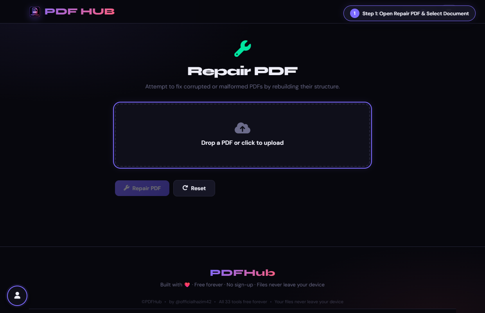
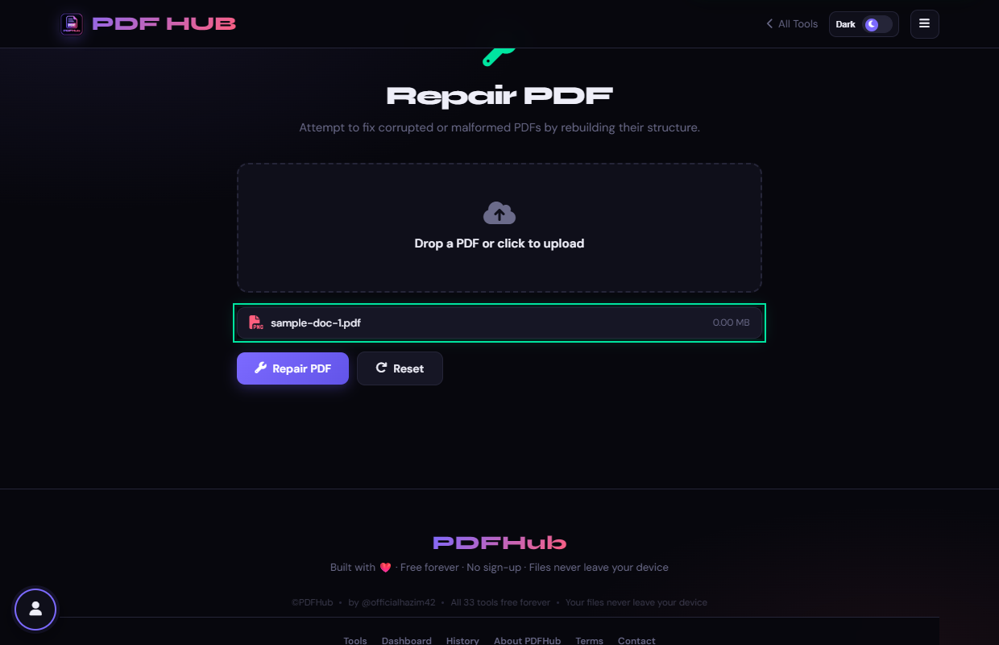
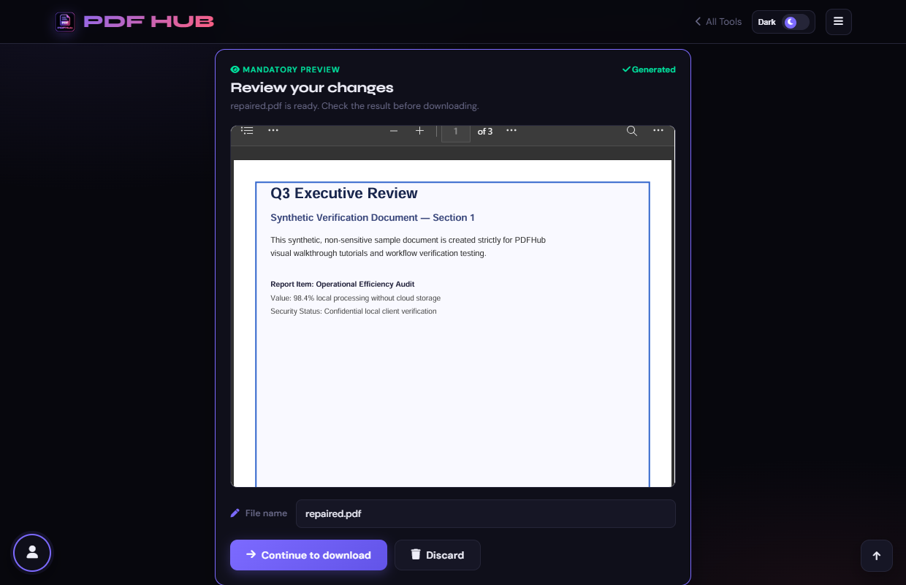

# Repair PDF — Technical Tool Documentation

> **Summary:** Try to parse and reserialize a malformed PDF structure.  
> **Tool Route:** `/tools/repair.html`  
> **Visual Guide Route:** `/guides/repair-pdf/`  
> **Category:** Optimize PDF  
> **Processing Architecture:** 100% Client-Side. Zero server uploads.

---

## 1. What the Tool Does
Repair PDF uses lenient pdf-lib loading and reserialization to rebuild a document that can still be parsed. It cannot restore missing data.

**Requirements & Constraints:** One PDF is required. Severely corrupted, encrypted, or incomplete files may not be recoverable.

---

## 2. When to Use It
Use **Repair PDF** whenever you need to perform client-side optimize pdf operations without uploading confidential records to third-party cloud servers. 

**Ideal Scenarios:**
- Working on personal identity records, banking statements, medical filings, or NDAs requiring 100% local confidentiality.
- Fast offline or low-bandwidth processing directly in your web browser.
- Universal cross-platform document operations on Windows, macOS, Linux, Android, or iOS.

---

## 3. Key Implemented Features
- **Engine Architecture:** `pdf-lib (PDFDocument.load with ignoreEncryption & xref recovery)`
- **Zero Server Uploads:** Processing executes directly within client browser memory.
- **Instant Processing:** Fast execution powered by WebAssembly and native HTML5 APIs.
- **Review Previews:** Visual feedback and progress indicators confirm results prior to saving.
- **No Sign-up / No Watermarks:** Full functionality with zero paywalls or forced branding.

---

## 4. Supported Input Files
- **Primary Input:** Corrupted or unreadable PDF document (.pdf)
- **Validation:** Files are validated in the browser prior to parsing.

---

## 5. Supported Output Files
- **Output Format:** Repaired and normalized PDF document (repaired.pdf)
- **MIME Types:** `application/pdf` (or appropriate image/text/zip formats).

---

## 6. File Size & Memory Limits
- **Recommended Bounds:** Client RAM bound
- **Technical Context:** Modern browser tabs enforce memory quotas (typically 1.5 GB to 2 GB per tab). PDFHub handles documents comfortably within standard browser memory limits. For files exceeding 150 MB or 1,000 pages, splitting into smaller sections is recommended.

---

## 7. Step-by-Step Instructions
1. **Upload the damaged PDF.**
2. **Select Repair PDF to start lenient parsing.**
3. **Wait while the document is reserialized.**
4. **Open the repaired download and compare its pages with the original.**

---

## 8. Required User Inputs & Controls
- **File Upload Area (`#drop` / `#fin`):** Click to open native file browser or drag and drop supported files.
- **Tool Options (`#opts`):** Dynamic settings panel configuring parameters, page ranges, or compression levels.
- **Execution Button (`Repair PDF (#goBtn)`):** Triggers client-side processing pipeline.
- **Reset Button:** Clears loaded files and resets workspace to pristine state.

---

## 9. Processing Behavior & Execution Pipeline
Attempts tolerant parsing of damaged byte streams, rebuilds broken cross-reference (xref) tables, recovers orphaned object dictionaries, and serializes a clean standards-compliant PDF file.

---

## 10. Expected Output & Download Verification
- Upon successful execution, the interface triggers an automated browser download via `downloadBlob()` or opens a result review modal.
- Users can verify file size, page count, and visual rendering before finalizing the download.

---

## 11. Practical Example Use Case
Fixing older PDFs downloaded from legacy portals that throw syntax errors in Acrobat or preview tools.

---

## 12. Common Errors & Troubleshooting
- **Issue:** If parsing fails, obtain a fresh export or use a dedicated desktop repair tool.
- **Issue:** If pages are missing, the source may not contain recoverable data.
- **Avoid:** Treating repair as guaranteed recovery.
- **Avoid:** Overwriting the only copy of the source.
- **Tip:** Severely truncated or zero-byte files where stream data is completely missing cannot be magically reconstructed.

---

## 13. Privacy & Data Handling Architecture
- **Local Processing:** 100% Client-Side. Zero server uploads.
- **Browser Memory:** Document bytes reside temporarily in `ArrayBuffer` memory and are garbage collected when the browser tab is refreshed or closed.
- **Cookies & Telemetry:** PDFHub sets zero tracking cookies, zero analytics beacons, and stores zero personal document data.

---

## 14. Frequently Asked Questions (FAQ)
#### Q: Can it repair every PDF?
**A:** No. It only helps when the structure remains parseable.

#### Q: Does repair upload the file?
**A:** The page processes it in the browser.

---

## 15. Related PDFHub Tools
- [Compress PDF Documentation](compress-pdf.md)
- [Unlock PDF Documentation](unlock-pdf.md)
- [Merge PDF Documentation](merge-pdf.md)

---

## 16. Links & Resources
- **Launch Live Tool:** [Open Repair PDF in PDFHub](../../tools/repair.html)
- **Visual Tutorial:** [View Repair PDF Visual Guide](../../guides/repair-pdf/)
- **All Tools Master Reference:** [All Tools Reference](../all-tools-reference.md)
- **Master Documentation Index:** [Documentation Index](../documentation-index.md)

---

## 17. Visual Walkthrough & Interface Screenshots

### Step 1: Open Repair PDF
- **Interface Control:** `Upload Drop Zone (#drop)`
- **What You See:** The drop area accepts damaged documents that fail to open in standard viewers.
- **What to Do:** Open Repair PDF to recover corrupted, broken, or unreadable PDF files.
- **Practical Pro-Tip:** PDFHub repairs cross-reference (XREF) tables and broken object indices.

### Step 2: Upload Damaged File
- **Interface Control:** `File Picker (#fin)`
- **What You See:** The tool analyzes the file structure and displays detected syntax status.
- **What to Do:** Select the damaged PDF document from your storage.
- **Practical Pro-Tip:** Even files truncated during network downloads can often be partially or fully recovered.

### Step 3: Inspect Diagnostic Report
- **Interface Control:** `Analysis Badge (#finfo)`
- **What You See:** The badge details salvageable pages and confirms repair feasibility.
- **What to Do:** Check the error report identifying corrupted internal streams and broken object trees.
- **Practical Pro-Tip:** No data is uploaded; recovery runs locally on your browser engine.

### Step 4: Click Repair PDF
- **Interface Control:** `Repair Action Button (#goBtn)`
- **What You See:** The recovery algorithm rebuilds the document header, trailers, and page references.
- **What to Do:** Click the primary "Repair PDF" button.
- **Practical Pro-Tip:** A clean cross-reference table is generated to ensure standard PDF compliance.

### Step 5: Verify Recovered Document
- **Interface Control:** `Review Section (#generatedPreview)`
- **What You See:** The preview displays salvaged pages, confirming that content is readable again.
- **What to Do:** Review the recovered pages in the mandatory preview frame.
- **Practical Pro-Tip:** Confirm that all text blocks and images recovered properly.

### Step 6: Download Restored PDF
- **Interface Control:** `Download Dialog (#dlModal .btn-success)`
- **What You See:** The download modal provides the clean, repaired PDF file ready for opening in any viewer.
- **What to Do:** Click "Download" to save the restored, valid PDF file.
- **Practical Pro-Tip:** Your repaired PDF is now fully standard-compliant and will open reliably in all PDF readers.

