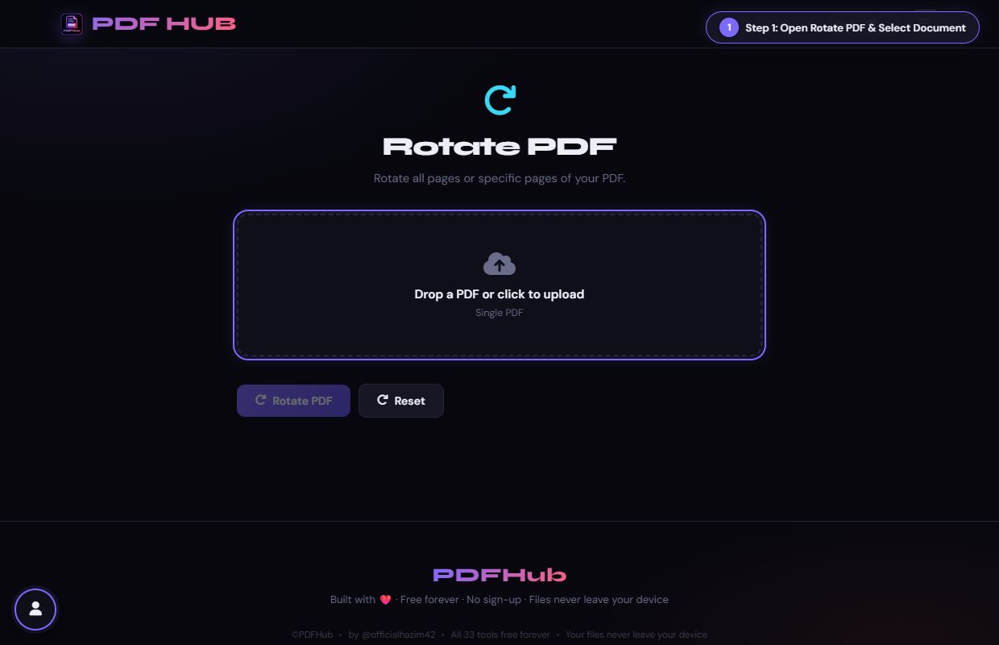
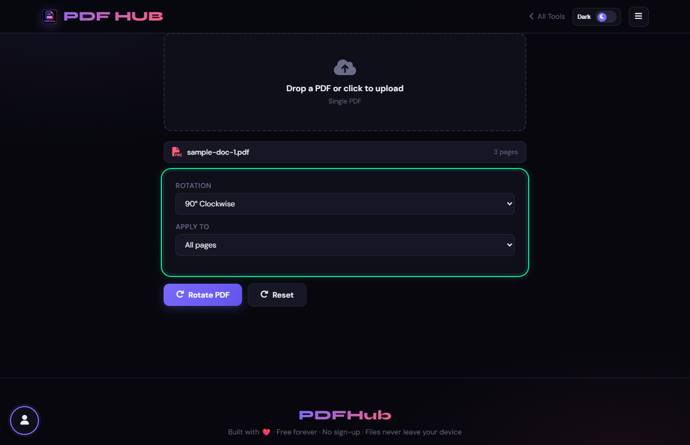
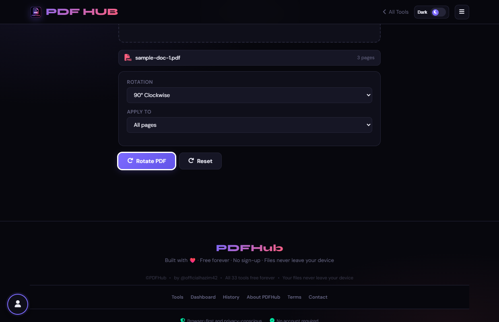
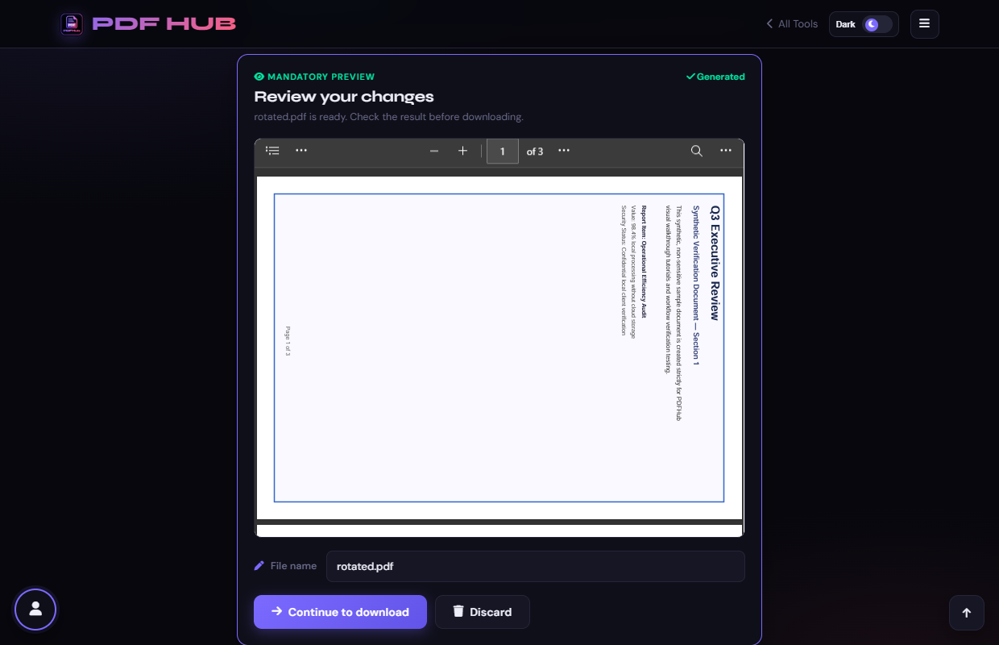

# Rotate PDF — Technical Tool Documentation

> **Summary:** Rotate all, odd, even, or custom PDF pages by a selected angle.  
> **Tool Route:** `/tools/rotate.html`  
> **Visual Guide Route:** `/guides/rotate-pdf/`  
> **Category:** Edit PDF  
> **Processing Architecture:** 100% Client-Side. Zero server uploads.

---

## 1. What the Tool Does
Rotate PDF updates page rotation metadata for the selected pages. It supports all, odd, even, or custom page selections.

**Requirements & Constraints:** One readable PDF is required. Custom selections use page numbers and ranges.

---

## 2. When to Use It
Use **Rotate PDF** whenever you need to perform client-side edit pdf operations without uploading confidential records to third-party cloud servers. 

**Ideal Scenarios:**
- Working on personal identity records, banking statements, medical filings, or NDAs requiring 100% local confidentiality.
- Fast offline or low-bandwidth processing directly in your web browser.
- Universal cross-platform document operations on Windows, macOS, Linux, Android, or iOS.

---

## 3. Key Implemented Features
- **Engine Architecture:** `pdf-lib (page.setRotation)`
- **Zero Server Uploads:** Processing executes directly within client browser memory.
- **Instant Processing:** Fast execution powered by WebAssembly and native HTML5 APIs.
- **Review Previews:** Visual feedback and progress indicators confirm results prior to saving.
- **No Sign-up / No Watermarks:** Full functionality with zero paywalls or forced branding.

---

## 4. Supported Input Files
- **Primary Input:** Single PDF document (.pdf)
- **Validation:** Files are validated in the browser prior to parsing.

---

## 5. Supported Output Files
- **Output Format:** Rotated PDF document (rotated.pdf)
- **MIME Types:** `application/pdf` (or appropriate image/text/zip formats).

---

## 6. File Size & Memory Limits
- **Recommended Bounds:** Client RAM bound (~150 MB)
- **Technical Context:** Modern browser tabs enforce memory quotas (typically 1.5 GB to 2 GB per tab). PDFHub handles documents comfortably within standard browser memory limits. For files exceeding 150 MB or 1,000 pages, splitting into smaller sections is recommended.

---

## 7. Step-by-Step Instructions
1. **Upload a PDF.**
2. **Choose 90, 180, or 270 degrees.**
3. **Choose All pages, Even pages, Odd pages, or Custom pages.**
4. **Select Rotate PDF and inspect the page orientation.**

---

## 8. Required User Inputs & Controls
- **File Upload Area (`#drop` / `#fin`):** Click to open native file browser or drag and drop supported files.
- **Tool Options (`#opts`):** Dynamic settings panel configuring parameters, page ranges, or compression levels.
- **Execution Button (`Rotate PDF (#goBtn)`):** Triggers client-side processing pipeline.
- **Reset Button:** Clears loaded files and resets workspace to pristine state.

---

## 9. Processing Behavior & Execution Pipeline
Reads PDF pages, computes target orientation by adding selected angle (+90°, +180°, +270°) modulo 360 to existing rotation attribute, applies transformation to selected pages (all, odd, even, custom), and saves binary.

---

## 10. Expected Output & Download Verification
- Upon successful execution, the interface triggers an automated browser download via `downloadBlob()` or opens a result review modal.
- Users can verify file size, page count, and visual rendering before finalizing the download.

---

## 11. Practical Example Use Case
Correcting sideways or upside-down orientation on scanned tax returns, contracts, or architectural schematics.

---

## 12. Common Errors & Troubleshooting
- **Issue:** If custom rotation does nothing, check that page numbers are valid.
- **Issue:** If a viewer caches the old display, close and reopen the output.
- **Avoid:** Confusing odd/even page parity with zero-based indexes.
- **Avoid:** Rotating all pages when only scanned pages need correction.
- **Tip:** Applying rotation to all pages when only page 1 was sideways. Solution: Use the custom page range filter.

---

## 13. Privacy & Data Handling Architecture
- **Local Processing:** 100% Client-Side. Zero server uploads.
- **Browser Memory:** Document bytes reside temporarily in `ArrayBuffer` memory and are garbage collected when the browser tab is refreshed or closed.
- **Cookies & Telemetry:** PDFHub sets zero tracking cookies, zero analytics beacons, and stores zero personal document data.

---

## 14. Frequently Asked Questions (FAQ)
#### Q: Does rotation change text?
**A:** No, it changes page orientation metadata.

#### Q: Can I rotate by 45 degrees?
**A:** No, the controls provide 90-degree increments.

---

## 15. Related PDFHub Tools
- [Organize PDF Documentation](organize-pdf.md)
- [Crop PDF Documentation](crop-pdf.md)
- [Add Page Numbers Documentation](page-numbers.md)

---

## 16. Links & Resources
- **Launch Live Tool:** [Open Rotate PDF in PDFHub](../../tools/rotate.html)
- **Visual Tutorial:** [View Rotate PDF Visual Guide](../../guides/rotate-pdf/)
- **All Tools Master Reference:** [All Tools Reference](../all-tools-reference.md)
- **Master Documentation Index:** [Documentation Index](../documentation-index.md)

---

## 17. Visual Walkthrough & Interface Screenshots

### Step 1: Open Rotate PDF
- **Interface Control:** `Upload Drop Zone (#drop)`
- **What You See:** The upload drop area accepts any multi-page PDF document.
- **What to Do:** Open Rotate PDF to fix sideways or inverted pages across your document.
- **Practical Pro-Tip:** Rotation updates the orientation metadata instantly without degrading image quality.

### Step 2: Upload PDF Document
- **Interface Control:** `File Browser (#fin)`
- **What You See:** The document loads and total page count is displayed.
- **What to Do:** Select your PDF document requiring orientation correction.
- **Practical Pro-Tip:** You can rotate the entire document or only specific pages (like sideways scans).

### Step 3: Select Rotation Angle
- **Interface Control:** `Angle Selector (#deg)`
- **What You See:** The dropdown updates the rotational angle transformation applied to page viewports.
- **What to Do:** Choose the degree of rotation from the dropdown (90° Clockwise, 180° Flip, or 270° Counter-clockwise).
- **Practical Pro-Tip:** 180° is useful for documents scanned upside-down via automatic document feeders.

### Step 4: Choose Target Pages
- **Interface Control:** `Page Target Selector (#which, #custPages)`
- **What You See:** Choosing "Custom" reveals an input field to specify exact page numbers.
- **What to Do:** Select which pages to rotate: "All pages", "Odd pages only", "Even pages only", or "Custom pages".
- **Practical Pro-Tip:** You can target specific landscape inserts (e.g. page 3) without rotating portrait pages.

### Step 5: Click Rotate PDF
- **Interface Control:** `Rotate Action Button (#goBtn)`
- **What You See:** The client-side engine updates the rotation matrix on the target page dictionaries.
- **What to Do:** Click the primary "Rotate PDF" button.
- **Practical Pro-Tip:** Because rotation modifies page metadata, the operation executes virtually instantaneously.

### Step 6: Inspect Adjusted Orientation
- **Interface Control:** `Preview Section (#generatedPreview)`
- **What You See:** The preview renders the pages in their new upright orientation.
- **What to Do:** Review the document in the mandatory preview viewer to confirm it is right-side up.
- **Practical Pro-Tip:** Ensure that all rotated pages read naturally from top to bottom.

### Step 7: Download Rotated PDF
- **Interface Control:** `Download Dialog (#dlModal .btn-success)`
- **What You See:** The download modal confirms your newly rotated PDF is ready.
- **What to Do:** Click "Download" to save your corrected PDF document.
- **Practical Pro-Tip:** The updated orientation is now permanent and will open correctly in all readers.

