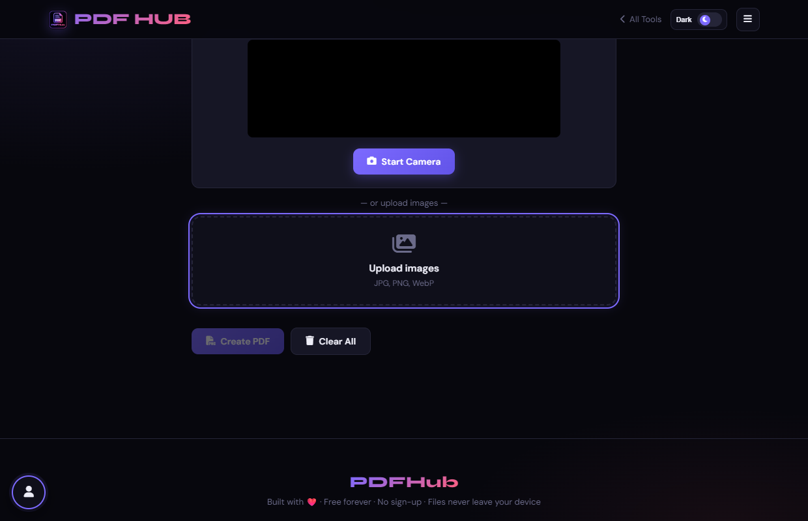
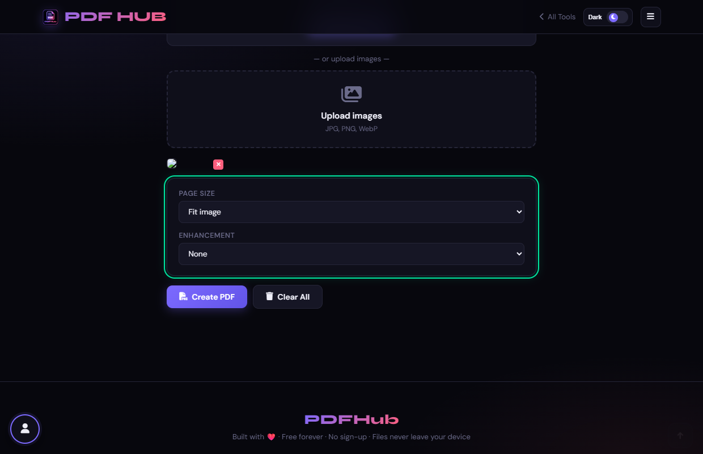
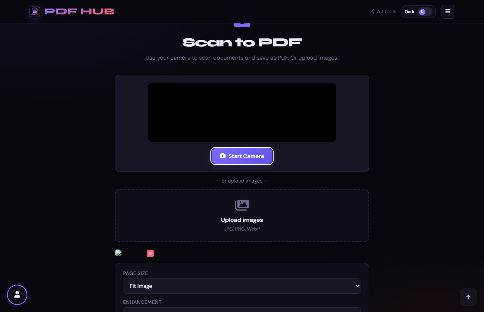

# Scan to PDF — Technical Tool Documentation

> **Summary:** Capture camera images or upload photos and assemble them into a PDF.  
> **Tool Route:** `/tools/scan-to-pdf.html`  
> **Visual Guide Route:** `/guides/scan-to-pdf/`  
> **Category:** Convert to PDF  
> **Processing Architecture:** 100% Client-Side. Camera frames are processed directly in local canvas memory.

---

## 1. What the Tool Does
Scan to PDF uses the camera when permitted or accepts uploaded images, optionally applies grayscale or high contrast, and embeds each image on a page.

**Requirements & Constraints:** Camera mode requires browser permission and a secure origin. Upload mode accepts image files. The page can work with either source.

---

## 2. When to Use It
Use **Scan to PDF** whenever you need to perform client-side convert to pdf operations without uploading confidential records to third-party cloud servers. 

**Ideal Scenarios:**
- Working on personal identity records, banking statements, medical filings, or NDAs requiring 100% local confidentiality.
- Fast offline or low-bandwidth processing directly in your web browser.
- Universal cross-platform document operations on Windows, macOS, Linux, Android, or iOS.

---

## 3. Key Implemented Features
- **Engine Architecture:** `navigator.mediaDevices.getUserMedia + HTML5 Canvas + pdf-lib`
- **Zero Server Uploads:** Processing executes directly within client browser memory.
- **Instant Processing:** Fast execution powered by WebAssembly and native HTML5 APIs.
- **Review Previews:** Visual feedback and progress indicators confirm results prior to saving.
- **No Sign-up / No Watermarks:** Full functionality with zero paywalls or forced branding.

---

## 4. Supported Input Files
- **Primary Input:** Direct webcam / camera stream or uploaded images (.jpg, .png, .webp)
- **Validation:** Files are validated in the browser prior to parsing.

---

## 5. Supported Output Files
- **Output Format:** Multi-page scanned PDF document (scanned-document.pdf)
- **MIME Types:** `application/pdf` (or appropriate image/text/zip formats).

---

## 6. File Size & Memory Limits
- **Recommended Bounds:** Client RAM bound
- **Technical Context:** Modern browser tabs enforce memory quotas (typically 1.5 GB to 2 GB per tab). PDFHub handles documents comfortably within standard browser memory limits. For files exceeding 150 MB or 1,000 pages, splitting into smaller sections is recommended.

---

## 7. Step-by-Step Instructions
1. **Choose Start Camera and grant permission, or upload document images.**
2. **Capture or add all pages and remove any incorrect image from the grid.**
3. **Choose Fit image, A4, or Letter and an enhancement.**
4. **Select Create PDF and review every scanned page.**

---

## 8. Required User Inputs & Controls
- **File Upload Area (`#drop` / `#fin`):** Click to open native file browser or drag and drop supported files.
- **Tool Options (`#opts`):** Dynamic settings panel configuring parameters, page ranges, or compression levels.
- **Execution Button (`Generate PDF (#goBtn)`):** Triggers client-side processing pipeline.
- **Reset Button:** Clears loaded files and resets workspace to pristine state.

---

## 9. Processing Behavior & Execution Pipeline
Connects to camera stream, captures snapshots to an in-memory canvas, optionally applies B&W contrast threshold or grayscale filters, converts frames to JPEG blobs, and embeds them as pages into a new PDF.

---

## 10. Expected Output & Download Verification
- Upon successful execution, the interface triggers an automated browser download via `downloadBlob()` or opens a result review modal.
- Users can verify file size, page count, and visual rendering before finalizing the download.

---

## 11. Practical Example Use Case
Photographing paper receipts, signed paper contracts, or student homework directly on a phone or laptop webcam into a PDF.

---

## 12. Common Errors & Troubleshooting
- **Issue:** If camera access is denied, use image upload or change the browser permission.
- **Issue:** If the output is rotated, retake the image or rotate it before scanning.
- **Avoid:** Leaving the camera stream running after finishing.
- **Avoid:** Adding pages in the wrong order.
- **Tip:** Camera permission denied by browser. Solution: Enable camera permissions in the browser address bar icon.
- **Tip:** Generating PDF without capturing any snaps. Solution: Click "Capture Page" at least once before generating.

---

## 13. Privacy & Data Handling Architecture
- **Local Processing:** 100% Client-Side. Camera frames are processed directly in local canvas memory.
- **Browser Memory:** Document bytes reside temporarily in `ArrayBuffer` memory and are garbage collected when the browser tab is refreshed or closed.
- **Cookies & Telemetry:** PDFHub sets zero tracking cookies, zero analytics beacons, and stores zero personal document data.

---

## 14. Frequently Asked Questions (FAQ)
#### Q: Can I use this without a camera?
**A:** Yes, upload JPG, PNG, or WebP images.

#### Q: Does it perform OCR?
**A:** No, use OCR PDF for text recognition.

---

## 15. Related PDFHub Tools
- [JPG to PDF Documentation](jpg-to-pdf.md)
- [OCR PDF Documentation](ocr-pdf.md)
- [PDF to JPG Documentation](pdf-to-jpg.md)

---

## 16. Links & Resources
- **Launch Live Tool:** [Open Scan to PDF in PDFHub](../../tools/scan-to-pdf.html)
- **Visual Tutorial:** [View Scan to PDF Visual Guide](../../guides/scan-to-pdf/)
- **All Tools Master Reference:** [All Tools Reference](../all-tools-reference.md)
- **Master Documentation Index:** [Documentation Index](../documentation-index.md)

---

## 17. Visual Walkthrough & Interface Screenshots

### Step 1: Open Scan to PDF
- **Interface Control:** `Input Selection (#camBtn, #drop)`
- **What You See:** You have options to "Use Camera" or upload pre-existing image scans.
- **What to Do:** Open Scan to PDF to turn photos or physical documents into clean PDFs.
- **Practical Pro-Tip:** Grant camera access if you plan to capture physical receipts or documents live.

### Step 2: Capture or Upload Pages
- **Interface Control:** `Camera / File Input (#snapBtn, #fin)`
- **What You See:** Captured image pages appear in the visual preview strip.
- **What to Do:** Snap a live photo using your camera or upload photo files (PNG, JPG).
- **Practical Pro-Tip:** Ensure good lighting and hold documents flat for optimal clarity.

### Step 3: Review Scanned Pages
- **Interface Control:** `Thumbnail Strip (#camPrev)`
- **What You See:** Thumbnails display each captured photo in order.
- **What to Do:** Review the scanned page thumbnails in the queue.
- **Practical Pro-Tip:** You can remove any blurry photo and re-snap it before generating the PDF.

### Step 4: Select Paper Size
- **Interface Control:** `Page Size Selector (#psize)`
- **What You See:** Standard document dimensions are applied to the generated pages.
- **What to Do:** Choose your desired output paper standard (A4, Letter, or Fit to Image).
- **Practical Pro-Tip:** "Fit to Image" keeps the exact original aspect ratio of your photo without borders.

### Step 5: Apply Enhancement Filter
- **Interface Control:** `Filter Dropdown (#enhance)`
- **What You See:** Filters enhance black-and-white text legibility and remove shadow gradients.
- **What to Do:** Select an image enhancement filter (e.g. "Grayscale" or "High Contrast").
- **Practical Pro-Tip:** Grayscale filtering also significantly reduces final PDF file size.

### Step 6: Click Create PDF
- **Interface Control:** `Create Action Button (#goBtn)`
- **What You See:** The images are processed, aligned, and compiled into standardized PDF pages.
- **What to Do:** Click the "Create PDF" action button.
- **Practical Pro-Tip:** High-resolution images are optimized to balance visual quality and file size.

### Step 7: Download Scanned PDF
- **Interface Control:** `Download Dialog (#dlModal .btn-success)`
- **What You See:** The download modal confirms your multi-page scanned PDF is ready.
- **What to Do:** Click the green "Download" button to save your digitized document.
- **Practical Pro-Tip:** Your scanned PDF is now ready for email attachments or official submissions.

