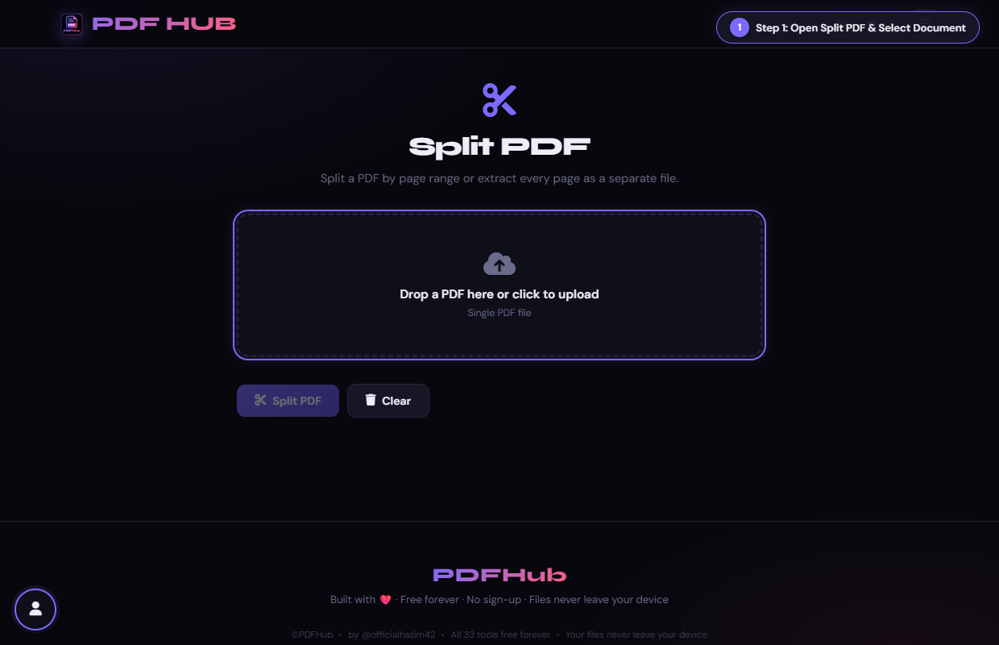
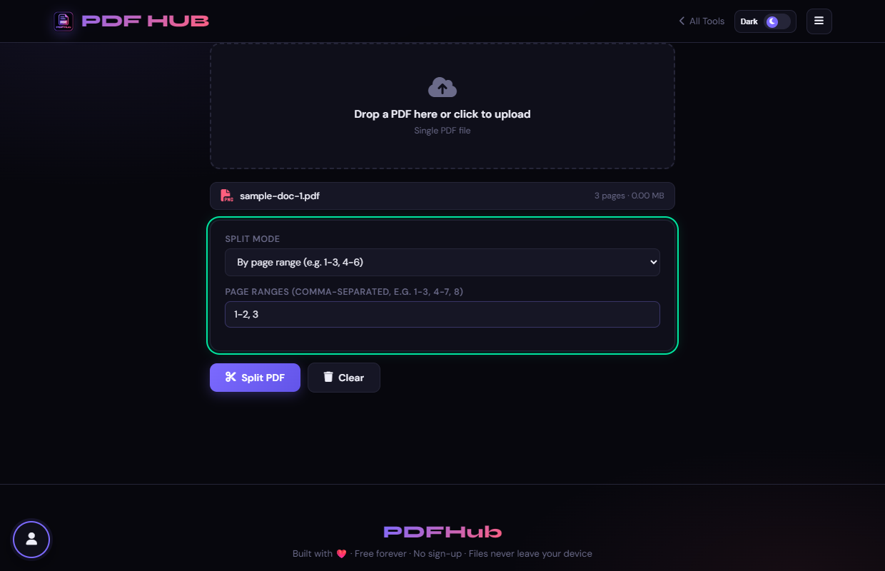
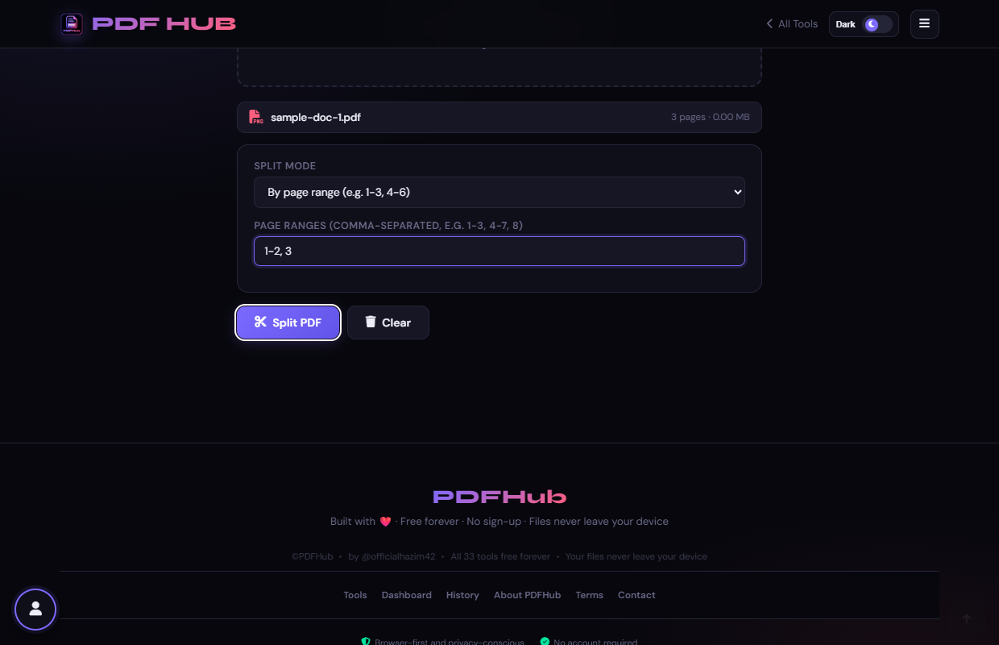
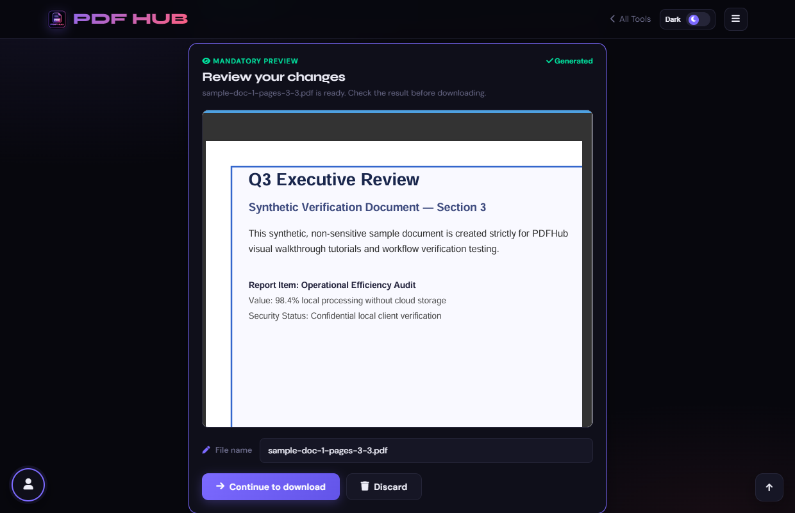

# Split PDF — Technical Tool Documentation

> **Summary:** Create separate PDFs from ranges, every page, or groups of N pages.  
> **Tool Route:** `/tools/split.html`  
> **Visual Guide Route:** `/guides/split-pdf/`  
> **Category:** Organize PDF  
> **Processing Architecture:** 100% Client-Side. Processed in local browser memory.

---

## 1. What the Tool Does
Split PDF copies selected page groups into separate files. It supports explicit ranges, one file per page, and every-N-pages grouping.

**Requirements & Constraints:** One readable PDF is required. Multiple groups can trigger multiple browser downloads.

---

## 2. When to Use It
Use **Split PDF** whenever you need to perform client-side organize pdf operations without uploading confidential records to third-party cloud servers. 

**Ideal Scenarios:**
- Working on personal identity records, banking statements, medical filings, or NDAs requiring 100% local confidentiality.
- Fast offline or low-bandwidth processing directly in your web browser.
- Universal cross-platform document operations on Windows, macOS, Linux, Android, or iOS.

---

## 3. Key Implemented Features
- **Engine Architecture:** `pdf-lib + JSZip`
- **Zero Server Uploads:** Processing executes directly within client browser memory.
- **Instant Processing:** Fast execution powered by WebAssembly and native HTML5 APIs.
- **Review Previews:** Visual feedback and progress indicators confirm results prior to saving.
- **No Sign-up / No Watermarks:** Full functionality with zero paywalls or forced branding.

---

## 4. Supported Input Files
- **Primary Input:** Single PDF document (.pdf)
- **Validation:** Files are validated in the browser prior to parsing.

---

## 5. Supported Output Files
- **Output Format:** Individual .pdf files or a bundled .zip archive
- **MIME Types:** `application/pdf` (or appropriate image/text/zip formats).

---

## 6. File Size & Memory Limits
- **Recommended Bounds:** Client RAM bound (documents up to 100 MB or ~500 pages recommended)
- **Technical Context:** Modern browser tabs enforce memory quotas (typically 1.5 GB to 2 GB per tab). PDFHub handles documents comfortably within standard browser memory limits. For files exceeding 150 MB or 1,000 pages, splitting into smaller sections is recommended.

---

## 7. Step-by-Step Instructions
1. **Upload a PDF and choose a split mode.**
2. **Enter ranges or a group size when the chosen mode needs it.**
3. **Select Split PDF and wait for each group to be created.**
4. **Open the resulting files and verify their names and page ranges.**

---

## 8. Required User Inputs & Controls
- **File Upload Area (`#drop` / `#fin`):** Click to open native file browser or drag and drop supported files.
- **Tool Options (`#opts`):** Dynamic settings panel configuring parameters, page ranges, or compression levels.
- **Execution Button (`Split PDF (#splitBtn)`):** Triggers client-side processing pipeline.
- **Reset Button:** Clears loaded files and resets workspace to pristine state.

---

## 9. Processing Behavior & Execution Pipeline
Loads the PDF into an ArrayBuffer, resolves total page count, parses the chosen split mode (ranges, all pages, or every N pages), extracts page subsets into fresh PDFDocument instances, serializes them, and bundles multiple outputs into a ZIP via JSZip.

---

## 10. Expected Output & Download Verification
- Upon successful execution, the interface triggers an automated browser download via `downloadBlob()` or opens a result review modal.
- Users can verify file size, page count, and visual rendering before finalizing the download.

---

## 11. Practical Example Use Case
Extracting a 5-page confidential section from a 100-page employee handbook to email to department heads.

---

## 12. Common Errors & Troubleshooting
- **Issue:** If no files are created, correct the ranges or N value.
- **Issue:** If downloads are blocked, update the browser permission for this site.
- **Avoid:** Leaving ranges empty in range mode.
- **Avoid:** Choosing Every page for a very large document without expecting many downloads.
- **Tip:** Invalid page range format (e.g. typing "5-2" instead of "2-5"). Solution: Use ascending numbers separated by commas or hyphens.
- **Tip:** Requesting page numbers higher than total document page count. Solution: Review page numbers in the loaded file card.

---

## 13. Privacy & Data Handling Architecture
- **Local Processing:** 100% Client-Side. Processed in local browser memory.
- **Browser Memory:** Document bytes reside temporarily in `ArrayBuffer` memory and are garbage collected when the browser tab is refreshed or closed.
- **Cookies & Telemetry:** PDFHub sets zero tracking cookies, zero analytics beacons, and stores zero personal document data.

---

## 14. Frequently Asked Questions (FAQ)
#### Q: Can I split every page separately?
**A:** Yes, choose Every page as separate PDF.

#### Q: Does the original remain intact?
**A:** Yes.

---

## 15. Related PDFHub Tools
- [Extract Pages Documentation](extract-pages.md)
- [Remove Pages Documentation](remove-pages.md)
- [Merge PDF Documentation](merge-pdf.md)

---

## 16. Links & Resources
- **Launch Live Tool:** [Open Split PDF in PDFHub](../../tools/split.html)
- **Visual Tutorial:** [View Split PDF Visual Guide](../../guides/split-pdf/)
- **All Tools Master Reference:** [All Tools Reference](../all-tools-reference.md)
- **Master Documentation Index:** [Documentation Index](../documentation-index.md)

---

## 17. Visual Walkthrough & Interface Screenshots

### Step 1: Open Split PDF
- **Interface Control:** `Upload Drop Zone (#drop)`
- **What You See:** The upload area accepts any multi-page PDF document.
- **What to Do:** Navigate to Split PDF and locate the upload zone.
- **Practical Pro-Tip:** Ensure your document contains at least two pages to enable splitting options.

### Step 2: Upload Multi-Page PDF
- **Interface Control:** `File Browser (#fin)`
- **What You See:** The file name and total detected page count are displayed above the options panel.
- **What to Do:** Select your target document from your local files.
- **Practical Pro-Tip:** The tool reads document page counts instantly without transmitting files over the network.

### Step 3: Choose Split Mode
- **Interface Control:** `Mode Selector (#mode)`
- **What You See:** Options include "Extract page ranges", "Split every page into separate files", or "Split every N pages".
- **What to Do:** Select your preferred division method from the "Split mode" dropdown.
- **Practical Pro-Tip:** Choosing "Split every page" creates individual single-page documents for every sheet.

### Step 4: Enter Target Page Ranges
- **Interface Control:** `Range Input (#ranges)`
- **What You See:** Input accepts comma-separated pages and hyphens for ranges (e.g. "1-2, 3").
- **What to Do:** Type the specific page ranges you want to extract into the input field.
- **Practical Pro-Tip:** You can create multiple separate output files in one go by separating ranges with commas.

### Step 5: Click Split PDF
- **Interface Control:** `Split Action Button (#splitBtn)`
- **What You See:** The status line shows processing activity as pages are parsed into separate documents.
- **What to Do:** Click the primary "Split PDF" action button.
- **Practical Pro-Tip:** The original document remains completely untouched on your device.

### Step 6: Review Split Pages
- **Interface Control:** `Generated Preview (#generatedPreview)`
- **What You See:** The preview displays the newly isolated page sections for verification.
- **What to Do:** Review the generated output document in the preview frame.
- **Practical Pro-Tip:** Ensure that no necessary pages were omitted before saving.

### Step 7: Download Split Files
- **Interface Control:** `Download Modal (#dlModal .btn-success)`
- **What You See:** A confirmation dialog appears offering the extracted PDF or a ZIP archive containing all parts.
- **What to Do:** Click the green "Download" button to save your files.
- **Practical Pro-Tip:** When multiple ranges are generated, they are conveniently packaged into a clean ZIP archive.

