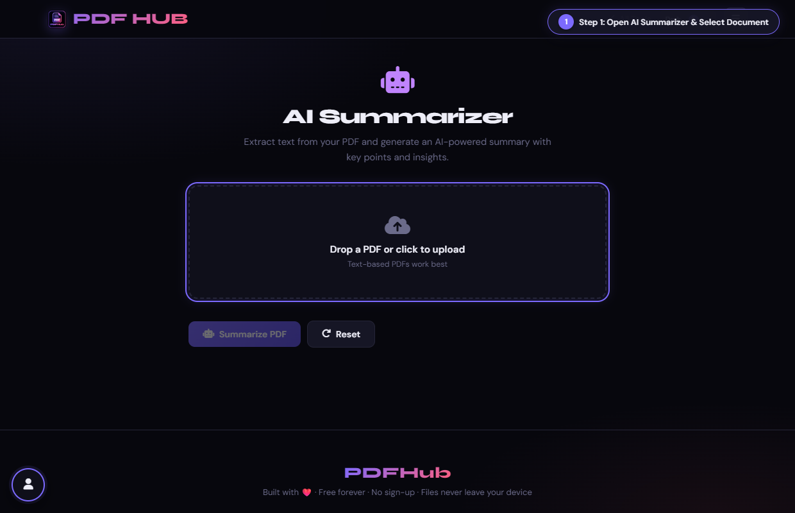
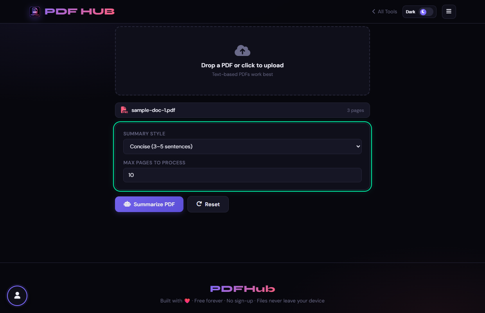
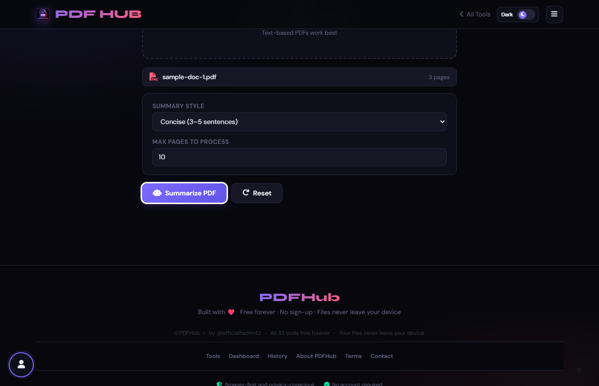
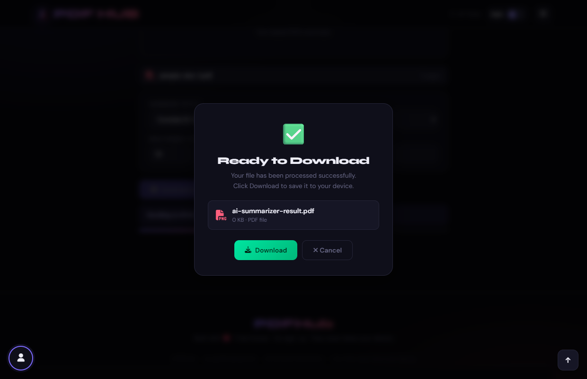

# AI Summarizer — Technical Tool Documentation

> **Summary:** Extract PDF text and request a summary through the page’s configured AI service.  
> **Tool Route:** `/tools/summarize.html`  
> **Visual Guide Route:** `/guides/summarize-pdf/`  
> **Category:** Extract Content  
> **Processing Architecture:** 100% Client-Side. PDF.js extracts text locally; local keyword-density NLP analyzes sentences in browser RAM.

---

## 1. What the Tool Does
AI Summarizer extracts up to the configured page limit and builds a summary request for the selected style. Its final result depends on the configured external AI service and network availability.

**Requirements & Constraints:** Text-based PDFs work best. An external AI service may be required; do not use this tool for confidential text unless you understand that service’s terms.

---

## 2. When to Use It
Use **AI Summarizer** whenever you need to perform client-side extract content operations without uploading confidential records to third-party cloud servers. 

**Ideal Scenarios:**
- Working on personal identity records, banking statements, medical filings, or NDAs requiring 100% local confidentiality.
- Fast offline or low-bandwidth processing directly in your web browser.
- Universal cross-platform document operations on Windows, macOS, Linux, Android, or iOS.

---

## 3. Key Implemented Features
- **Engine Architecture:** `pdf.js (text extraction) + Client-Side Heuristic Sentence Scoring (localSummarize)`
- **Zero Server Uploads:** Processing executes directly within client browser memory.
- **Instant Processing:** Fast execution powered by WebAssembly and native HTML5 APIs.
- **Review Previews:** Visual feedback and progress indicators confirm results prior to saving.
- **No Sign-up / No Watermarks:** Full functionality with zero paywalls or forced branding.

---

## 4. Supported Input Files
- **Primary Input:** Text-based PDF document (.pdf)
- **Validation:** Files are validated in the browser prior to parsing.

---

## 5. Supported Output Files
- **Output Format:** Formatted text summary on-screen, copy-to-clipboard, or .txt download
- **MIME Types:** `application/pdf` (or appropriate image/text/zip formats).

---

## 6. File Size & Memory Limits
- **Recommended Bounds:** Client RAM bound (up to 50 pages)
- **Technical Context:** Modern browser tabs enforce memory quotas (typically 1.5 GB to 2 GB per tab). PDFHub handles documents comfortably within standard browser memory limits. For files exceeding 150 MB or 1,000 pages, splitting into smaller sections is recommended.

---

## 7. Step-by-Step Instructions
1. **Upload a PDF and choose a summary style.**
2. **Set the maximum number of pages to process.**
3. **Select Summarize PDF and wait for extraction and the service response.**
4. **Review the summary against the original, then copy or download it.**

---

## 8. Required User Inputs & Controls
- **File Upload Area (`#drop` / `#fin`):** Click to open native file browser or drag and drop supported files.
- **Tool Options (`#opts`):** Dynamic settings panel configuring parameters, page ranges, or compression levels.
- **Execution Button (`Summarize PDF (#goBtn)`):** Triggers client-side processing pipeline.
- **Reset Button:** Clears loaded files and resets workspace to pristine state.

---

## 9. Processing Behavior & Execution Pipeline
Extracts live text runs from first N pages, cleans and tokenizes sentences, computes word frequency against a stop-word dictionary, scores sentences by keyword density, formats summary based on style (Concise, Detailed, Bullets, Executive), and displays result.

---

## 10. Expected Output & Download Verification
- Upon successful execution, the interface triggers an automated browser download via `downloadBlob()` or opens a result review modal.
- Users can verify file size, page count, and visual rendering before finalizing the download.

---

## 11. Practical Example Use Case
Quickly understanding key takeaways and findings from 40-page academic papers, annual reports, or industry whitepapers.

---

## 12. Common Errors & Troubleshooting
- **Issue:** If the request fails, check connectivity and retry with fewer pages.
- **Issue:** If extraction is empty, run OCR first for a scanned PDF.
- **Avoid:** Treating an AI summary as a substitute for the original.
- **Avoid:** Sending sensitive documents without checking the service behavior.
- **Tip:** Attempting to summarize a scanned image-only PDF. Solution: Run OCR PDF first to generate a text layer.

---

## 13. Privacy & Data Handling Architecture
- **Local Processing:** 100% Client-Side. PDF.js extracts text locally; local keyword-density NLP analyzes sentences in browser RAM.
- **Browser Memory:** Document bytes reside temporarily in `ArrayBuffer` memory and are garbage collected when the browser tab is refreshed or closed.
- **Cookies & Telemetry:** PDFHub sets zero tracking cookies, zero analytics beacons, and stores zero personal document data.

---

## 14. Frequently Asked Questions (FAQ)
#### Q: Is the summary guaranteed accurate?
**A:** No; AI output can omit or misstate details.

#### Q: Does this work fully offline?
**A:** The configured AI request may require network access.

---

## 15. Related PDFHub Tools
- [OCR PDF Documentation](ocr-pdf.md)
- [PDF to Markdown Documentation](pdf-to-markdown.md)
- [PDF to Word Documentation](pdf-to-word.md)

---

## 16. Links & Resources
- **Launch Live Tool:** [Open AI Summarizer in PDFHub](../../tools/summarize.html)
- **Visual Tutorial:** [View AI Summarizer Visual Guide](../../guides/summarize-pdf/)
- **All Tools Master Reference:** [All Tools Reference](../all-tools-reference.md)
- **Master Documentation Index:** [Documentation Index](../documentation-index.md)

---

## 17. Visual Walkthrough & Interface Screenshots

### Step 1: Open AI Summarizer
- **Interface Control:** `Upload Drop Zone (#drop)`
- **What You See:** The upload drop area accepts lengthy reports, research papers, and documents.
- **What to Do:** Open AI Summarizer to extract executive summaries, core arguments, and takeaways from long PDFs.
- **Practical Pro-Tip:** Summarization distills dense reports into actionable insights in seconds.

### Step 2: Upload Research or Report PDF
- **Interface Control:** `File Browser (#fin)`
- **What You See:** The document loads and total page count is detected.
- **What to Do:** Select your PDF document from your storage.
- **Practical Pro-Tip:** Documents with clear sections and headings produce the most structured summaries.

### Step 3: Select Summary Style
- **Interface Control:** `Style Dropdown (#style)`
- **What You See:** The style selector adjusts the depth and tone of the extraction.
- **What to Do:** Choose your desired summary format: "Executive Summary", "Key Takeaways (Bullet Points)", or "Detailed Breakdown".
- **Practical Pro-Tip:** Bullet Points format is ideal for preparing meeting agendas and discussion notes.

### Step 4: Set Page Analysis Range
- **Interface Control:** `Page Limit (#maxPg)`
- **What You See:** The setting defines the processing scope for document text extraction.
- **What to Do:** Specify how many pages to analyze (e.g. first 10 pages) or leave blank for full document.
- **Practical Pro-Tip:** Setting page range is useful for focusing on specific chapters or the executive preface.

### Step 5: Click Summarize Document
- **Interface Control:** `Action Button (#goBtn)`
- **What You See:** The intelligence engine extracts text content and synthesizes core themes.
- **What to Do:** Click the primary "Summarize Document" button.
- **Practical Pro-Tip:** All processing takes place privately without storing your document text.

### Step 6: Read Executive Summary
- **Interface Control:** `Summary Result Card (#summaryResult)`
- **What You See:** The card displays a structured briefing with bullet points and bold headers.
- **What to Do:** Review the generated summary text rendered in the clean result card.
- **Practical Pro-Tip:** The summary highlights core statistics, conclusions, and action items.

### Step 7: Copy or Export Summary Notes
- **Interface Control:** `Action Buttons (copySummary, downloadSummary)`
- **What You See:** The copy confirmation confirms the summary is on your clipboard ready to paste into emails.
- **What to Do:** Click "Copy Summary" to copy text to clipboard or "Download Notes" to save as a text file.
- **Practical Pro-Tip:** Your executive summary is ready to share immediately with team members.

