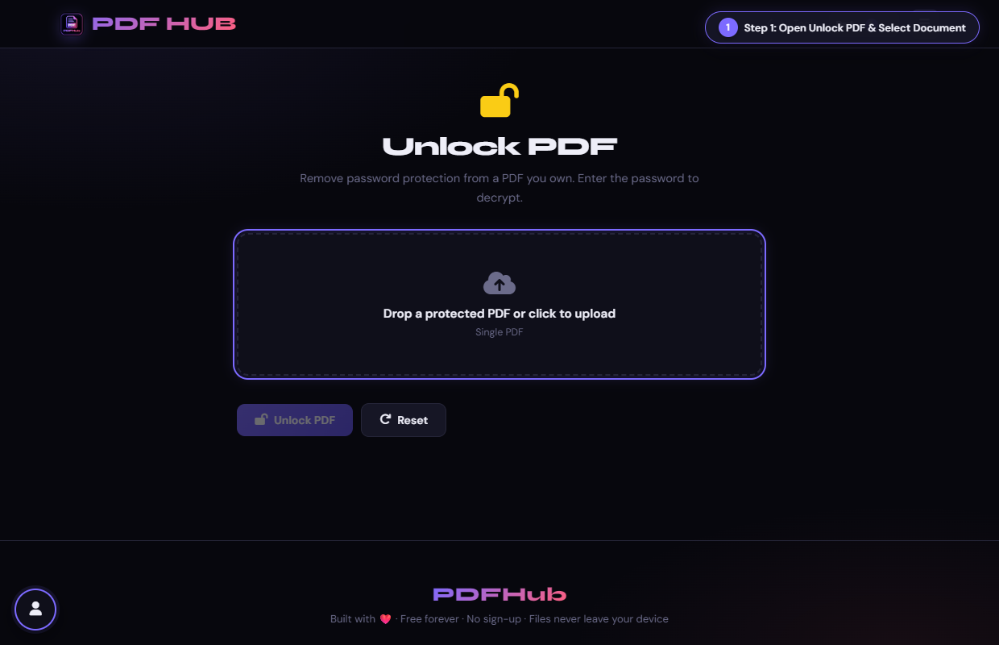
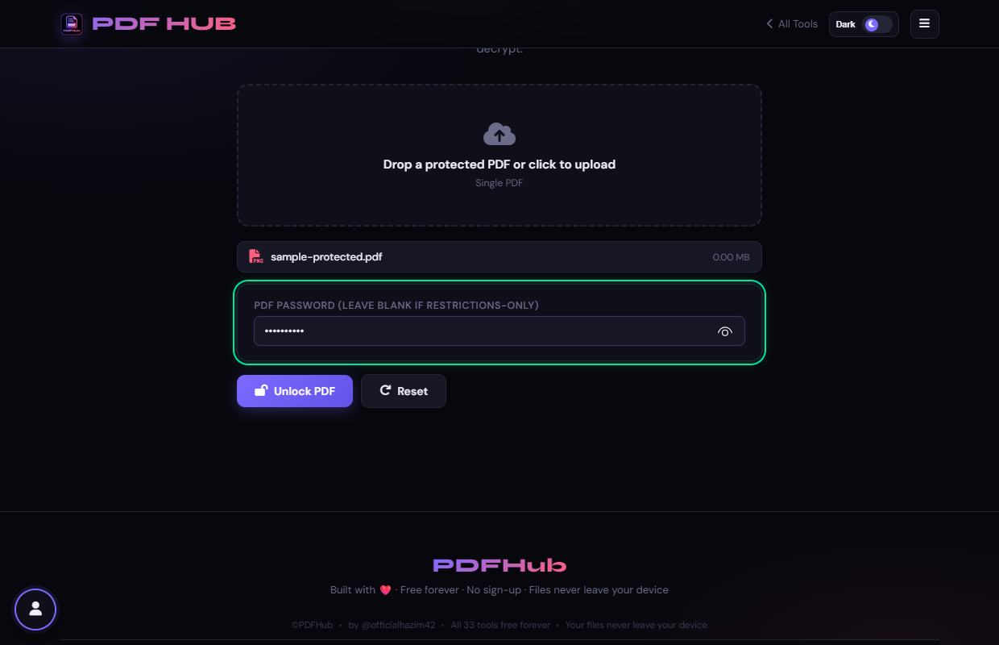
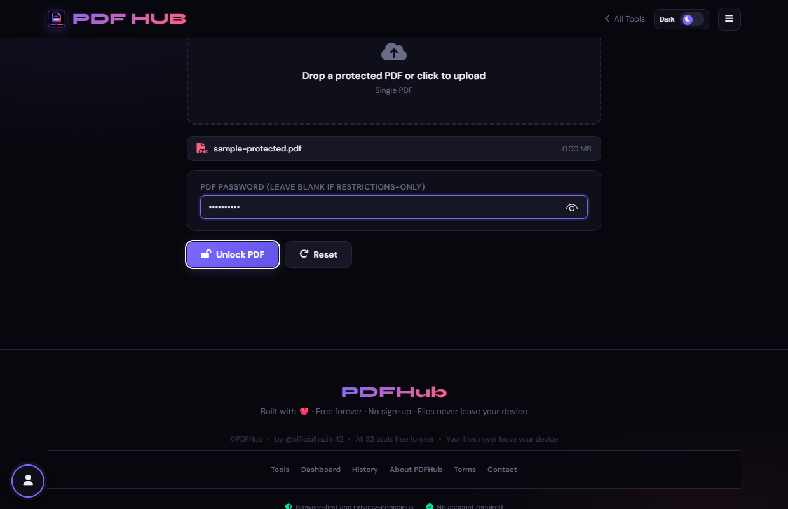
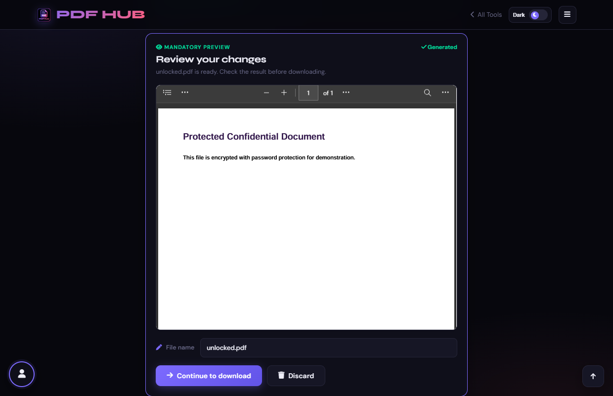

# Unlock PDF — Technical Tool Documentation

> **Summary:** Remove supported PDF encryption when you provide the document password.  
> **Tool Route:** `/tools/unlock.html`  
> **Visual Guide Route:** `/guides/unlock-pdf/`  
> **Category:** Secure PDF  
> **Processing Architecture:** 100% Client-Side. Zero server uploads.

---

## 1. What the Tool Does
Unlock PDF loads a protected PDF with the entered password and saves a new copy without the original encryption when the browser library supports it.

**Requirements & Constraints:** You must be authorized to use the document and know its password when required. Unsupported encryption cannot be bypassed.

---

## 2. When to Use It
Use **Unlock PDF** whenever you need to perform client-side secure pdf operations without uploading confidential records to third-party cloud servers. 

**Ideal Scenarios:**
- Working on personal identity records, banking statements, medical filings, or NDAs requiring 100% local confidentiality.
- Fast offline or low-bandwidth processing directly in your web browser.
- Universal cross-platform document operations on Windows, macOS, Linux, Android, or iOS.

---

## 3. Key Implemented Features
- **Engine Architecture:** `pdf-lib (PDFDocument.load with password)`
- **Zero Server Uploads:** Processing executes directly within client browser memory.
- **Instant Processing:** Fast execution powered by WebAssembly and native HTML5 APIs.
- **Review Previews:** Visual feedback and progress indicators confirm results prior to saving.
- **No Sign-up / No Watermarks:** Full functionality with zero paywalls or forced branding.

---

## 4. Supported Input Files
- **Primary Input:** Password-protected PDF document (.pdf)
- **Validation:** Files are validated in the browser prior to parsing.

---

## 5. Supported Output Files
- **Output Format:** Unencrypted PDF document (unlocked.pdf)
- **MIME Types:** `application/pdf` (or appropriate image/text/zip formats).

---

## 6. File Size & Memory Limits
- **Recommended Bounds:** Client RAM bound
- **Technical Context:** Modern browser tabs enforce memory quotas (typically 1.5 GB to 2 GB per tab). PDFHub handles documents comfortably within standard browser memory limits. For files exceeding 150 MB or 1,000 pages, splitting into smaller sections is recommended.

---

## 7. Step-by-Step Instructions
1. **Upload the protected PDF.**
2. **Enter its password if the document requests one.**
3. **Select Unlock PDF.**
4. **Open the output and confirm it no longer prompts for the password.**

---

## 8. Required User Inputs & Controls
- **File Upload Area (`#drop` / `#fin`):** Click to open native file browser or drag and drop supported files.
- **Tool Options (`#opts`):** Dynamic settings panel configuring parameters, page ranges, or compression levels.
- **Execution Button (`Unlock PDF (#goBtn)`):** Triggers client-side processing pipeline.
- **Reset Button:** Clears loaded files and resets workspace to pristine state.

---

## 9. Processing Behavior & Execution Pipeline
Attempts to decrypt and load PDF using provided password, strips internal encryption handler dictionaries, and re-saves unencrypted document.

---

## 10. Expected Output & Download Verification
- Upon successful execution, the interface triggers an automated browser download via `downloadBlob()` or opens a result review modal.
- Users can verify file size, page count, and visual rendering before finalizing the download.

---

## 11. Practical Example Use Case
Removing the password from your own bank statements or tax documents so you do not need to re-type it every time.

---

## 12. Common Errors & Troubleshooting
- **Issue:** If the password is rejected, verify it and check capitalization.
- **Issue:** If the encryption is unsupported, use the original authoring application or a compatible tool.
- **Avoid:** Trying to bypass a password you do not know.
- **Avoid:** Assuming every encryption scheme is supported.
- **Tip:** Entering an incorrect password fails decryption. PDFHub decrypts authorized files; it does not brute-force passwords.

---

## 13. Privacy & Data Handling Architecture
- **Local Processing:** 100% Client-Side. Zero server uploads.
- **Browser Memory:** Document bytes reside temporarily in `ArrayBuffer` memory and are garbage collected when the browser tab is refreshed or closed.
- **Cookies & Telemetry:** PDFHub sets zero tracking cookies, zero analytics beacons, and stores zero personal document data.

---

## 14. Frequently Asked Questions (FAQ)
#### Q: Can it guess a password?
**A:** No.

#### Q: Does it remove permissions-only restrictions?
**A:** Results depend on the PDF library and encryption type.

---

## 15. Related PDFHub Tools
- [Protect PDF Documentation](protect-pdf.md)
- [Repair PDF Documentation](repair-pdf.md)
- [Merge PDF Documentation](merge-pdf.md)

---

## 16. Links & Resources
- **Launch Live Tool:** [Open Unlock PDF in PDFHub](../../tools/unlock.html)
- **Visual Tutorial:** [View Unlock PDF Visual Guide](../../guides/unlock-pdf/)
- **All Tools Master Reference:** [All Tools Reference](../all-tools-reference.md)
- **Master Documentation Index:** [Documentation Index](../documentation-index.md)

---

## 17. Visual Walkthrough & Interface Screenshots

### Step 1: Open Unlock PDF
- **Interface Control:** `Upload Drop Zone (#drop)`
- **What You See:** The upload drop area is ready to accept your locked or encrypted PDF.
- **What to Do:** Open Unlock PDF to remove password security and restrictions from encrypted PDF documents.
- **Practical Pro-Tip:** Unlocking creates an unrestricted PDF so you can print, copy, and open without passwords.

### Step 2: Upload Encrypted PDF
- **Interface Control:** `File Browser (#fin)`
- **What You See:** The tool detects the encryption cipher and prompts for the document password.
- **What to Do:** Select your protected PDF document from your storage.
- **Practical Pro-Tip:** You must possess the authorized password to decrypt the document.

### Step 3: Enter Document Password
- **Interface Control:** `Password Input (#pw)`
- **What You See:** The password field masks characters for security while you type.
- **What to Do:** Type the valid user or owner password for the document into the input field.
- **Practical Pro-Tip:** Passwords are case-sensitive.

### Step 4: Click Unlock PDF
- **Interface Control:** `Unlock Action Button (#goBtn)`
- **What You See:** The client-side crypto engine decrypts the internal streams and strips restriction flags.
- **What to Do:** Click the primary "Unlock PDF" button.
- **Practical Pro-Tip:** Decryption happens 100% locally on your device; passwords are never sent over the web.

### Step 5: Verify Decrypted Document
- **Interface Control:** `Preview Section (#generatedPreview)`
- **What You See:** The preview opens without requiring any password prompt.
- **What to Do:** Inspect the decrypted document in the preview viewer.
- **Practical Pro-Tip:** Confirm that text can now be selected and printed freely.

### Step 6: Download Unrestricted PDF
- **Interface Control:** `Download Dialog (#dlModal .btn-success)`
- **What You See:** The download modal confirms your unrestricted PDF is ready.
- **What to Do:** Click "Download" to save your unlocked PDF document.
- **Practical Pro-Tip:** The downloaded PDF can now be opened without ever prompting for a password again.

